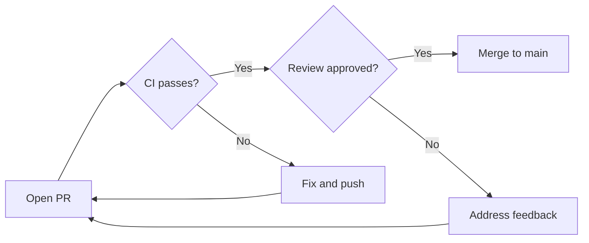
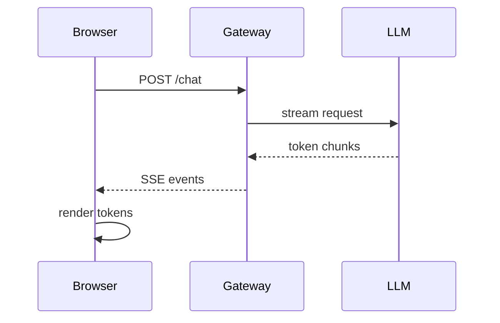
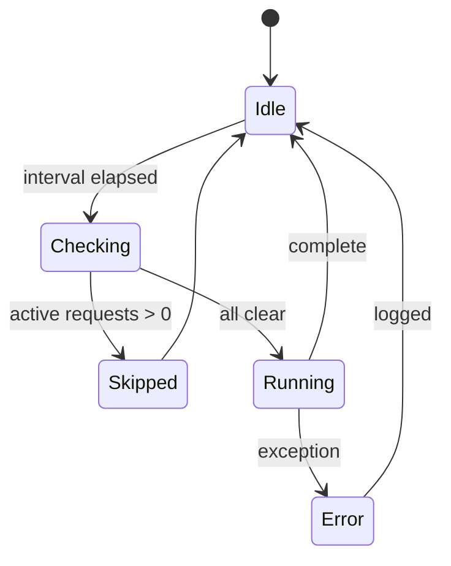
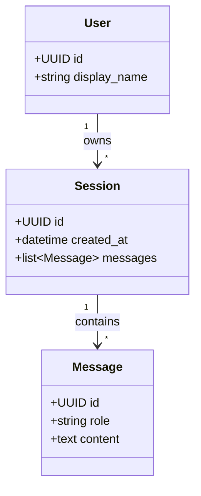
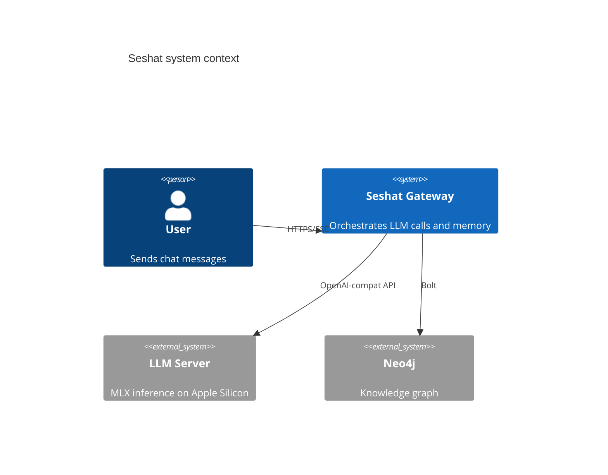
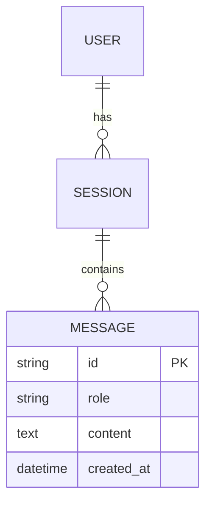

# Prompt Corpus — Seshat Personal Agent

> Source revision: `411a8a43` · Committed: 2026-10-14T04:55:44Z  
> ADR: ADR-0078 · Spec: `docs/specs/PROMPT_MANAGEMENT_SPEC.md`  
>
> **Cache tier key**  
> 🟢 STATIC — never varies at runtime  
> 🟡 SEMI_STATIC — varies at session boundary  
> 🔴 DYNAMIC — varies per turn (end of cacheable prefix)


---

## Summary

### Leaf Prompts

| component_id | cache tier | tokens | source |
|---|---|---|---|
| `entity_extraction_system` | 🟢 STATIC | 113 | `src/personal_agent/second_brain/entity_extraction.py:60` |
| `entity_extraction_template` | 🟡 SEMI_STATIC | 4,011 | `src/personal_agent/second_brain/entity_extraction.py:69` |
| `context_compressor_system` | 🟢 STATIC | 1,076 | `src/personal_agent/orchestrator/context_compressor.py:118` |
| `router_system_prompt` | 🟢 STATIC | 124 | `src/personal_agent/orchestrator/prompts.py:24` |
| `tool_rules` | 🟢 STATIC | 476 | `src/personal_agent/orchestrator/prompts.py:138` |
| `tool_use_native_prompt` | 🟢 STATIC | 71 | `src/personal_agent/orchestrator/prompts.py:153` |
| `tool_use_injected_prompt` | 🟢 STATIC | 202 | `src/personal_agent/orchestrator/prompts.py:163` |
| `tool_awareness_prompt` | 🟡 SEMI_STATIC | runtime | `src/personal_agent/orchestrator/prompts.py:201` |
| `operator_stanza` | 🟡 SEMI_STATIC | runtime | `src/personal_agent/orchestrator/prompts.py:368` |
| `reflection_dspy_signature` | 🟢 STATIC | 816 | `src/personal_agent/captains_log/reflection_dspy.py:79` |
| `reflection_manual_fallback` | 🟢 STATIC | 558 | `src/personal_agent/captains_log/reflection.py:172` |
| `html_generation_system` | 🟢 STATIC | 1,607 | `src/personal_agent/tools/artifact_tools.py:1154` |

### Skill Documents

Total skill docs: 11 · Total tokens (all skills): 17,637  
*(No body is injected: the model loads one with `read_skill`; ADR-0156 D2)*

| skill | tokens | source |
|---|---|---|
| graph-inspection — Read the structure and exact facts of the knowledge graph | 1,756 | `skills/graph-inspection/SKILL.md` |
| interaction-outcomes — How interactions ended, and what the reflections say | 823 | `skills/interaction-outcomes/SKILL.md` |
| log-search — Count, break down and find agent log events | 2,229 | `skills/log-search/SKILL.md` |
| SKILL: Mermaid Diagrams | 3,593 | `skills/mermaid-diagrams/SKILL.md` |
| model-latency — How slow the model calls are over a window | 825 | `skills/model-latency/SKILL.md` |
| sequential-thinking — Multi-Step Reasoning Procedure | 432 | `skills/sequential-thinking/SKILL.md` |
| service-health — Is each service healthy? | 1,130 | `skills/service-health/SKILL.md` |
| spend-and-tokens — The agent's own tokens, cost and budget | 2,559 | `skills/spend-and-tokens/SKILL.md` |
| system-diagnostics — ps, ss, vmstat, iostat, lsof | 826 | `skills/system-diagnostics/SKILL.md` |
| system-metrics — CPU, memory and disk utilisation snapshot | 917 | `skills/system-metrics/SKILL.md` |
| turn-explanation — Explain one turn end to end | 2,547 | `skills/turn-explanation/SKILL.md` |

---

## Orchestrator Composition Skeleton

**Callsite:** `orchestrator.primary`  
**Source:** `src/personal_agent/orchestrator/executor.py:1835–2244`  
**Note:** This prompt is assembled imperatively — it is not a string constant. The skeleton below shows the ordered components and their cache tiers. Components must be in STATIC/SEMI_STATIC order before DYNAMIC for KV-cache prefix stability (ADR-0038).  

```
[🟡 SEMI_STATIC ] deployment_context           executor.py:1840–1850
[🟡 SEMI_STATIC ] operator_stanza              executor.py:1852–1858
[🟡 SEMI_STATIC ] skill_index                  executor.py:1860–1993
[🔴 DYNAMIC     ] memory_section               executor.py:2126–2149
[🟡 SEMI_STATIC ] tool_awareness               executor.py:2151–2171  ⚠ OUT OF ORDER
[🟢 STATIC      ] tool_use_rules               executor.py:2171–2194
[🟢 STATIC      ] decomposition_instructions   executor.py:2176–2194
```

### Component descriptions

**`deployment_context`** (🟡 SEMI_STATIC)  
VPS/cloud deployment environment variables injected into the system prompt.

**`operator_stanza`** (🟡 SEMI_STATIC)  
Authenticated user identity + precedence rule (see operator_stanza leaf prompt).

**`skill_index`** (🟡 SEMI_STATIC)  
The skill catalog: one line per skill (name and description) from skills/<name>/SKILL.md. Populated by orchestrator/skills.py (ADR-0156 D2).

**`memory_section`** (🔴 DYNAMIC)  
Recalled memory nodes for this turn. Varies per turn. ⚠ DYNAMIC — marks the end of the cacheable prefix.

**`tool_awareness`** (🟡 SEMI_STATIC)  
Tool list + capabilities (see tool_awareness_prompt leaf prompt). ⚠ PREPENDED late at line 2171 — inserted after memory_section, violating the stable-prefix ordering invariant.

**`tool_use_rules`** (🟢 STATIC)  
_TOOL_RULES + TOOL_USE_PROMPT_INJECTED (see leaf prompts).

**`decomposition_instructions`** (🟢 STATIC)  
Task decomposition guidance for SINGLE/HYBRID/DECOMPOSE/DELEGATE paths.

> ⚠ **Cache-erosion risk**: `tool_awareness` (SEMI_STATIC) is prepended at line 2171, **after** `memory_section` (DYNAMIC). This means the DYNAMIC content precedes a SEMI_STATIC block, breaking the stable-prefix invariant that ADR-0038 assumed. See P2 (FRE-406) for the cache-erosion measurement dashboard.

---

## Leaf Prompts

### `entity_extraction_system`

| | |
|---|---|
| **Cache tier** | 🟢 STATIC — never varies at runtime |
| **Token count** | 113 |
| **Source** | `src/personal_agent/second_brain/entity_extraction.py:60` |

```
You are a knowledge graph extraction expert building a personal memory system.
Reason carefully about (a) which entities and relationships have lasting knowledge value,
(b) the OUTPUT KIND of each entity (knowledge / ephemeral / finding) and, for knowledge
items, the KNOWLEDGE CLASS (World / Personal), and (c) the user's explicit STANCES and
personal situational CLAIMS — which you must emit as structured items, never flatten into
an entity's description.
Your final output must be valid JSON only — no markdown fences, no explanation text.
```

---

### `entity_extraction_template`

| | |
|---|---|
| **Cache tier** | 🟡 SEMI_STATIC — varies at session boundary |
| **Token count** | 4,011 |
| **Source** | `src/personal_agent/second_brain/entity_extraction.py:69` |

```
Analyze this conversation and extract knowledge graph elements.

ENTITY TYPES — use EXACTLY one of these values, no others (ADR-0109 V2, 10-type):
  Person              — a real, named individual human. Not "User"/"Assistant", generic
                        roles, teams, orgs.
  Organization        — a named company, institution, agency, department, team, or
                        standards body. Not software products or locations.
  Location            — a named geographic or physical place. Not organizations named
                        after places, namespaces, repos.
  TechnicalArtifact   — a concrete, named engineered/built thing you install, run, call,
                        deploy, configure, process, or physically use — software or
                        hardware, and the data assets a system runs on (datasets,
                        benchmarks, gold files, prompts). Not a human-authored work you
                        read to understand (-> KnowledgeArtifact); not an abstract
                        method/idea (-> MethodOrConcept).
                        e.g. Python, Neo4j, FastAPI, a GPU, an oscilloscope.
  KnowledgeArtifact   — a concrete, named human-authored work whose purpose is to convey
                        understanding to a reader — a document, ADR, report, paper,
                        article, chapter, specification, or plan. Not a thing you
                        run/deploy/process (-> TechnicalArtifact); not the facts
                        extracted from it into the KG; not a broad field
                        (-> DomainOrTopic). e.g. an ADR, a research paper, a drafted
                        book chapter, an incident post-mortem report.
  MethodOrConcept     — a specific human-invented abstract idea, method, technique,
                        algorithm, data structure, pattern, or principle. Not a built
                        artifact; not a broad field; not a natural phenomenon.
                        e.g. GraphRAG, trie, Nash equilibrium, retrieval-augmented
                        generation.
  DomainOrTopic       — a broad field, domain, discipline, or subject area as a whole.
                        Not a specific technique within it (-> MethodOrConcept).
                        e.g. behavioral economics, cosmology, cybersecurity, game theory.
  Phenomenon          — a naturally-occurring physical/natural phenomenon, process,
                        effect, force, limit, or observable that exists independently of
                        human design. Not a human-invented method (-> MethodOrConcept);
                        not the quantity used to measure it (-> QuantityMeasure).
                        e.g. cosmic microwave background, gravity, photosynthesis, the
                        greenhouse effect, the diffraction limit.
  QuantityMeasure     — a named physical quantity, property, dimension, or unit of
                        measure — an axis along which things are measured. Not the
                        naturally-occurring phenomenon/effect/limit that exhibits it
                        (-> Phenomenon); not a human-invented method to compute it
                        (-> MethodOrConcept); not a specific measured value.
                        e.g. wavelength, mass, temperature, frequency, luminosity.
  Event               — a specific named occurrence, milestone, incident, release, or
                        time-bound activity. e.g. the Big Bang, ICLR 2024, a production
                        outage.

RELATIONSHIP TYPES — use EXACTLY one of these UPPER_SNAKE_CASE values, no others:
  PART_OF       — entity is a component or subset of another
  USES          — entity uses or depends on another
  RELATED_TO    — general semantic relationship
  SIMILAR_TO    — entities are comparable or equivalent
  CREATED_BY    — entity was created or authored by another
  LOCATED_IN    — entity is geographically within another

OUTPUT KIND — every entity MUST carry an "output_kind", EXACTLY one of these three
  (ADR-0115 — the routing axis, orthogonal to "class" below):
  knowledge  — durable user/world knowledge that belongs in the user's memory. This is the
               default for real subject-matter content, whether about the world or the user.
  finding    — the agent's OWN machinery discussed as a subject: infrastructure, tooling,
               telemetry, operations. Examples: a database discussed as infra ("Postgres is
               healthy"), healthchecks, log/telemetry review (sensor_poll,
               cost_gate_reaper_swept, DEBUG counts), harness internals (executor.py,
               ToolLoopGate, the consolidation job), connectivity pings. Judge by the SUBJECT
               of the turn, not the word alone: "our graph store is up" → Postgres is
               finding; "graph databases store nodes and edges" → Postgres is knowledge.
  ephemeral  — a single item that is transient noise with no lasting value even as a system
               observation. (A whole turn with no real content at all is handled by rule 8
               below — return empty entities/relationships arrays for those; use this value
               only for one item that is noise within an otherwise substantive turn.)

KNOWLEDGE CLASS — for "knowledge" items ONLY, every such entity MUST also carry a "class",
  EXACTLY one of these two (omit or ignore for finding/ephemeral items):
  World     — reusable, impersonal know-how: facts, concepts, products, techniques, and
              named people/orgs/places discussed as general knowledge. This is the default
              for real subject-matter content.
  Personal  — a named thing belonging to the USER'S OWN life: their doctor, employer, city of
              residence, their own project. (A first-person SITUATIONAL FACT such as
              "my lease ends in March" is NOT an entity — put it under "claims", below.)
  (There is NO "Stance" or "System" entity class. A stance is a RELATION — emit it under
  "stances", below. System-ness is expressed via output_kind=finding/ephemeral, above, never
  as a class value.)

STANCES — the user's explicit first-person affect toward, or mastery of, a World concept
  ("I love X", "I prefer X over Y", "I'm learning X", "I've basically mastered X").
  A stance is NOT an entity and must NEVER be written into an entity's description.
  Each stance object:
    subject — always the literal string "owner"
    target  — the World concept it is about (this concept should ALSO appear in "entities")
    affect  — a SHORT phrase for the sentiment/preference ("loves it", "prefers over CR-V",
              "wants to learn"); use "" if the stance is purely a mastery/skill level
    mastery — a number 0.0-1.0 if a skill/learning level is stated or clearly implied,
              otherwise null (a pure preference like "I love it" has mastery = null)
    description — one sentence of context

CLAIMS — first-person SITUATIONAL FACTS about the user's own life/relationships/events that
  are assertions, not named entities ("my lease ends in March", "I saw the cardiologist
  today", "I'm actively shopping for a car"). These have no entity slot and are silently
  DROPPED today — you MUST emit them here instead.
  Each claim object:
    subject — always the literal string "owner"
    content — the fact as ONE self-contained declarative sentence
    facet   — a SHORT stable slot key naming WHAT the fact is about, as lower_snake_case
              (e.g. "lease_end_date", "employer", "current_city", "car_shopping_status").
              Two claims about the SAME underlying thing must share the SAME facet so a
              later value replaces the earlier one. Use "" if you cannot name a clear slot.
    update_kind — one of "new" | "correction" | "evolution":
              "correction" when the user is FIXING an earlier mistake ("actually…", "I was
              wrong", "not X, it's Y"); "evolution" when the fact CHANGED ("now…", "as of…",
              "we moved to…", "extended to…"); "new" otherwise (the default).
    description — optional one sentence of context

Do NOT put any provenance, timestamp, id, or record-date on stances or claims — the system
adds those, not you.

EXTRACTION RULES (follow strictly):
1. NEVER extract the protocol role labels "User" / "Assistant" / "System" / "Reasoning" as Person
   entities — these are chat-template role slots, not people.
   This does NOT preclude extracting the human operator (the person who speaks through the User
   slot) when they are named. If a turn contains "my name is Alex" or similar self-reference,
   extract Alex as a normal Person entity.
2. NEVER extract generic message artifacts: "Test message", "Another message", "Original message",
   "Quick test", "Test query", or any placeholder/test text
3. NEVER extract internal tool binding names that start with "mcp_" (e.g. mcp_perplexity_ask,
   mcp_docker, mcp_search, mcp_fetch_content) — extract the underlying service instead
   (e.g. "Perplexity" not "mcp_perplexity_ask", "Docker" not "mcp_docker")
   NEVER extract the native tool name "search_memory" as an entity — it is an internal
   capability, not user-discussed content (ADR-0026).
4. NEVER extract ephemeral data values as entities: temperatures ("7°C", "53°F"), dates used
   only as context ("March 6, 2026"), sky conditions ("Partly sunny"), generic time references
5. ONLY extract entities with knowledge recall value: would knowing this be useful in a future conversation?
6. Normalize entity names to canonical form with consistent diacritics and casing:
   - "Python" not "python", "Neo4j" not "neo4j", "LM Studio" not "lm studio"
   - "Météo France" not "Meteo France" or "Météo-France" (use the official accented form, no hyphen)
   - "Forcalquier" not "Forcqlquier" (correct spelling, not typos)
7. Deduplicate: if two names clearly refer to the same entity, use one canonical name only
8. If the exchange is an empty/placeholder/test artifact with no real content (e.g. "test
   message", a bare ping with no substance), return empty entities and relationships arrays.
   BUT a real operational turn the user actually engaged in — a healthcheck they ran, a
   telemetry/log review, a harness explainer — is NOT empty: emit its subjects as entities
   with output_kind=finding (see rule 11), do not drop them.
9. Write summaries as one concrete sentence about what was accomplished or learned
10. Describe the ENTITY, never the conversation. A description must be a standalone statement
    of what the thing IS — true whether or not this exchange ever happened, and useful to someone
    who never saw it. Write "A French baked dessert of cherries in a custard-like batter", not
    "A French dessert discussed as a cherry dish". Never write that something "was discussed",
    "was mentioned", "was reportedly" anything, and NEVER refer to the retrieval situation you
    are running in (e.g. "in the memory search context") — that is machinery leaking into the
    user's knowledge. If the exchange gave you no durable fact about the entity beyond its name,
    write a short definition from what the name denotes; do not describe the occasion instead.
11. Assign every entity an "output_kind" (knowledge | finding | ephemeral) and, for knowledge
    items, a "class" (World | Personal) per the definitions above. When the turn's SUBJECT is
    the agent's own infra/tooling/telemetry/healthcheck, the entity is output_kind=finding
    even if it names a general technology.
12. NEVER flatten a user stance into an entity description (no "a car the user loves",
    "central to the user's preference"). Emit it as a structured object in "stances".
13. NEVER drop a first-person situational fact. If it is an assertion about the user's life
    rather than a named entity, emit it in "claims".
14. Set each entity's "description_update_kind" from THIS TURN's intent (you are NOT comparing to
    any stored description — you cannot see one; judge only the conversation in front of you):
      "correction" — the turn EXPLICITLY corrects/contradicts an earlier statement about this
                     entity ("actually X is Y, not Z"; "I was wrong, it's …").
      "enrichment" — the turn SUBSTANTIVELY defines or explains the entity (a real definition or
                     characterization), not just a passing mention.
      "new"        — the default: a passing mention with no correction or defining intent.
    Emit "new" whenever unsure. This signal is about the entity's DESCRIPTION only — never a
    stance or a claim.

GOOD EXAMPLES:
  ✓ {{"name": "Paris", "type": "Location", "output_kind": "knowledge", "class": "World", "description": "Capital of France, subject of weather inquiry"}}
  ✓ {{"name": "Qwen3.5", "type": "TechnicalArtifact", "output_kind": "knowledge", "class": "World", "description": "Local reasoning LLM used for entity extraction"}}
  ✓ {{"name": "Postgres", "type": "TechnicalArtifact", "output_kind": "finding", "description": "The agent's own database, referenced in a healthcheck"}}  ← System-natured: finding, not a class value
  ✓ {{"name": "GraphRAG", "type": "MethodOrConcept", "output_kind": "knowledge", "class": "World", "description": "Technique combining knowledge graphs with RAG retrieval"}}
  ✓ {{"name": "Neo4j", "type": "TechnicalArtifact", "output_kind": "knowledge", "class": "World", "description": "A graph database management system storing data as nodes and typed relationships", "description_update_kind": "enrichment"}}  ← the turn substantively defines it
  ✓ stance: {{"subject": "owner", "target": "Toyota RAV4 Hybrid", "affect": "loves the hybrid powertrain", "mastery": null, "description": "User strongly prefers the RAV4 Hybrid's drivetrain"}}
  ✓ claim:  {{"subject": "owner", "content": "The user's current car lease ends in March.", "description": "Situational constraint driving purchase timing"}}

BAD EXAMPLES (never produce these):
  ✗ {{"name": "User", "type": "Person", ...}}
  ✗ {{"name": "Assistant", "type": "Person", ...}}
  ✗ {{"name": "mcp_perplexity_ask", "type": "TechnicalArtifact", ...}}  ← use "Perplexity" instead
  ✗ {{"name": "mcp_docker", "type": "TechnicalArtifact", ...}}           ← use "Docker" instead
  ✗ {{"name": "search_memory", "type": "TechnicalArtifact", ...}}        ← internal tool, not an entity
  ✗ {{"name": "Postgres", "type": "TechnicalArtifact", "class": "System", ...}}  ← System is not a class value; use output_kind=finding instead
  ✗ {{"name": "7°C", "type": "QuantityMeasure", ...}}                   ← ephemeral data value
  ✗ {{"name": "Météo-France", ...}}                               ← use "Météo France" (no hyphen)
  ✗ {{"name": "Test message", "type": "Message", ...}}
  ✗ {{"name": "DomainOrTopic", "type": "DomainOrTopic", ...}}
  ✗ {{"name": "Clafoutis", ..., "description": "A French baked dessert discussed as a cherry-filled dish in the memory search context"}}
        ← describes the occasion and leaks the machinery; write what a clafoutis IS
  ✗ {{"name": "Amlodipine", ..., "description": "A medication discussed as interacting with grapefruit"}}
        ← "discussed as" framing; write "A calcium channel blocker used to treat high blood pressure"
  ✗ {{"name": "Toyota RAV4 Hybrid", ..., "description": "a car the user loves"}}   ← stance flattened; emit a stance
  ✗ (silently omitting "my lease ends in March")                                   ← emit it as a claim
  ✗ {{"name": "my lease ends in March", "type": "Event", ...}}                     ← situational fact is a claim, not an entity
  ✗ {{"subject": "owner", "target": "...", "provenance": {{...}}}}                 ← never emit provenance; the system adds it

{fewshot_exemplars}Conversation:
User: {user_message}
Assistant: {assistant_response}

Return ONLY valid JSON (no markdown fences, no explanation):
{{
  "summary": "One concrete sentence about what was accomplished or discussed",
  "entities": [
    {{
      "name": "Canonical Entity Name",
      "type": "Person|Organization|Location|TechnicalArtifact|KnowledgeArtifact|MethodOrConcept|DomainOrTopic|Phenomenon|QuantityMeasure|Event",
      "output_kind": "knowledge|ephemeral|finding",
      "class": "World|Personal",
      "description": "One sentence with useful context beyond the name",
      "description_update_kind": "new|enrichment|correction",
      "properties": {{}}
    }}
  ],
  "relationships": [
    {{
      "source": "Entity Name 1",
      "target": "Entity Name 2",
      "type": "PART_OF|USES|RELATED_TO|SIMILAR_TO|CREATED_BY|LOCATED_IN",
      "weight": 0.1-1.0,
      "properties": {{}}
    }}
  ],
  "stances": [
    {{
      "subject": "owner",
      "target": "World Concept Name",
      "affect": "short phrase or empty string",
      "mastery": null,
      "description": "One sentence of context"
    }}
  ],
  "claims": [
    {{
      "subject": "owner",
      "content": "One self-contained declarative sentence about the user's situation",
      "facet": "lower_snake_case slot key, or empty string",
      "update_kind": "new|correction|evolution",
      "description": "Optional one sentence of context"
    }}
  ]
}}
```

---

### `context_compressor_system`

| | |
|---|---|
| **Cache tier** | 🟢 STATIC — never varies at runtime |
| **Token count** | 1,076 |
| **Source** | `src/personal_agent/orchestrator/context_compressor.py:118` |

```
You are a context compressor. Given a sequence of conversation messages that are being evicted from the context window, produce a concise structured summary that preserves the most important information for continuing the conversation.

Output format (use exactly these headings):
## Conversation Summary
- **Decisions:** Bullet list of decisions made (empty if none)
- **Entities:** Key names, tools, technologies, people mentioned
- **Facts:** Important facts established during the conversation
- **Open Items:** Unresolved questions or pending actions

Rules:
- Maximum 200 words total
- Only include information actually present in the messages
- Prefer specifics over generalities (names, versions, choices)
- Skip pleasantries and meta-conversation
- Each bullet should stand on its own — a downstream reader will not see the
  original messages
- Preserve identifiers (file paths, ticket IDs, function names, model IDs,
  hostnames, ports) verbatim — they are how the next turn re-grounds itself
- Tool outputs may be truncated upstream; if you encounter an "[Earlier messages truncated]" marker or an existing "## Conversation Summary"
  block, fold that prior summary into the new one rather than re-summarising
  raw text that no longer exists

Worked example 1 — coding session:
  Input (paraphrased):
    [user]: We're deciding between SQLite and Postgres for the metrics store.
    [assistant]: How many writes/sec do you expect, and is concurrent
                 read/write a hard requirement?
    [user]: ~50/sec peak, multiple concurrent readers, single writer.
    [assistant]: Postgres is the right call — SQLite WAL handles concurrent
                 readers fine but multiple-writer concurrency requires
                 server-grade locking, and you'll want pg_stat_statements
                 from day one.
    [tool: ran ALTER TABLE …]: ok
  Output:
    ## Conversation Summary
    - **Decisions:** Use Postgres (not SQLite) for the metrics store; enable
      pg_stat_statements from day one.
    - **Entities:** Postgres, SQLite, WAL, pg_stat_statements, metrics store.
    - **Facts:** Expected load ~50 writes/sec peak, multiple concurrent
      readers, single writer. ALTER TABLE applied successfully.
    - **Open Items:** None.

Worked example 2 — debugging session:
  Input (paraphrased):
    [user]: The /chat endpoint is returning 504 after 30s when the prompt
            exceeds ~10k tokens.
    [assistant]: That looks like the gateway timeout, not the LLM. Check
                 the proxy.
    [tool: curl /chat]: HTTP 504 after 30.1s
    [assistant]: Confirmed — Caddy's default upstream timeout is 30s.
                 Raise it on the /chat path.
  Output:
    ## Conversation Summary
    - **Decisions:** Raise Caddy upstream timeout on the /chat path; root
      cause is gateway, not LLM.
    - **Entities:** /chat endpoint, Caddy reverse proxy, 504 status.
    - **Facts:** 504 reproduces at ~30s when prompt exceeds ~10k tokens;
      Caddy default upstream_timeout=30s.
    - **Open Items:** Apply the timeout bump and re-test.

Worked example 3 — tool-heavy session with prior summary:
  Input (paraphrased):
    [system]: ## Conversation Summary
              - **Decisions:** Use Neo4j 5.26 LTS for the knowledge graph.
              - **Entities:** Neo4j 5.26 LTS, pgvector.
              - **Facts:** pgvector deferred to phase 2.
              - **Open Items:** Choose embedding dimension.
    [user]: Let's go with 768d embeddings — matches Qwen3-Embedding-0.6B.
    [tool: edit docker-compose.yml]: ok
    [assistant]: 768d set. Embedding service rebuilt.
  Output:
    ## Conversation Summary
    - **Decisions:** Use Neo4j 5.26 LTS for the knowledge graph; embedding
      dimension is 768 to match Qwen3-Embedding-0.6B.
    - **Entities:** Neo4j 5.26 LTS, pgvector, Qwen3-Embedding-0.6B,
      docker-compose.yml.
    - **Facts:** pgvector deferred to phase 2; embedding service rebuilt.
    - **Open Items:** None pending from this slice.

Anti-patterns to avoid:
- Do not invent details that are not in the messages — if a decision was
  discussed but not concluded, list it under Open Items, not Decisions.
- Do not summarise meta-conversation ("I will now check…", "let me think
  about this…") — only the substantive turn output matters.
- Do not collapse distinct entities into a generic term ("the database",
  "the model") — name them.
- Do not write narrative prose under the headings — every line is a bullet.
- Do not include this instruction text or any system metadata in the
  output. Output only the four-section summary.
```

---

### `router_system_prompt`

| | |
|---|---|
| **Cache tier** | 🟢 STATIC — never varies at runtime |
| **Token count** | 124 |
| **Source** | `src/personal_agent/orchestrator/prompts.py:24` |

```
You are a routing classifier.
Choose exactly one target model for the user request:
- STANDARD: general chat and tool-oriented requests.
- REASONING: proofs, derivations, rigorous formal analysis, research synthesis.
- CODING: code writing/debugging/refactoring, stack traces, diffs, CI failures.

Return ONLY JSON with this shape:
{"target_model":"STANDARD|REASONING|CODING","confidence":0.0,"reason":"short reason"}

Rules:
- Always delegate. Never answer the user directly.
- No markdown, no code fences, no commentary.
- If uncertain, choose STANDARD.

```

---

### `tool_rules`

| | |
|---|---|
| **Cache tier** | 🟢 STATIC — never varies at runtime |
| **Token count** | 476 |
| **Source** | `src/personal_agent/orchestrator/prompts.py:138` |

```
Rules:
- If no tool is needed to answer accurately, respond directly without calling any tool.
- Do not invent tools or parameters. If no tool fits, say so directly.
- Never describe the outcome of a system action (database write, file edit, API call, graph upsert) unless an actual tool call in this turn performed it and returned a result. If you have no tool for a requested action, say so plainly — do not narrate success, invent counts, or fabricate payloads you did not produce.
- Provide ALL required parameters as specified by each tool's schema.
- PARALLEL CALLS: When a task needs multiple independent tool calls (e.g. checking errors AND checking memory AND checking infra health), issue ALL of them in a SINGLE response as multiple tool_calls entries. Never call them one at a time when they are independent — batching saves iterations.
- Step budget: Complete most requests in ≤ 6 tool calls. Prefer synthesizing with gathered data over additional lookups. If you have enough information to answer, synthesize immediately.
- After tool results are returned, synthesize a final natural-language answer. Do NOT request the same tool again unless the path/args must change.
- Search is not gated on whether the topic "sounds recent". Call web_search for quick lookups (free, private, multi-engine) whenever you need to make a factual claim and memory, tool results, or the user's own words so far don't already give you a source for it — current events and CVEs need this exactly as much as any other unsourced claim does, and no more. Pass categories='it' for technical queries, 'science' for research, 'news' for current events, 'weather' for forecasts.
- web_search results are directly citable. If snippets are insufficient, use fetch_url to read the full page — its fetched page content is an admissible citation source; the URL you pass is not, and a `bash`/curl fetch of the same page is not admissible at all.
- perplexity_query's synthesized output cannot be cited under the grounding contract — reach for it only for background research you will re-verify from a citable source before asserting anything from it, never as the source itself.
- Do NOT answer from your own knowledge when live information is needed; always search first.
```

---

### `tool_use_native_prompt`

| | |
|---|---|
| **Cache tier** | 🟢 STATIC — never varies at runtime |
| **Token count** | 71 |
| **Source** | `src/personal_agent/orchestrator/prompts.py:153` |

```
[f-string template]
You are a tool-using assistant.

When tools are provided, you may call them to gather facts. Use ONLY the provided tool names and EXACT parameter names.

If you need to call a tool, use native function calling (the tool_calls mechanism). Do NOT embed tool calls as text in your response.

{_TOOL_RULES}

```

---

### `tool_use_injected_prompt`

| | |
|---|---|
| **Cache tier** | 🟢 STATIC — never varies at runtime |
| **Token count** | 202 |
| **Source** | `src/personal_agent/orchestrator/prompts.py:163` |

```
[f-string template]
You are a tool-using assistant.

You have access to tools listed below. To call a tool, emit exactly this format (one per tool call):
[TOOL_REQUEST]{{"name":"tool_name","arguments":{{...}}}}[END_TOOL_REQUEST]

If you call a tool, do NOT answer the user yet — wait for the tool result first.

{_TOOL_RULES}

Examples:

User: "What's the latest version of FastAPI?"
[TOOL_REQUEST]{{"name": "web_search", "arguments": {{"query": "FastAPI latest version 2026", "categories": "it"}}}}[END_TOOL_REQUEST]

User: "Give me a comprehensive comparison of React vs Svelte with citations"
[TOOL_REQUEST]{{"name": "perplexity_query", "arguments": {{"query": "comprehensive comparison React vs Svelte 2026 with benchmarks", "mode": "research"}}}}[END_TOOL_REQUEST]

```

---

### `tool_awareness_prompt`

| | |
|---|---|
| **Cache tier** | 🟡 SEMI_STATIC — varies at session boundary |
| **Token count** | runtime (see description) |
| **Source** | `src/personal_agent/orchestrator/prompts.py:201` |

_Dynamically generated listing of available tools grouped by category. Cached for 60 s. Includes tool counts per category and key capability declarations (web search, file access, etc.). Content varies with the active tool registry — changes when tools are added or governance config is reloaded. Cannot be extracted statically; see function source._

---

### `operator_stanza`

| | |
|---|---|
| **Cache tier** | 🟡 SEMI_STATIC — varies at session boundary |
| **Token count** | runtime (see description) |
| **Source** | `src/personal_agent/orchestrator/prompts.py:368` |

_Async function. Renders the operator stanza: the authenticated user's name and the FRE-1150 identity-precedence rule. No Neo4j content — the :Person profile fields (location, pronouns, role, languages) ride the memory_recall tool result instead (FRE-1566, ADR-0140 T2). Content varies per connected user. Cannot be extracted statically._

---

### `reflection_dspy_signature`

| | |
|---|---|
| **Cache tier** | 🟢 STATIC — never varies at runtime |
| **Token count** | 816 (docstring + field descriptors) |
| **Source** | `src/personal_agent/captains_log/reflection_dspy.py:79` |

```
[Class docstring]
Generate structured reflection on task execution to propose improvements.

Analyzes task execution telemetry to identify patterns, issues, and opportunities
for optimization. Proposes concrete, actionable improvements based on evidence.

Focus areas:
- Performance patterns (slow operations, repeated calls)
- Error patterns (failures, retries)
- Tool usage patterns (effectiveness, unnecessary calls)
- Mode/governance interactions
- Optimization opportunities (caching, parallelization)

[user_message] The user's original message

[steps_count] Number of orchestrator steps executed

[final_state] Final task state (e.g., COMPLETED, FAILED)

[reply_length] Length of agent's reply in characters

[telemetry_summary] Summarized telemetry events showing LLM calls, tool executions, errors

[metrics_summary] Pre-formatted system metrics from RequestMonitor (e.g., 'cpu: 9.3%, duration: 5.4s')

[failure_excerpt] JSON-serialized FailureExcerpt with failed tool calls, error summary, and recovery actions. Empty string when had_errors is False.

[had_errors] True when the trace contained at least one tool call failure or error event.

[prompt_manifest] Snapshot of THIS turn's prompt composition: the ordered active component IDs, the cacheable static prefix hash, and a recent quality signal for the callsite (mean 0-3 rating over the trailing 7 days). Use it to notice composition problems and, when warranted, propose a prompt-composition change that names the specific component_id. Patterns to watch for: (1) A component that is always present yet never load-bearing — e.g. skill_index present but no skill content matched — propose trimming it. (2) A static prefix hash that changed recently — indicates cacheable prefix instability that erodes KV-cache reuse — propose stabilising it. (3) A declining or low mean rating for this callsite — suggest revisiting the prompt components driving those turns. When proposing a prompt change, name the component_id in proposed_change_what and set proposed_change_scope to 'llm_client' or 'orchestrator'. Empty string when no manifest is available — skip composition analysis.

[rationale] Analysis of what happened and key observations about the execution

[proposed_change_what] What to change (empty string if no change proposed)

[proposed_change_why] Why this change would help (empty string if no change proposed)

[proposed_change_how] How to implement this change (empty string if no change proposed)

[proposed_change_category] Category of proposed change. One of: performance, reliability, concurrency, knowledge, cost, ux, observability, architecture, safety. Empty string if no change proposed.

[proposed_change_scope] Target subsystem of proposed change. One of: llm_client, orchestrator, second_brain, captains_log, brainstem, tools, telemetry, governance, insights, config, cross_cutting. Empty string if no change proposed.

[impact_assessment] Expected benefits if change is implemented (empty string if none)

[failure_path_fix_what] Surgical fix (≤ 80 chars) that would have prevented this exact failure. Example: 'Add retry-with-scope-reduction note to query_elasticsearch tool description.' Return empty string if had_errors is False or no specific fix is identifiable.

[failure_path_fix_location] File path + symbol of the text to edit, if known. Example: 'src/personal_agent/tools/fetch_url.py::DESCRIPTION' or 'skills/model-latency/SKILL.md'. Empty string if had_errors is False or unknown.

[missing_skill_names] Skills you needed but didn't have. Format: {domain}-{noun}. Nouns: fetcher, runner, sender, writer, monitor, checker, scanner, analyzer, summarizer, generator, creator, tracker, detector, validator, notifier. Same gap = same name every time. Max 3, comma-separated. Empty string if nothing was missing.
```

---

### `reflection_manual_fallback`

| | |
|---|---|
| **Cache tier** | 🟢 STATIC — never varies at runtime |
| **Token count** | 558 |
| **Source** | `src/personal_agent/captains_log/reflection.py:172` |

```
You are a personal AI agent analyzing your own task execution to generate insights and improvement proposals.

## Task Context
- **User Message**: {user_message}
- **Trace ID**: {trace_id}
- **Steps Completed**: {steps_count}
- **Final State**: {final_state}
- **Reply Length**: {reply_length} characters

## Telemetry Events
{telemetry_summary}

## Prompt Composition (this turn)
{prompt_manifest}

## Your Task
Analyze this task execution and generate a structured reflection entry with:

1. **Rationale**: What happened? Key observations about the execution.
2. **Supporting Metrics**: Specific metrics that stand out (e.g., "llm_call_duration: 2.3s", "tool_executions: 3")
3. **Proposed Change** (if any): Concrete, actionable improvement suggestion based on evidence
   - What to change
   - Why it would help
   - How to implement it
4. **Impact Assessment**: Expected benefits if the change is implemented

Focus on:
- Performance patterns (slow operations, repeated calls)
- Error patterns (failures, retries)
- Tool usage patterns (which tools, success rates, unnecessary calls, permission issues)
- Tool effectiveness (did tool calls provide value or could LLM handle directly?)
- Mode/governance interactions
- Opportunities for optimization (caching, parallelization, reduced tool calls)
- Prompt composition patterns (unused components, unstable static prefix hash, low/declining
  callsite ratings); when proposing a prompt change, name the specific component_id from the
  taxonomy and set scope to llm_client or orchestrator

If this was a simple, successful task with no issues, keep the reflection lightweight.
If there were errors, inefficiencies, or interesting patterns, provide deeper analysis.

Respond with ONLY valid JSON in this exact format:
{{
  "rationale": "string",
  "proposed_change": {{
    "what": "string",
    "why": "string",
    "how": "string",
    "category": "performance|reliability|concurrency|knowledge|cost|ux|observability|architecture|safety",
    "scope": "llm_client|orchestrator|second_brain|captains_log|brainstem|tools|telemetry|governance|insights|config|cross_cutting"
  }} | null,
  "supporting_metrics": ["metric1: value1", "metric2: value2"],
  "impact_assessment": "string" | null,
  "related_adrs": [],
  "related_experiments": []
}}

Do not include markdown formatting, explanations, or any text outside the JSON object.
```

---

### `html_generation_system`

| | |
|---|---|
| **Cache tier** | 🟢 STATIC — never varies at runtime |
| **Token count** | 1,607 |
| **Source** | `src/personal_agent/tools/artifact_tools.py:1154` |

```
You are an HTML document generator. You receive a structured plan and produce a complete, standalone HTML document.

REQUIREMENTS:
- Output ONLY the HTML document. No explanation, no markdown fences, no preamble.
- Start with <!DOCTYPE html> and end with </html>.
- Define a complete design system in a <style> block in <head>:
  * CSS custom properties for colors: --color-primary, --color-secondary, --color-accent, --color-bg, --color-surface, --color-text, --color-muted.
  * Spacing scale: --spacing-1 through --spacing-8 (0.25rem increments).
  * Typography: --font-sans, --font-mono; size classes from text-xs to text-3xl.
  * Utility classes: flex, grid, gap-1 through gap-6, p-1 through p-8, m-1 through m-8, text-center, text-left, text-right, font-bold, font-medium, rounded, rounded-lg, shadow, shadow-lg, hidden, w-full.
- INTERACTIVITY: JavaScript is available. The document runs in a sandboxed, sealed page — inline <script> blocks and event handlers run normally, so use them freely for genuine interactivity: simulations, explorable diagrams, charts, animations, calculators, tabs, filters. Prefer plain CSS (:hover, :target, <details>/<summary>, transitions) when it does the job with less code; reach for JavaScript when the experience genuinely needs it.
- QUALITY: the reader judges every page on five questions. Build for all five.
  * Every widget works: each visible control does something visible when used. No dead or placeholder controls.
  * It is creative: give the page its own visual identity that fits its subject, not a generic template.
  * It is easy to learn from: explain as the reader goes, show cause and effect, and give feedback on every action.
  * It is attractive and enticing: deliberate colour, typography, spacing and motion.
  * It encourages learning or continued use: give the reader a reason to keep exploring, such as a challenge, a goal, progress, or something to discover.
- CURATED TOOLKIT: a small, vetted /lib/ shelf is hosted on the artifact origin — it is the ONLY external origin this page may load. Reference each asset by its EXACT absolute, version-pinned URL below (a relative path will not load). Reach for one only when the document genuinely needs it; otherwise inline your own code.
  * Math (KaTeX) — render TeX/LaTeX:
    <link rel="stylesheet" href="https://artifacts.example.com/lib/katex@0.16.47/katex.min.css">
    <script src="https://artifacts.example.com/lib/katex@0.16.47/katex.min.js"></script>
  * Data viz (Chart.js — global `Chart`) — charts/graphs from inline data:
    <script src="https://artifacts.example.com/lib/chartjs@4.4.7/chart.umd.js"></script>
  * 3-D (three.js — global `THREE`, r171) — scenes/geometry; build meshes in code and embed any textures as data: URIs, never fetch them:
    <script src="https://artifacts.example.com/lib/three@0.171.0/three.iife.min.js"></script>
  * Code (highlight.js) — syntax-highlight code blocks:
    <link rel="stylesheet" href="https://artifacts.example.com/lib/highlightjs@11.9.0/github-dark.min.css">
    <script src="https://artifacts.example.com/lib/highlightjs@11.9.0/highlight.min.js"></script>
  * Prose typography (OFL variable fonts) — declare with @font-face, then use the family in your design system:
    @font-face { font-family: "Source Serif 4"; src: url("https://artifacts.example.com/lib/fonts/source-serif-4@4.005/source-serif-4.woff2") format("woff2"); }
    @font-face { font-family: "Playfair Display"; src: url("https://artifacts.example.com/lib/fonts/playfair-display@2.103/playfair-display.woff2") format("woff2"); }
    @font-face { font-family: "JetBrains Mono"; src: url("https://artifacts.example.com/lib/fonts/jetbrains-mono@2.304/jetbrains-mono.woff2") format("woff2"); }
    Use Source Serif 4 for body prose, Playfair Display for display headings, JetBrains Mono for code.
  * Book/print layout: prefer the NATIVE CSS recipes below (@page, column-count, break-*). A paged.js polyfill is also on the shelf but is EXPERIMENTAL and may be restricted under the live page policy — do not rely on it.
- NATIVE TYPOGRAPHY (no library) — reach for these before any font library for refined text:
  * Drop cap: p::first-letter { float: left; font-size: 3.2em; line-height: 0.8; padding-right: 0.08em; }
  * Justified prose: text-align: justify; hyphens: auto; (set lang on <html>).
  * Balanced headings: text-wrap: balance;
  * Ligatures / old-style figures: font-feature-settings: "liga", "onum", "kern";
  * Multi-column flow: column-count, column-gap, column-rule.
  * Print/book pages: @page { margin: ... } with break-inside: avoid; and widows/orphans control.
- SEALED-BOX CONSTRAINTS (hard, enforced by the runtime — design within them):
  * No network: fetch/XHR/WebSocket/beacon are blocked. Embed ALL of your own data inline; inline images and 3-D textures as data: URIs or inline SVG — never fetch them.
  * No storage: localStorage, sessionStorage, IndexedDB, and cookies are unavailable. Keep state in JS variables or the DOM.
  * No arbitrary CDN: only the curated /lib/ shelf above loads. Any other external script/style/font/image (Tailwind CDN, Alpine.js, jQuery, Google Fonts, unpkg, etc.) silently fails — inline it instead. Default to inline CSS and native JS wherever no shelf library is warranted.
  * No popups, no form submission to external endpoints.
- PORTABILITY (choose deliberately): for static diagrams that should travel with the file — flowcharts, architecture, sequence/class diagrams — use <pre class="mermaid">…</pre> markup with Mermaid syntax; the server renders these to static inline SVG, so the document stays self-contained and viewable anywhere. Example: <pre class="mermaid">graph LR; A[Start] --> B[End];</pre>. Use JavaScript instead when the experience is genuinely interactive — such an artifact is viewed on its hosted page.
- Use semantic HTML5 elements: header, main, section, article, footer, nav, aside, figure, figcaption.
- Responsive: use CSS media queries (@media) for mobile/tablet/desktop.
- Accessibility: heading hierarchy (h1 > h2 > h3), alt text on images, ARIA labels where helpful, sufficient color contrast.
- For data tables: <table> with <thead>/<tbody>, striped rows via nth-child, sticky header if many rows.
- For metrics/KPIs: card layout with large number and small label beneath.
- For comparison layouts: CSS grid with equal-width columns.
- Maximum document size: aim for under 200KB of HTML text.
```


---

## Skill Documents (`skills/<name>/SKILL.md`)

The `skill_index` component holds the catalog only. A body reaches the model as the result of a `read_skill` call (ADR-0156 D2).  

### graph-inspection — Read the structure and exact facts of the knowledge graph

| | |
|---|---|
| **Cache tier** | 🔴 DYNAMIC — a read_skill result, only when the model loads it |
| **Token count** | 1,756 |
| **Source** | `skills/graph-inspection/SKILL.md` |

```markdown
# graph-inspection — Read the structure and exact facts of the knowledge graph

## Rules

- Use this skill for the facts that only Cypher reads: counts of nodes and relationships, the labels and relationship types, the schema and property keys, the `first_seen` and `last_seen` times of an `Entity`, and the degree of a node. `search_memory` reads the same graph for meaning. It does not return these facts.
- The skill is read-only. Use `MATCH` and `RETURN`. Never write to the graph from a diagnostic query: no `CREATE`, `MERGE`, `SET`, `DELETE`, `REMOVE`, `DROP`.
- If the user asks to change the graph, do not do it. Show the `MATCH` that finds the nodes and leave the change to the user.
- Use the script, not a hand-written driver call. The `run_python` sandbox has no `neo4j` driver.
- Pass a value with `--param name=value`. Never put a value into the query text.
- A `CALL` is allowed only for the schema procedures `db.labels`, `db.relationshipTypes`, `db.propertyKeys`, `db.schema.visualization`, `db.schema.nodeTypeProperties` and `db.schema.relTypeProperties`. Any other procedure (an `apoc.*` call, `dbms.*`) is refused: it can write, reach a URL or show the configuration.
- The script also refuses administration commands (`SHOW`, `TERMINATE`, `USE`, `ALTER`, `GRANT` and the like). For the schema, use the procedures above.
- Functions without a namespace (`count`, `toLower`, `size`, `labels`) are allowed. A function with a namespace is allowed only from a list: the Cypher built-ins (`date.*`, `datetime.*`, `duration.*`, `point.*`, `vector.similarity.*` and the time types) and the APOC namespaces that compute on their arguments (`apoc.coll`, `apoc.map`, `apoc.text`, `apoc.convert`, `apoc.date`, `apoc.number`, `apoc.math` and others). The error names the full list. Any other namespace (`apoc.cypher`, `apoc.util`, `ai.text`) is refused.
- Do not use the `/db/data/transaction/commit` HTTP endpoint. It does not exist in Neo4j 5 (404 or 401).

## Step 1 — Run one query

```bash
python3 skills/graph-inspection/scripts/cypher.py "MATCH (e:Entity) RETURN count(e) AS n"
```

The reply is one JSON document: `{"rows": [...], "row_count": n, "truncated": false}`. The script
returns at most 100 rows. Use `--limit N` (up to 1000) for more. `truncated: true` means that the
query holds more rows than were returned.

The script opens a read transaction, so the server refuses a write, including
`apoc.cypher.doIt`. It checks for a write clause and for a procedure that is not on
the list first, to give a plain error before it connects. A word inside a string, a comment or a
backtick name is not read as a clause.

## Step 2 — Common diagnostic queries

```bash
python3 skills/graph-inspection/scripts/cypher.py "MATCH (n) RETURN labels(n)[0] AS label, count(n) AS cnt ORDER BY cnt DESC"
```

```bash
python3 skills/graph-inspection/scripts/cypher.py "CALL db.relationshipTypes() YIELD relationshipType RETURN relationshipType"
```

```bash
python3 skills/graph-inspection/scripts/cypher.py "MATCH (e:Entity) RETURN e.name AS name, e.first_seen AS first_seen ORDER BY e.first_seen DESC LIMIT 5"
```

```bash
python3 skills/graph-inspection/scripts/cypher.py 'MATCH (e:Entity) WHERE toLower(e.name) CONTAINS $q RETURN e.name AS name, e.entity_type AS type LIMIT 10' --param q=memory
```

```bash
python3 skills/graph-inspection/scripts/cypher.py "MATCH (e:Entity)-[r]-() RETURN e.name AS name, count(r) AS degree ORDER BY degree DESC LIMIT 10"
```

Labels in the graph include `Entity` and `Turn`. A relationship type of interest is `DISCUSSES`.
Run the label query first when you are unsure what exists.

When was an entity created? Use `first_seen` and `last_seen`: `Entity`
nodes hold both. `created_at` is set on almost no node, so an `ORDER BY` on it gives no useful order.
Find the property keys of the graph with `CALL db.propertyKeys()`.

## Environment

The script reads these variables. Never write a value into a command.

| Variable | Default | Purpose |
|---|---|---|
| `AGENT_NEO4J_URI` | `bolt://neo4j:7687` | Bolt address (a Docker DNS name inside the network) |
| `AGENT_NEO4J_USER` | `neo4j` | User |
| `AGENT_NEO4J_PASSWORD` | none | Password. The script stops with an error if it is empty |

## Success

Check the result before you answer:

- The answer quotes the number or the rows from the script output, with the query that produced them.
- `truncated` is `false`, or the answer says that only `row_count` rows are shown.
- A count of 0 is checked once with the label query (Step 2): a wrong label name also gives 0.
- A column that is `null` in every row names a property that these nodes do not hold. Check it with `count(e.<property>)` and `CALL db.propertyKeys()`. The driver may print a warning on stderr for a property that does not exist: read it.
- No write was attempted.

## Recovery

| Failure | Cause | Next step |
|---|---|---|
| `error: this script is read-only and the query holds SET` | A write clause, or a property named like one | Remove the write. If it is a property or alias name, quote it with backticks |
| `error: the procedure apoc.x.y is not allowed` | A `CALL` outside the list | Use `MATCH` and `RETURN`, or one of the listed schema procedures |
| `error: AGENT_NEO4J_PASSWORD is not set in this environment` | The script runs where the variable is not set | Say that the graph cannot be read from here. Do not look for the password |
| `error: authentication failed` | The user or password is wrong | Stop. Tell the user. Do not try other credentials |
| `error: cannot connect to bolt://...` | Neo4j is down, or the name does not resolve from here | Run the `service-health` skill for `neo4j`. Do not use `localhost` inside the container |
| `error: the server refused the query: ...` | A syntax error, or the server refused a write | Fix the query as the message states |
| `error: the neo4j driver is not importable by this python3` | The command ran with another Python | Run it with `/app/.venv/bin/python` in place of `python3` |
| The driver is not usable at all | — | The HTTP API is the last resort (below). It asks the user |
| The same failure twice | — | Stop. Tell the user what failed and what was tried |

The HTTP Cypher API, only when the Python driver cannot be used:

```bash
# ask: the shell expands ${AGENT_NEO4J_USER} and ${AGENT_NEO4J_PASSWORD} here, so this is not a plain command and asks for approval.
curl -fsS -X POST \
  -H "Content-Type: application/json" \
  -H "Accept: application/json" \
  -u "${AGENT_NEO4J_USER}:${AGENT_NEO4J_PASSWORD}" \
  "http://neo4j:7474/db/neo4j/tx/commit" \
  -d '{"statements":[{"statement":"MATCH (e:Entity) RETURN count(e) AS n"}]}'
```
```

---

### interaction-outcomes — How interactions ended, and what the reflections say

| | |
|---|---|
| **Cache tier** | 🔴 DYNAMIC — a read_skill result, only when the model loads it |
| **Token count** | 823 |
| **Source** | `skills/interaction-outcomes/SKILL.md` |

```markdown
# interaction-outcomes — How interactions ended, and what the reflections say

## Rules

- Cite real rows from a live query. Never describe what the Captain's Log probably holds.
- Use curl on `elasticsearch:9200`. The `search_logs` tool does not list the captures and reflections families.
- The date field of the captures index is `timestamp`, not `@timestamp`. A range on `@timestamp` returns nothing and no error.
- Write a number and a time bound as a literal in the command. A shell variable or `$(...)` makes the command ask for approval.

## Step 1 — The last interactions, newest first

A capture holds `trace_id`, `outcome`, `total_tokens` and `timestamp`.

```bash
curl -fsS -X POST 'http://elasticsearch:9200/agent-captains-captures-*/_search?format=json' \
  -H 'Content-Type: application/json' \
  -d '{
    "size": 10,
    "sort": [{"timestamp": "desc"}],
    "_source": ["trace_id", "outcome", "total_tokens", "timestamp"]
  }' | jq '.hits.hits[]._source'
```

## Step 2 — Outcomes over a window

```bash
curl -fsS -X POST 'http://elasticsearch:9200/agent-captains-captures-*/_search?format=json' \
  -H 'Content-Type: application/json' \
  -d '{
    "size": 0,
    "query": {"range": {"timestamp": {"gte": "now-24h"}}},
    "aggs": {"by_outcome": {"terms": {"field": "outcome", "size": 10}}}
  }' | jq '{total: .hits.total.value, outcomes: .aggregations.by_outcome.buckets}'
```

## Step 3 — The patterns that reflections repeat

Reflections are in `agent-captains-reflections-*`. A reflection holds `title`, `rationale`
and `proposed_change`, an object with `what`, `category` and `seen_count`. Use the same
`_search` form, with `"sort": [{"proposed_change.seen_count": "desc"}]` and
`"query": {"range": {"proposed_change.seen_count": {"gte": 2}}}`. A bare `seen_count` is not
a field of this index. The date field of this family is `timestamp`.

## Success

Check the result before you answer:

- The answer names the time range of the rows, or the window of the counts.
- The buckets of an outcome count can sum to less than the total: a capture can hold no `outcome`. Say how many hold none.
- A reflection is quoted with its `proposed_change.seen_count`. A pattern that was seen once is not called a recurring pattern.

## Recovery

| Failure | Cause | Next step |
|---|---|---|
| A range on the captures index returns nothing | The range used `@timestamp` | Use `timestamp` |
| `{"hits": {"total": {"value": 0}}}` and the agent ran | The window is too short, or the index pattern is wrong | Widen the window once. Check the family name against the `log-search` skill |
| `could not resolve host: elasticsearch` | The command ran on the host shell | Run it through the `bash` tool, which runs in the gateway container |
| HTTP 400 with `parse_exception` | The request body is not valid JSON | Check the quotes and braces of the body |
| HTTP 400 with `No mapping found for [seen_count]` | The sort used a bare `seen_count` | Use `proposed_change.seen_count` |
| The same failure twice | — | Stop. Tell the user what failed and what was tried |
```

---

### log-search — Count, break down and find agent log events

| | |
|---|---|
| **Cache tier** | 🔴 DYNAMIC — a read_skill result, only when the model loads it |
| **Token count** | 2,229 |
| **Source** | `skills/log-search/SKILL.md` |

```markdown
# log-search — Count, break down and find agent log events

## Rules

- Answer only from a live query. Never answer from what the logs probably hold.
- Start with the `search_logs` tool. It knows the fields, a refusal lists the allowed fields, and the result is bounded.
- Use curl only for what the tool cannot do. The table below says which.
- Use only the index families in this file. Never write a guessed index name.
- A scheduled monitor index records what a monitor saw at its last run. Read its newest document before you say that a pipeline is healthy.
- The monitor of the local model server (`agent-monitors-slm-health`) is in the `service-health` skill.
- Model-call timing is not in Elasticsearch. Use the `model-latency` skill.
- Spend and token totals are in the `spend-and-tokens` skill. How interactions ended is in the `interaction-outcomes` skill.

## Step 1 — Use the tool

The tool description lists the fields of each family. The tool sorts hits newest first and
returns at most 50. `since` is at most `30d`.

```python
# Count the errors of the last 24 hours
search_logs(action="count", index="agent-logs", query={"term": {"level": "ERROR"}}, since="24h")

# The most common event types of the last hour
search_logs(action="search", index="agent-logs", size=0, since="1h",
                aggs={"by_event": {"terms": {"field": "event_type", "size": 20}}})

# The last 20 errors, with the fields that name them
search_logs(action="search", index="agent-logs", query={"term": {"level": "ERROR"}}, size=20,
                since="3h", fields=["@timestamp", "event_type", "message", "tool_name", "trace_id", "error"])

# The events of one trace
search_logs(action="search", index="agent-logs", query={"term": {"trace_id": "<trace_id>"}},
                size=50, since="7d", fields=["@timestamp", "event_type", "role", "tool_name", "input_tokens"])

# Which events carry a field (find the event before you aggregate on the field)
search_logs(action="search", index="agent-logs", size=0, since="24h",
                query={"exists": {"field": "input_tokens"}},
                aggs={"by_event": {"terms": {"field": "event_type", "size": 10}}})
```

What the events carry:

| `event_type` | Fields to read |
|---|---|
| `model_call_completed` | `model`, `provider`, `role`, `input_tokens`, `output_tokens`, `cache_read_tokens`, `cost_usd`. LLM-only: it leaves out embedding and rerank cost |
| `api_cost_recorded` | `provider`, `model`, `cost_usd`. Every priced call. This is the total-spend event |
| `tool_call_started` | `tool_name` |
| `tool_call_completed` | `tool_name`, `success` |
| `tool_loop_gate` | `decision`: `warn_consecutive`, `block_consecutive`, `block_identity` |
| `embedding_generated`, `reranker_applied` | `provider`, `cost_usd`. Part of total spend, not of `model_call_completed` |

Other values that had events in the last 7 days: `session_created`, `state_transition`,
`model_call_started`, `history_sanitised`, `budget_counter_snapshot`. Do not guess a value:
run the last call above and read the buckets.

## Step 2 — When the tool cannot do it, use curl

| Need | Why the tool cannot | Use |
|---|---|---|
| A family that is not `agent-logs`, `agent-topology` or `agent-monitors-slm-health` (captures, reflections, insights, other monitors) | `index` is a fixed list | `_search` with curl: see `references/curl-recipes.md` |
| A field that the tool refuses and that exists | The allowlist is closed | Check the field first (below). Fields that hold conversation text are left out on purpose |
| More than 50 hits, oldest first, or a window over 30 days | The caps | `_search` with curl |
| ES\|QL | Not offered | `references/esql.md` |
| The list of indices, or the fields of an index | Not offered | The two commands below |

**Check a field before a curl aggregation.** Elasticsearch gives empty buckets, not an
error, for a field that does not exist. A field missing from `fields` in this reply does not
exist:

```bash
curl -fsS 'http://elasticsearch:9200/agent-logs-*/_field_caps?fields=event_type,level'
curl -fsS 'http://elasticsearch:9200/_cat/indices?format=json&h=index,docs.count'
```

## Index families

Use `<family>-*`. The tool takes the family name without `-*`.

| Pattern | Holds | Date field |
|---|---|---|
| `agent-logs-*` | All structured log events | `@timestamp` |
| `agent-topology-*` | Per-turn routing and planning facts | `@timestamp` |
| `agent-captains-captures-*` | Captain's Log, one document for each request | `timestamp` |
| `agent-captains-reflections-*` | DSPy self-reflection output | `timestamp` |
| `agent-insights-*` | Cross-session insights and anomalies | `timestamp` |
| `agent-monitors-slm-health-*` | Probes of the local model server (the `service-health` skill reads them) | `probed_at` |
| `agent-monitors-cache-reset-cadence-*`, `agent-monitors-projector-health-*` | Monitors | `@timestamp` |
| `agent-monitors-cache-erosion-*`, `agent-monitors-delivery-ratio-*` | Monitors | `run_at` |
| `agent-monitors-joinability-*` | Monitor | `started_at` |

A time bound must use the date field of its own family. A range on the wrong field returns
nothing and no error.

A family holds daily indices (`YYYY.MM.DD`), monthly indices (`YYYY-MM`), or both. Never cut a
date off a name: a cut name such as `agent-logs-2026` looks real and is not. To classify a
family, use the tested script:

```bash
curl -fsS 'http://elasticsearch:9200/_cat/indices?h=index' \
  | grep '^agent-monitors-joinability-' \
  | python3 skills/log-search/scripts/es_index_granularity.py agent-monitors-joinability
```

The script prints the daily and monthly counts, flags `MIXED`, and lists every name that it
does not recognise. It exits 1 if its input is empty, so a failed `curl` is never read as
"no indices".

## Field notes

- `level`, `event_type`, `trace_id`, `session_id`, `tool_name`, `model` and `provider` are plain `keyword`: use `term`, with no `.keyword` suffix.
- `message` is `text`. Use `match` on it. Do not aggregate on it.
- `error` is `text` with a `.keyword` subfield. Aggregate on `error.keyword`.
- Today is ambiguous at midnight UTC. Use a rolling window (`since="24h"`).

## Success

Check the result before you answer:

- The answer names the index family and the window that the numbers cover.
- A reply with `shards_failed`, `timed_out` or `truncated` is partial. Say so.
- A `total` of 0 for a window in which the agent ran means the window or the filter is wrong.
- A terms aggregation with no buckets and a `total` above 0 means the field is empty for these events. Find the event that carries it (the last call in Step 1).
- A count that you quote is the count that the reply holds, with its window. Do not round it up.
- A monitor answer gives the time of the newest document.
- Three monitors run on a schedule. At the default interval they write every hour (`agent-monitors-cache-erosion`, `agent-monitors-joinability`) or every day (`agent-monitors-delivery-ratio`). A newest document older than its interval is reported as stale.
- `agent-monitors-cache-reset-cadence` and `agent-monitors-projector-health` write on events, so they have no interval. A quiet period is not stale.

## Recovery

| Failure | Cause | Next step |
|---|---|---|
| `refused: field 'x' is not available in agent-logs. Allowed fields: ...` | The field is not in the allowlist, or the name is wrong | Pick a field from the list in the message. If none fits, check the field with `_field_caps` and use curl |
| `refused: index must be one of ...` | The family is not one of the three | Use the curl path in Step 2 |
| `refused: since ...` | The window is malformed or over 30 days | Write a number and `m`, `h` or `d` |
| `store_unavailable` or `store_timeout` | Elasticsearch is down or slow | Call once more. If it fails again, stop and tell the user. The `service-health` skill checks the service |
| `store_rejected` (HTTP 400) | The query shape is wrong | Change the query as the message states |
| HTTP 404 `index_not_found_exception` with curl | A guessed index name. The names `agent-events-*`, `agent-traces-*`, `agent-telemetry-*` and `logs-*` are retired or never existed | Use a family from the table. Events of every kind are in `agent-logs-*` |
| A curl reply is `{"hits": {"total": {"value": 0}}}` and the agent ran | Wrong date field, or `since` too short | Check the date field of the family. Widen the window once |
| The same failure twice | — | Stop. Tell the user what failed and what was tried |
```

---

### SKILL: Mermaid Diagrams

| | |
|---|---|
| **Cache tier** | 🔴 DYNAMIC — a read_skill result, only when the model loads it |
| **Token count** | 3,593 |
| **Source** | `skills/mermaid-diagrams/SKILL.md` |

```markdown
# SKILL: Mermaid Diagrams

## Rules

Before emitting any non-trivial mermaid block to the user, validate it with the check script `scripts/validate_mermaid.py`, which runs `mmdc` (see Validation section).
The first content line MUST be the diagram-type keyword. Do not invent syntax — every arrow, keyword, and bracket must be from the v11 spec.

> **Use this skill to** (a) decide when a diagram beats prose, (b) pick the right type, (c) get v11 syntax exactly right, (d) **validate the fence with the check script before sending it to the user**.

---

## When to Use a Diagram vs Prose

**Diagram if:**
- Three or more entities with non-linear relationships
- Temporal ordering or message sequence is the point
- A state machine has three or more states
- A decision tree branches into multiple paths
- Architecture explanation benefits from spatial layout

**Prose if:**
- Linear narrative or a single entity
- The diagram adds chrome without adding information
- A bulleted list is shorter and equally clear

---

## Diagram Type Selection

| Intent | Type | First-line header |
|---|---|---|
| Flow / decision / process / pipeline | flowchart | `flowchart TD` or `flowchart LR` |
| Actors exchanging messages over time | sequence | `sequenceDiagram` |
| States and transitions | state | `stateDiagram-v2` |
| Entities + relationships (DB/domain schema) | ER | `erDiagram` |
| OO model / class hierarchy / domain model | class | `classDiagram` |
| Software architecture (system/container/component) | C4 | `C4Context` / `C4Container` / `C4Component` |
| Git branching strategy | git | `gitGraph` |
| Timeline / project plan | gantt | `gantt` |
| Proportions of a whole | pie | `pie` |
| Hierarchical brainstorm | mindmap | `mindmap` |

**Layout hints for `flowchart`:**
- `TD` (top-down): tree structures, ≤6 nodes
- `LR` (left-right): chains, pipelines, request flows
- `BT` / `RL` are valid but uncommon — prefer `TD`/`LR` unless you have a specific reason (e.g. bottom-up dependency tree)

**When to use C4 vs flowchart for architecture:**
- C4 for multi-level architectural views (system → containers → components)
- Flowchart for data/request flow within one level

---

## Core Syntax

All mermaid diagrams follow this pattern: a fenced code block with the language tag `mermaid`, whose first line is the diagram-type keyword, followed by the diagram body. Example structure (literal backticks not shown):

    fenced block with language `mermaid`
        first line: diagram type keyword
        following lines: diagram content

Key principles:
- The **first non-empty line** is the diagram-type keyword — mandatory, no exceptions
- Use `%%` for comments: `%% this is a comment`
- Indentation and line breaks improve readability but aren't required
- Unknown keywords and typos break diagrams silently or with a parse error

---

## Syntax Invariants

These are the rules most commonly broken. Violating any produces a parse error in mermaid v11.

### 1. Diagram-type header is mandatory on line 1

Without it: `No diagram type detected`.

```
flowchart TD
    A --> B    ✅

    A --> B    ❌  (missing header)
```

### 2. Node IDs vs labels in `flowchart`

A node ID is a bare token (no spaces, no punctuation). Put the display label in square brackets:

```
flowchart TD
    A[User clicks Buy] --> B{Authenticated?}
    B -->|Yes| C[Dashboard]
    B -->|No| D[Login page]
```

Never write `User clicks Buy --> B` — that tries to use a label as an ID.

### 3. Arrow syntax is type-specific — never mix

| Type | Valid arrows |
|---|---|
| `flowchart` | `-->` `-.->` `==>` `--text-->` `-->|label|` |
| `sequenceDiagram` | `->>` `-->>` `-x` `--x` `-)` `--)` |
| `stateDiagram-v2` | `-->` only |
| `erDiagram` | cardinality glyphs (see §8 below) |

### 4. Reserved words cannot be bare node IDs

In `flowchart`, these are reserved: `end`, `class`, `subgraph`, `direction`, `default`, `style`, `linkStyle`. Bracket them or rename:

```
A --> B[end state]   ✅
A --> end            ❌  (parse error)
```

### 5. `subgraph` must close with `end`

```
flowchart TD
    subgraph Pipeline
        A --> B
    end
    B --> C
```

Missing `end` leaves the parser in an open block.

### 6. Curly braces have meaning — use them deliberately

In `flowchart`, `{...}` is the **decision/rhombus node shape**: `B{Authenticated?}` is a valid diamond node. `{}` is *not* generally broken — it's reserved syntax.

What can break:
- `{}` inside a `[ ]` rectangle label can confuse the parser depending on contents — e.g. `A[Result {data}]` may parse `{data}` as start of a new node. Either rephrase the label or escape: `A["Result {data}"]` (quoted label).
- `{}` in `%%` comments is usually fine but has been reported to break in some v11 builds — when in doubt, paraphrase the comment.

Quoted labels (`A["any string here"]`) are the safest form when the label contains punctuation, brackets, or special characters.

### 7. `sequenceDiagram` participants with spaces

Declare them explicitly when names contain spaces:

```
sequenceDiagram
    participant GitHub Actions
    participant Deploy Server
    GitHub Actions ->> Deploy Server: push artifacts
```

### 8. `erDiagram` cardinality glyphs

Use exactly these — don't invent variants:

| Relationship | Glyph |
|---|---|
| One to many | `||--o{` |
| One to one | `||--||` |
| Many to many | `}o--o{` |
| Zero or one | `|o--o|` |

### 9. `stateDiagram-v2` specifics

- `[*]` is the start/end state
- Transitions use `-->` with optional label after `:`
- Nested states: `state X { ... }`

---

## Pre-emit Checklist (mental)

Before closing the fence, verify:

1. First line has the diagram-type header
2. Every arrow uses the syntax for *that* diagram type
3. Every label with spaces or punctuation is inside `[ ]` (flowchart) or declared via `participant` (sequence)
4. All `subgraph` blocks have matching `end` lines
5. Decision-shape `{...}` is only used as a `flowchart` node shape, not inside `[...]` rectangles

---

## Validation (automated)

The gateway container has `mmdc` (`@mermaid-js/mermaid-cli`) installed, and the check script `scripts/validate_mermaid.py` of this skill runs it and gives one verdict. **Validate any non-trivial diagram before showing it to the user.** A trivial diagram is ≤5 nodes of a type you've successfully produced earlier in this turn.

### Pattern

1. Write the diagram body (no fence) to `/tmp/m.mmd` with the `write` tool.
2. Run the script on that file:

```bash
python3 skills/mermaid-diagrams/scripts/validate_mermaid.py /tmp/m.mmd
```

The first line of the output is the verdict:

| First line | Meaning | Next step |
|---|---|---|
| `VALID` | `mmdc` parsed the diagram and wrote an SVG | Emit the fence to the user. |
| `INVALID` | The diagram has a syntax error. The error text follows. | Read it, fix, write the file again, run the script again (Recovery). |
| `ERROR` | The check could not run: no `mmdc`, no browser, a time-out, a missing file, or a file that is not a `.mmd` file | Do not repair the diagram (Recovery). |

**Why a script.** Do not rebuild the check with `mmdc` and a file test. Observed on `mmdc` 11.17.0:

- most parse errors exit 1 and write no SVG, but a broken `pie` diagram exits 0 and writes mermaid's error diagram as an SVG;
- a diagram of more than 50,000 characters exits 0, and mermaid reads none of it (it draws a placeholder);
- a browser failure also exits 1, and it looks like a diagram error;
- a fixed output path such as `/tmp/m.svg` keeps an old SVG, and a file test then calls a broken diagram valid.

The script writes to a new directory on every run, reads the exit code and the SVG, and tells a browser failure from a diagram error. `--help` lists the options.

### Cost-aware policy

Each `mmdc` call takes ~2 seconds (Chromium spin-up). Use the cost budget:

- ✅ **Validate** diagrams ≥6 nodes, any new diagram type in the turn, anything with unfamiliar syntax (cardinality glyphs, C4 directives, subgraphs)
- ❌ **Skip validation** for trivial fences you've already seen succeed earlier in the same turn — repeated calls just burn 2s for no information gain

### Repair loop

If the script prints `INVALID`:

1. Read the error text. Typical forms: `Parse error on line 3: ... Expecting 'X', got 'Y'`.
2. Match the error against the Syntax Invariants section above. The most common failures: missing diagram-type header (§1), label not bracketed (§2), wrong arrow for the type (§3), reserved word as bare ID (§4).
3. Rewrite the diagram and re-validate. Cap at **3 repair attempts** — if you can't get it to parse after three, fall back to the source-only form: emit the raw `mermaid` fence as a `text` code block (so it's at least readable) and explain in prose what the diagram was supposed to show.

If the script prints `ERROR`, the check did not run, so the diagram is not known to be wrong. Do not repair it.

---

## Seshat PWA Conventions

The PWA renders mermaid fences with a custom dark theme (slate palette, blue-500 accent). To keep diagrams native to the app:

- **Keep diagrams ≤30 nodes** — larger diagrams overflow the chat column.
- **Do not use `%%{init: ...}%%` directives** — the PWA injects its own theme. An `init` directive overrides it.
- **Do not use frontmatter config blocks** (the `---\nconfig:\n---` syntax) — same reason.
- **Do not embed click handlers** (`click NodeId href "..."`) — strict security mode strips them silently.

---

## Worked Examples

### Flowchart — PR merge flow



### Sequence diagram — SSE streaming



### State diagram — consolidation lifecycle



### Class diagram — domain model



### C4 — system context



### ER diagram — session schema



---

## Success

A diagram is ready to show when all of these hold:

- The script printed `VALID` for this exact text, or the diagram is trivial under the cost-aware policy.
- The first non-empty line is the diagram-type keyword.
- The Pre-emit Checklist holds.
- The diagram has ≤30 nodes, no `%%{init: ...}%%` directive, no frontmatter config block and no `click` handler (Seshat PWA Conventions).

## Recovery

What to do on each failure, with a stop rule:

| Failure | Cause | Next step |
|---|---|---|
| `INVALID`: `Parse error on line N: ... Expecting 'X', got 'Y'` | A syntax rule is broken | Match the error to the Syntax Invariants: missing header (§1), label not bracketed (§2), wrong arrow for the type (§3), reserved word as bare ID (§4). Rewrite, write the file again, run the script again. |
| `INVALID`: `No diagram type detected` | The first line is not a diagram-type keyword | Add the header (§1). Run the script again. |
| `INVALID`: `mmdc drew mermaid's error diagram` | The diagram has a syntax error that `mmdc` does not report as a failure | Compare the diagram with the syntax of its type. Rewrite and run the script again. |
| `ERROR` | `mmdc` is missing, its browser did not start, or it timed out | Do not repair the diagram. Emit the `mermaid` fence and say that it was not validated. |
| `INVALID`: `The diagram has N characters` | The text is over the limit of 50,000 characters of mermaid | Split it into smaller diagrams. Check each one. |
| `INVALID` 3 times in a row | The diagram is not fixed | Stop. Emit the raw source as a `text` code block and explain in prose what the diagram was supposed to show. |
| The user reports that a diagram did not render | The PWA failed to parse it | Ask them to paste the error shown in the source-view fallback in the PWA (the rose-tinted annotation above the raw code). Compare it with the Syntax Invariants: most failures are a missing header, mixed arrow types, a bare reserved word, or `{}` in a label. Re-emit the corrected fence in a fresh message — don't patch the previous one in place. |

---

## Further Reference

External resources (use for syntax lookup, not as import targets):
- [Mermaid Live Editor](https://mermaid.live) — paste a diagram and see if it parses before sending
- Mermaid v11 docs: [mermaid.js.org](https://mermaid.js.org/)
```

---

### model-latency — How slow the model calls are over a window

| | |
|---|---|
| **Cache tier** | 🔴 DYNAMIC — a read_skill result, only when the model loads it |
| **Token count** | 825 |
| **Source** | `skills/model-latency/SKILL.md` |

```markdown
# model-latency — How slow the model calls are over a window

## Rules

- Answer only from a live Tempo query. Never answer from what a trace probably holds.
- Start with the `measure_model_latency` tool. Elasticsearch holds no model-call timing.
- `since` is from 1 minute to 7 days. Tempo refuses a longer window: say so, and give the 7-day figure with its window.
- Use the curl recipe only for a filter or a span attribute that the tool does not list (Step 2).
- Write a clock value and a number as a literal in a command. A shell variable or `$(...)` makes the command ask for approval.

## Step 1 — Use the tool

```python
# p50, p90 and max of model calls, by role, over the last day
measure_model_latency(since="24h", group_by=["role"])

# By role and model
measure_model_latency(since="24h", group_by=["role", "model"])

# One role only
measure_model_latency(since="24h", role="primary", group_by=["model"])

# The local server's side: prefill and decode time, by model, over the last week
measure_model_latency(since="7d", span="slm_chat", group_by=["model"])
```

`limit` is the number of traces to read, 200 by default and 500 at most. The reply holds, for each
group: `count`, `errors`, `p50_ms`, `p90_ms`, `max_ms` and token sums. The `slm_chat` span adds
prefill and decode percentiles.

**Read `complete` before you report a number.** `complete: false` means a cap was hit and the
numbers cover a sample. Name `incomplete_reasons` in the answer. An empty `groups` list means that no
model-call span matched in the window. It does not mean zero latency.

## Step 2 — A filter that the tool does not list

Read `references/latency-recipe.md`. It holds a curl and `jq` recipe. Change the TraceQL
condition in `q`, and the recipe returns the same summary, with `complete` computed from the reply. Tempo answers on
the compose network as `http://tempo:3200`. It is not reachable from the host shell.

## Success

Check the result before you answer:

- The answer states the window, the group keys and the value of `complete`.
- A percentile comes from `spans_used`. A role or model with few spans has a coarse p90: say how many spans.
- A figure for a window over 7 days is not given. The answer says that Tempo holds at most 7 days.
- A number in nanoseconds is converted: the answer states the unit.

## Recovery

| Failure | Cause | Next step |
|---|---|---|
| `refused: ...` from the tool | An argument is not allowed (a span kind, a group key, a window over 7 days) | Change the argument as the message states |
| `store_unavailable`, `store_timeout`, `store_blocked` | Tempo is down, slow or blocked | Call once more. If it fails again, stop and tell the user. The `service-health` skill reads the Tempo status |
| `complete: false` | A trace or span cap was hit | Narrow `since`, or add `role` or `model`. Report the figure as a sample |
| `could not resolve host: tempo` | The curl recipe ran on the host shell | Run it through the `bash` tool, which runs in the gateway container |
| An empty `groups` list | No model-call span in the window | Widen `since` once. Say that the window held no call |
| The same failure twice | — | Stop. Tell the user what failed and what was tried |
```

---

### sequential-thinking — Multi-Step Reasoning Procedure

| | |
|---|---|
| **Cache tier** | 🔴 DYNAMIC — a read_skill result, only when the model loads it |
| **Token count** | 432 |
| **Source** | `skills/sequential-thinking/SKILL.md` |

```markdown
# sequential-thinking — Multi-Step Reasoning Procedure

## The procedure

Apply these steps in your own working, for the whole turn. The system prompt sets what the answer shows.

- **Estimate first.** Before working the problem, form a rough count of the steps it will take.
  Revise that count as you go — do not silently overrun it.
- **State the current step.** Know which step you are on and how many you believe remain.
- **Mark a revision as a revision.** When a later step contradicts an earlier one, that is a
  revision — name what is being reconsidered and why, not just the new conclusion.
- **Name a branch when you take one.** When two genuine alternatives are worth pursuing, name
  the branch point and which line you are following.
- **Gate completion on done-ness.** Only treat the problem as finished when the answer actually
  holds up — not when you have produced a plausible-looking response.

## Success

Check these points before the answer is final:

- The answer holds up. It covers every part of the question, and no later step contradicts an
  earlier one without a marked revision.
- The step count that was estimated first matches the work done, or the change was noted.

## Recovery

What to do on each failure, with a stop rule:

| Failure | Cause | Next step |
|---|---|---|
| A later step contradicts an earlier conclusion | An assumption was wrong | Mark it as a revision: name what is reconsidered and why. Redo each step that depended on it. |
| The work passes the estimated step count | The task is larger than estimated | Note the new count. Do not continue as if the first count held. |
| The answer does not hold up on the final check | A step was skipped, or a conclusion was assumed | Name the point that failed. Redo the work from the step that holds it. |
| The same check fails twice | — | Stop. Tell the user what is not settled and what was tried. |
```

---

### service-health — Is each service healthy?

| | |
|---|---|
| **Cache tier** | 🔴 DYNAMIC — a read_skill result, only when the model loads it |
| **Token count** | 1,130 |
| **Source** | `skills/service-health/SKILL.md` |

```markdown
# service-health — Is each service healthy?

## Rules

- Probe the live endpoint before you say that a service is healthy or down.
- Use a real connection for Postgres, not a TCP probe. Port 5432 is the wire protocol, not HTTP: `curl http://postgres:5432` always gives a meaningless reply.
- The names `postgres`, `neo4j`, `elasticsearch`, `redis` and `tempo` are Docker DNS names. They resolve only inside the `cloud-sim` network. From the host shell use `localhost:<port>`.
- The health monitor of the local model server records what its last probe saw. Read its newest document before you say that the model server is healthy.
- Any other monitor index is in the `log-search` skill. Load it with `read_skill`.

## Step 1 — One service, or all four

The script opens a real Postgres connection and runs `SELECT 1`, reads the Elasticsearch cluster
health, reads the Neo4j HTTP page, and sends a Redis `PING`. It prints one line for each service.
A client that speaks HTTP cannot do the Postgres connection or the Redis `PING`.

```bash
python3 skills/service-health/scripts/probe_services.py all
```

```bash
python3 skills/service-health/scripts/probe_services.py postgres
```

The argument is `postgres`, `elasticsearch`, `neo4j`, `redis` or `all`. Each line reads
`<service>: ok <detail>` or `<service>: FAIL <detail>`. The exit code is 0 when every probed
service answered, 1 when one did not, and 2 for bad usage. No password is printed.

## Step 2 — Without asking: the HTTP endpoints

A plain `GET` of a listed health endpoint runs without asking:

```bash
curl -fsS http://elasticsearch:9200/_cluster/health
curl -fsS http://neo4j:7474/
curl -fsS http://tempo:3200/status
```

`status` in the first reply is `green`, `yellow` or `red`. A single-node cluster is often
`yellow`: that is up. Only `red` is unhealthy. The Tempo reply holds its version and build.
`/ready` answers `ready` when Tempo takes requests.

## Step 3 — The monitor of the local model server

The monitor writes one document for each probe, in `agent-monitors-slm-health`. Read the newest
document, and use its date field `probed_at`. A range on another field returns nothing and no error.

```python
# The newest probe of the local model server
search_logs(action="search", index="agent-monitors-slm-health", size=1, since="1h")
```

## Success

Check the result before you answer:

- The answer has one line for each service that was asked about, with `ok` or the error text.
- "Down" rests on a failed connection or a bad reply, not on a missing tool or a wrong name.
- A `yellow` Elasticsearch status is reported as `yellow` and as up.
- A monitor answer gives the time of the newest document. A document older than the probe interval (5 minutes by default) is reported as stale.
- The answer says whether the probe ran inside the gateway container or on the host.

## Recovery

| Failure | Cause | Next step |
|---|---|---|
| `postgres: FAIL AGENT_DATABASE_URL is not set in this environment` | The script runs where the variable is not set | Say that Postgres cannot be probed from here. Do not guess |
| `postgres: FAIL psql is not installed in this environment` | The host shell has no client | Run the probe through the `bash` tool in the gateway container |
| `FAIL cannot connect to ...` | The service is down, or the name does not resolve from here | Check where the command runs (the Rules above). If it runs in the gateway, the service is down: say so |
| `redis: ok ... asks for a password` | Redis needs authentication | The server is up. Say that PING was not tried with a password |
| `elasticsearch: FAIL cluster status red` | Shards are missing | Report `red`. Use the `log-search` skill for `_cat/indices` if asked for the cause |
| The monitor query returns no document | The window is too short, or the date field is wrong | Check that the date field is `probed_at`. Widen `since` once |
| HTTP 404 on `/api/status` of Tempo | Wrong status path | Use `/status` or `/api/echo` |
| The same failure twice | — | Stop. Tell the user the service, the error text and what was tried |

## Governance

- `curl` `GET` of a listed health endpoint runs without asking in NORMAL, ALERT and DEGRADED. Any other host, path or method asks. For Neo4j only `GET http://neo4j:7474/` runs without asking.
- The probe script (`python3 skills/service-health/scripts/probe_services.py`) runs without asking in NORMAL, ALERT and DEGRADED. `psql`, `redis-cli` and any other `python3` command ask the user.
- LOCKDOWN and RECOVERY: `bash` is disabled.
```

---

### spend-and-tokens — The agent's own tokens, cost and budget

| | |
|---|---|
| **Cache tier** | 🔴 DYNAMIC — a read_skill result, only when the model loads it |
| **Token count** | 2,559 |
| **Source** | `skills/spend-and-tokens/SKILL.md` |

```markdown
# spend-and-tokens — The agent's own tokens, cost and budget

## Rules

- Cite real counts from a live query. Never describe what the telemetry probably shows.
- Start with `search_logs`. Use curl only for the budget snapshot (Pattern 3b).
- For total spend, use `api_cost_recorded`. `model_call_completed` is LLM-only: it leaves out embedding and rerank cost.
- How long model calls took is in the `model-latency` skill. How interactions ended is in the `interaction-outcomes` skill. Counts of other log events are in the `log-search` skill.
- A path of the form `<skill>/<file>` names a file of another skill: load it with `read_skill`, with `name` set to `<skill>` and `path` set to `<file>`.

## What the events hold

| `event_type` | Fields to read |
|---|---|
| `api_cost_recorded` | The total-spend ledger. Every priced call, by `provider` (`anthropic`, `openai`, `ovh`, `voyage`). `model`, `cost_usd`, `trace_id`, `session_id` |
| `model_call_completed` | LLM-completions only, cloud and local. `model`, `provider`, `role`, `input_tokens`, `output_tokens`, `cache_read_tokens`, `cost_usd` (priced calls) |
| `embedding_generated` | Managed embedding call. `provider`, `model`, `cost_usd` |
| `reranker_applied` | Reranker call. `provider` (`voyage`), `cost_usd` is empty for the free local fallback |
| `budget_counter_snapshot` | One document for each budget role and window, every 60 seconds. `role`, `time_window`, `running_total`, `cap_usd`, `utilization_ratio` |

Two fields have different names for the same meaning. On `model_call_completed` the cache field
is `cache_read_tokens`. On `api_cost_recorded` it is `cache_read_input_tokens`. A query for the
second name on `model_call_completed` returns nothing.

## Pattern 1 — Token stats by model

```python
search_logs(action="search", index="agent-logs", size=0, since="2h",
                query={"term": {"event_type": "model_call_completed"}},
                aggs={"by_model": {"terms": {"field": "model", "size": 10},
                                   "aggs": {"input": {"sum": {"field": "input_tokens"}},
                                            "output": {"sum": {"field": "output_tokens"}},
                                            "cost": {"sum": {"field": "cost_usd"}}}}})
```

## Pattern 2 — Prompt-cache hit rate

Cache read tokens are served from the cache. A higher share means more reuse.

```python
search_logs(action="search", index="agent-logs", size=0, since="24h",
            query={"term": {"event_type": "model_call_completed"}},
            aggs={"by_provider": {"terms": {"field": "provider", "size": 10},
                                  "aggs": {"input": {"sum": {"field": "input_tokens"}},
                                           "cached": {"sum": {"field": "cache_read_tokens"}}}}})
```

Give the rate for each provider, with the formula. `input_tokens` already includes the cached
tokens for every provider that the client records:

| Provider path | What `input_tokens` holds | Hit rate |
|---|---|---|
| Local server (llama.cpp) | `prompt_tokens`, which includes the cached tokens | `cached / input` |
| Anthropic | The client adds the cache reads to `prompt_tokens` | `cached / input` |
| OpenAI | `prompt_tokens`, which includes the cached tokens | `cached / input` |

Check the formula on the data. A provider whose `cached` sum is larger than its `input` sum
reports the input without the cache. For that provider the rate is `cached / (input + cached)`.
A rate above 1 means that the wrong formula was used. A rate near zero means caching does not
fire. Some calls hold no `cache_read_tokens`: the sum covers only those that do.

## Pattern 3 — Cost by role and by model, LLM only (last 24 hours)

`role` is the factory role: `primary`, `sub_agent`, `compressor`, `artifact_builder`. It is
not the budget cap (see Pattern 3b). This pattern is LLM-only and leaves out embedding and
rerank cost. For total spend use Pattern 3c.

```python
search_logs(action="search", index="agent-logs", size=0, since="24h",
                query={"bool": {"must": [{"term": {"event_type": "model_call_completed"}},
                                         {"exists": {"field": "cost_usd"}}]}},
                aggs={"by_role": {"terms": {"field": "role", "size": 10},
                                  "aggs": {"cost": {"sum": {"field": "cost_usd"}}}}})
```

For the split by model, change `"field": "role"` to `"field": "model"`.

## Pattern 3a — Daily spend trend (last 7 days)

Total spend across all providers (LLM, OVH embedding, Voyage rerank). It uses
`api_cost_recorded`, the unified per-call ledger.

```python
search_logs(action="search", index="agent-logs", size=0, since="7d",
                query={"term": {"event_type": "api_cost_recorded"}},
                aggs={"by_day": {"date_histogram": {"field": "@timestamp", "calendar_interval": "day"},
                                 "aggs": {"cost": {"sum": {"field": "cost_usd"}}}}})
```

## Pattern 3b — Spend by budget cap

Several factory roles share one budget cap. `budget_counter_snapshot` already holds the grouped
`running_total` for each cap, so no join is needed. The tool does not list these fields, so this
pattern uses curl. The role in this event is the budget role from `config/governance/budget.yaml`,
not the factory role of Pattern 3.

```bash
curl -fsS -X POST 'http://elasticsearch:9200/agent-logs-*/_search?format=json' \
  -H 'Content-Type: application/json' \
  -d '{
    "size": 0,
    "query": {"bool": {"filter": [
      {"term": {"event_type": "budget_counter_snapshot"}},
      {"range": {"@timestamp": {"gte": "now-5m"}}}
    ]}},
    "aggs": {"by_window": {
      "terms": {"field": "time_window", "size": 5},
      "aggs": {"by_role": {
        "terms": {"field": "role", "size": 20},
        "aggs": {
          "running_total": {"max": {"field": "running_total"}},
          "cap_usd": {"max": {"field": "cap_usd"}},
          "utilization_ratio": {"max": {"field": "utilization_ratio"}}
        }
      }}
    }}
  }' | jq '.aggregations.by_window.buckets'
```

If the reply has no buckets, the last 5 minutes hold no snapshot. Widen `gte` to `now-30m` once.

## Pattern 3c — Total spend by provider (last 24 hours)

The total-spend source of truth. `api_cost_recorded` carries every priced call.
`model_call_completed` alone understates spend, because it leaves out the `embedding_generated`
(OVH) and `reranker_applied` (Voyage) cost.

```python
search_logs(action="search", index="agent-logs", size=0, since="24h",
                query={"term": {"event_type": "api_cost_recorded"}},
                aggs={"by_provider": {"terms": {"field": "provider", "size": 10},
                                      "aggs": {"cost": {"sum": {"field": "cost_usd"}}}}})
```

## Pattern 3d — Managed-inference cost: embedding and reranker (last 7 days)

These are the two non-LLM cost paths that Pattern 3c adds up without a split by purpose.

```python
# OVH embedding cost, by day
search_logs(action="search", index="agent-logs", size=0, since="7d",
                query={"term": {"event_type": "embedding_generated"}},
                aggs={"by_day": {"date_histogram": {"field": "@timestamp", "calendar_interval": "day"},
                                 "aggs": {"cost": {"sum": {"field": "cost_usd"}}}}})

# Voyage reranker cost, total. The free local fallback has no cost_usd, so it is left out
search_logs(action="search", index="agent-logs", size=0, since="7d",
                query={"bool": {"must": [{"term": {"event_type": "reranker_applied"}},
                                         {"term": {"provider": "voyage"}},
                                         {"exists": {"field": "cost_usd"}}]}},
                aggs={"total": {"sum": {"field": "cost_usd"}}})
```

## Pattern 5 — Am I running well right now?

```python
# Errors in the last hour, by event type
search_logs(action="search", index="agent-logs", size=0, since="1h",
                query={"term": {"level": "ERROR"}},
                aggs={"by_event": {"terms": {"field": "event_type", "size": 10}}})

# Model calls in the last hour
search_logs(action="count", index="agent-logs", since="1h",
                query={"term": {"event_type": "model_call_completed"}})
```

For how long those calls took, use the `model-latency` skill.

## Success

Check the result before you answer:

- The answer names the window (`since`) and says whether the figure is LLM-only or total spend.
- A total-spend figure comes from `api_cost_recorded`. It is higher than the LLM-only figure by the embedding and rerank cost. If the two are equal, check the filter.
- A cache hit rate states the provider that it covers, the formula, and a value between 0 and 1. A local provider and a cloud provider have different cache behaviour.
- The budget figure is the latest snapshot for each role and window, not a sum of snapshots.

## Recovery

| Failure | Cause | Next step |
|---|---|---|
| `refused: field 'x' is not available in agent-logs. Allowed fields: ...` | A field outside the allowlist (for example `time_window` or `running_total`) | For the budget fields use Pattern 3b. Otherwise pick a field from the list |
| An aggregation returns no buckets | The field does not exist for this event, or the window is empty | Run a terms aggregation on `event_type` with `exists` on the field (see the `log-search` skill). Widen the window once |
| A query on `cache_read_input_tokens` returns nothing on `model_call_completed` | That name is for `api_cost_recorded` | Use `cache_read_tokens` on `model_call_completed` |
| A hit rate above 1 | The input does not include the cache for that provider | Use `cached / (input + cached)` for it, and say so |
| `run_python` raises `ImportError` on `personal_agent` | The sandbox holds no project source | Use the tool, or curl. Never import project modules |
| `store_unavailable` or `store_timeout` | Elasticsearch is down or slow | Call once more. If it fails again, stop and tell the user |
| The same failure twice | — | Stop. Tell the user what failed and what was tried |
```

---

### system-diagnostics — ps, ss, vmstat, iostat, lsof

| | |
|---|---|
| **Cache tier** | 🔴 DYNAMIC — a read_skill result, only when the model loads it |
| **Token count** | 826 |
| **Source** | `skills/system-diagnostics/SKILL.md` |

```markdown
# system-diagnostics — ps, ss, vmstat, iostat, lsof

## Rules

- Run the command and read its output. Do not answer from memory of what is usually running.
- Bound every sampling command with a count: `interval × count` is under 30 seconds. `vmstat` and `iostat` without a count run until the 30 second timeout and return nothing.
- If a piped command fails, do not infer that the binary is not supported. Retry without the pipe, or run `<binary> --version`.
- For a utilisation number (how much CPU, memory or disk) use the `system-metrics` skill.

## Processes

```bash
# The processes that use the most memory
ps aux --sort=-%mem | head -15
```

```bash
# The full list, without a pipe (always works)
ps -eo pid,user,pcpu,pmem,rss,comm,args --sort=-rss
```

```bash
# One process by name
pgrep -fa uvicorn
```

## Network and ports

```bash
# Listening ports, TCP and UDP, with the process
ss -tunlp
```

```bash
# Established connections
ss -tnp state established
```

## Load and I/O

```bash
vmstat 1 3
iostat 1 3
uptime
```

`vmstat 1 3` takes 3 samples, 1 second apart, and ends in 3 seconds.

## Disk usage and open files

```bash
# ask: the shell expands the glob /app/* here, so this is not a plain command and asks for approval.
du -sh /app/*
```

```bash
lsof -i | head -c 30000
```

```bash
# The process that holds one file open (the path below is an example)
lsof /app/data/cache.db
```

## Success

Check the result before you answer:

- The answer quotes the lines of output that it rests on (the process, the port, the address).
- A sampling answer states the interval and the count.
- "Nothing is listening" rests on an `ss` that ran and printed no matching line, not on a failed command.

## Recovery

| Failure | Cause | Next step |
|---|---|---|
| `command not found` | The binary is not in the image | Say which binary is missing. Use another command in this file for the same fact |
| A piped command prints an error | A pipe or an option failed | Run the same command without the pipe |
| `vmstat` or `iostat` runs until the timeout | No count was given | Add `1 3` |
| `Operation not permitted` from `lsof` or `ss -p` | The process runs as another user | Report the part that is visible. Do not try `sudo` |
| The output is very long | A verbose command | Pipe it into `head -c 30000` (the tool cap is 50 KiB) |
| The same failure twice | — | Stop. Tell the user what failed and what was tried |

## Governance

- NORMAL runs without asking: `ps`, `pgrep`, `ss`, `netstat`, `lsof`, `vmstat`, `iostat`, `uname`, `uptime`, `du`, `df`, `free`, `top`, `find`.
- ALERT runs without asking: `ps`, `top`, `free`, `df`, `uname`, `ss`, `netstat`, `pgrep`.
- DEGRADED runs without asking: `ps`, `top`, `free`, `df`, `uname`. Any other command asks.
- A glob such as `/app/*` asks (the shell expands it).
- LOCKDOWN and RECOVERY: `bash` is disabled.
```

---

### system-metrics — CPU, memory and disk utilisation snapshot

| | |
|---|---|
| **Cache tier** | 🔴 DYNAMIC — a read_skill result, only when the model loads it |
| **Token count** | 917 |
| **Source** | `skills/system-metrics/SKILL.md` |

```markdown
# system-metrics — CPU, memory and disk utilisation snapshot

## Rules

- Run the command before you answer. Do not estimate or approximate a value.
- `free -m` reports the memory of the **host**, not of the agent process. For "how much memory does the agent use" read the resident set size of the process.
- To list or find processes and ports, use the `system-diagnostics` skill.

## The agent process

```bash
# Resident set size (RSS, in KB) of the agent processes
ps -eo pid,rss,pmem,args --sort=-rss | grep -E 'uvicorn|personal_agent' | head
```

```bash
# Without a pipe: find the process id, then read it
pgrep -fa uvicorn
ps -p <pid> -o pid,rss,pmem,args
```

RSS is in KB. Divide by 1024 for MB.

## The host

```bash
top -bn1 | head -5
free -m
df -h /
df -h
uptime
```

`top -bn1 | head -5` gives the load average and the CPU line. `free -m` is the host total.
`df -h /` is the root disk, and `df -h` lists every mount.

## Structured values from `run_python`

Use `run_python` only when downstream code needs keys and values. It needs no `network` setting
(it reads local files only) and needs the sandbox image (`make sandbox-build`). The sandbox sees
its own cgroup: `/proc/meminfo` may report the host total, but CPU figures are per container. For
host values use the commands above.

```python
import json, shutil

with open('/proc/loadavg') as f:
    load = f.read().split()
mem = {}
with open('/proc/meminfo') as f:
    for line in f:
        parts = line.split()
        if parts[0] in ('MemTotal:', 'MemAvailable:'):
            mem[parts[0].rstrip(':')] = int(parts[1])
disk = shutil.disk_usage('/')
print(json.dumps({
    "load_1m": float(load[0]), "load_5m": float(load[1]), "load_15m": float(load[2]),
    "mem_total_mb": mem.get('MemTotal', 0) // 1024,
    "mem_available_mb": mem.get('MemAvailable', 0) // 1024,
    "disk_used_pct": round(disk.used / disk.total * 100, 1),
}, indent=2))
```

GPU metrics are not available in this environment. If asked for GPU data, answer "GPU metrics
unavailable in this environment".

## Success

Check the result before you answer:

- Each number comes from a command that ran in this turn. The answer names the command.
- The unit is stated (KB or MB, percent, load over 1, 5 and 15 minutes).
- A memory answer says whether it is the agent process or the host.
- A load figure is read next to the CPU count if the answer calls it high or low.

## Recovery

| Failure | Cause | Next step |
|---|---|---|
| `grep` prints nothing for the process name | The process has another name | Run `ps -eo pid,rss,pmem,args --sort=-rss` and read the first rows |
| `command not found` | The binary is not in the image | Say which one. Use the `run_python` snippet for the values |
| The `run_python` call fails to start | Docker is not available to the gateway | Use the `bash` commands. Report that the structured form was not available |
| A GPU figure is asked for | The environment has no GPU sensor | Answer that GPU metrics are unavailable. Do not give a number |
| The same failure twice | — | Stop. Tell the user what failed and what was tried |

## Governance

- `top`, `free` and `df` run without asking in NORMAL, ALERT and DEGRADED.
- `bash` is disabled in LOCKDOWN and RECOVERY. There is no other route for those modes.
- `run_python` for `/proc` metrics runs without asking in NORMAL. It asks in ALERT and DEGRADED.
```

---

### turn-explanation — Explain one turn end to end

| | |
|---|---|
| **Cache tier** | 🔴 DYNAMIC — a read_skill result, only when the model loads it |
| **Token count** | 2,547 |
| **Source** | `skills/turn-explanation/SKILL.md` |

```markdown
# turn-explanation — Explain one turn end to end

## Rules

- Pull the turn from live data. Never infer the timeline or a token count from priors.
- Input: a `trace_id` (best) or a `session_id`. If the task names only "the last turn" or "the slowest turn", find the trace first (Step 0).
- Start with the `input_tokens` ladder (Step 1). It answers "why did the context grow" and shows which call was slow.
- This skill explains one turn in depth. For a count or a breakdown over many turns use the `log-search` skill. For latency over a window use the `model-latency` skill.
- `turn_status.context_tokens` is not a field that `search_logs` can read. The tool refuses it. Read the context size from `input_tokens`.
- `trace_id` and `session_id` join every substrate.

## What each substrate answers

| Substrate | Answers | How to read it |
|---|---|---|
| Elasticsearch `agent-logs-*` | The calls, the tokens, the tool calls | `search_logs` (Steps 0 and 1) |
| Gateway log | The same events, complete, with time stamps | `call_timeline.py` (Step 1b) |
| Tempo | The duration of each span | curl on `tempo:3200` (Step 1c) |
| Postgres `session_events` | What the browser received (`RUN_ERROR`, `STATE_DELTA`) | `psql` (Step 2) |
| R2 artifact store | The bytes of an artifact | Step 3 |
| Inference-server log | The model server's view of each request | Step 4 |

## Step 0 — Find the trace

```python
# The traces of one session, newest first (a model call starts every one)
search_logs(action="search", index="agent-logs", size=20, since="24h",
                query={"bool": {"must": [{"term": {"session_id": "<session_id>"}},
                                         {"term": {"event_type": "model_call_started"}}]}},
                fields=["@timestamp", "trace_id", "role"])
```

A turn with a model call has one trace id. Take the newest `trace_id` for "the last turn".

## Step 1 — The `input_tokens` ladder: the per-call timeline and the context attribution

```python
search_logs(action="search", index="agent-logs", size=50, since="24h",
                query={"bool": {"must": [{"term": {"trace_id": "<trace_id>"}},
                                         {"terms": {"event_type": ["model_call_completed", "tool_call_started"]}}]}},
                fields=["@timestamp", "event_type", "role", "model", "input_tokens", "output_tokens", "tool_name"])
```

The reply is newest first. Sort it by `@timestamp`. Read `input_tokens` down the primary calls.
A big step up is context growth. The `tool_call_started` before it is the cause. A whole-file
`read` is the usual one: file bytes divided by 4 are about the tokens (`wc -c <path>` gives the bytes).

### Step 1b — The same timeline from the gateway log, with the time gaps

Use this when the tool reply holds fewer events than expected, or when you need the gap in
seconds between events. The script strips colour codes, keeps the trace, and prints one line for
each model call, tool call and sub-agent end:

```bash
docker logs cloud-sim-seshat-gateway --since=40m 2>&1 \
  | python3 skills/turn-explanation/scripts/call_timeline.py <trace_id>
```

Each line reads `HH:MM:SS  +Ns  CALL in=<tokens> role=<role>`, or `TOOL <name> <path>`. The
`+Ns` is the gap since the previous line. The script exits 1 with one `error:` line when no event
of the trace is in the window: widen `--since`, or use Step 1.

### Step 1c — The spans of one trace (Tempo)

Tempo answers on the compose network as `tempo:3200`. It is not reachable from the host shell.
Write a trace id, a clock value and a number as a literal in the command. A shell variable or
`$(...)` makes the command ask for approval.

```bash
# Each span with its duration in milliseconds, in time order (the id below is an example)
curl -fsS 'http://tempo:3200/api/v2/traces/1bc849bf94ebf80162af9c97b9ee91c3' | jq '[.trace.resourceSpans[].scopeSpans[].spans[] | {name, spanId, parentSpanId, start: (.startTimeUnixNano | tonumber), durationMs: (((.endTimeUnixNano | tonumber) - (.startTimeUnixNano | tonumber)) / 1000000)}] | sort_by(.start)'
```

A span holds `name`, `spanId`, `parentSpanId` (absent for the root), `startTimeUnixNano`,
`endTimeUnixNano`, `kind`, `attributes` and `status`. Times are in nanoseconds: divide by
1,000,000 for milliseconds. A very large trace (more than 1000 spans) is slow: select the span
fields with `jq` and do not print the whole trace.

Recent traces. `limit` is required: a search without it fails silently.

```bash
curl -fsS 'http://tempo:3200/api/search?limit=10' | jq '.traces'
curl -fsS 'http://tempo:3200/api/search/tags' | jq '.tagNames'
```

`q` takes TraceQL, with braces and quotes: `{ resource.service.name = "seshat-vps" }`. A bare
`key=value` in `q` is refused with HTTP 400. `start` and `end` are Unix seconds, written as
literals (`date +%s` gives the clock). Tempo status and version belong to the `service-health` skill.

## Step 2 — What the browser received (Postgres `session_events`)

```bash
# ask: no allow rule covers docker exec, so this asks for approval.
docker exec cloud-sim-postgres psql -U agent -d personal_agent -c \
 "select seq, event_type, payload->'data'->>'category' as cat, created_at \
  from session_events where session_id='<session_id>' order by seq desc limit 20;"
```

## Step 3 — The bytes of an artifact, if the turn wrote one

```bash
# ask: no allow rule covers docker exec, so this asks for approval.
docker exec cloud-sim-postgres psql -U agent -d personal_agent -t -c \
 "select r2_key from artifacts where id='<artifact_id>';"
docker exec cloud-sim-seshat-gateway sh -c 'cd /app && /app/.venv/bin/python -c "
import asyncio; from personal_agent.storage.artifact_store import get_artifact_store
print(len(asyncio.run(get_artifact_store().get(\"<r2_key>\"))))"'
```

The first command gives the storage key. The second prints the size of the stored bytes.

## Step 4 — Join the inference-server request log

The model server writes a `request_complete` event for each request to `slm-requests-*`. It is
tagged with the `X-Span-Id` and `X-Trace-Id` headers of the harness. Join on `span_id`
for one call, or on `trace_id` for the turn:

```bash
# ask: the shell expands $CF_ACCESS_CLIENT_ID and $CF_ACCESS_CLIENT_SECRET here, so this is not a plain command and asks for approval.
curl -fsS -H "CF-Access-Client-Id: $CF_ACCESS_CLIENT_ID" \
        -H "CF-Access-Client-Secret: $CF_ACCESS_CLIENT_SECRET" \
  "https://es.example.com/slm-requests-*/_search?q=trace_id:<trace_id>&size=20" \
  | jq -r '.hits.hits[]._source | [.ts, (.span_id // "?")[0:8], .prompt_tokens, .completion_tokens, .prefill_ms, .decode_ms, .total_ms, .cache_reuse] | @tsv'
```

Columns: time, span, prompt tokens, completion tokens, prefill ms, decode ms, total ms, cache
reuse. A `cache_reuse` above 0 means the server reused a KV-cache prefix: the prompt was cheaper in
compute than the token count shows. All times are UTC ISO-8601.

## Reading the result

- **A context jump after a `read`**: a large read. The default `read` returns the first 200 lines and at most 8 KiB. A jump means that the call named a large `max_bytes` or `limit`, or that the model paged through a file in many reads. The arguments of the `tool_call_started` before the jump show which.
- **A slow primary call with no tool before it**: a large prefill (the grown context is sent again at each step), or a degraded model server (multi-minute calls, HTTP 524). A restart of the model server fixes the second case.
- **A gap between the sub-agent end and the final reply**: the synthesis call on the grown context. The sub-agent was not slow.
- **A terminal tool failure**: look for `tool_terminal_short_circuit`. The turn must end in milliseconds with a `tool_failure` `RUN_ERROR` and no recovery call.
- `turn_status.context_tokens` is an estimate that the UI shows. `search_logs` does not list it, and `input_tokens` (the model's tokenizer) differs from it by 10 to 20 percent. Quote `input_tokens`.

## Success

Check the result before you answer:

- The answer names the trace id and lists the calls with `input_tokens` and the gap before each.
- A "why was it slow" answer names one step (a call or a tool) and gives its seconds, from Step 1b or Step 1c.
- A "why did the context grow" answer names the tool result before the jump and its size.
- The answer says which substrates were read. A substrate that was not reachable is named, not skipped.

## Recovery

| Failure | Cause | Next step |
|---|---|---|
| The tool reply holds no event for the trace | The `since` window is too short, or the id is wrong | Widen `since` to `7d` once. Check the id against Step 0 |
| `error: no model call or tool call of trace ...` from the script | The window of `--since` is too short, or `docker logs` failed | Use `--since=2h`, or use Step 1 |
| `docker logs` prints nothing | The container name is wrong | List the names with `docker ps` and use the gateway container |
| Step 4 returns HTTP 401 or 403 | The access headers are missing | Say that the model server log is not reachable. Do not guess its content |
| Step 4 cannot resolve the host | `es.example.com` is not reachable from here | Use Steps 1 to 3. They are self-contained on the gateway host |
| A `span_id` is absent | An older turn | Match by `ts` within 5 seconds of `model_call_started` in the gateway log |
| `could not resolve host: tempo` | The command ran on the host shell | Run it through the `bash` tool, which runs in the gateway container |
| The same failure twice | — | Stop. Tell the user what failed and what was tried |
```

