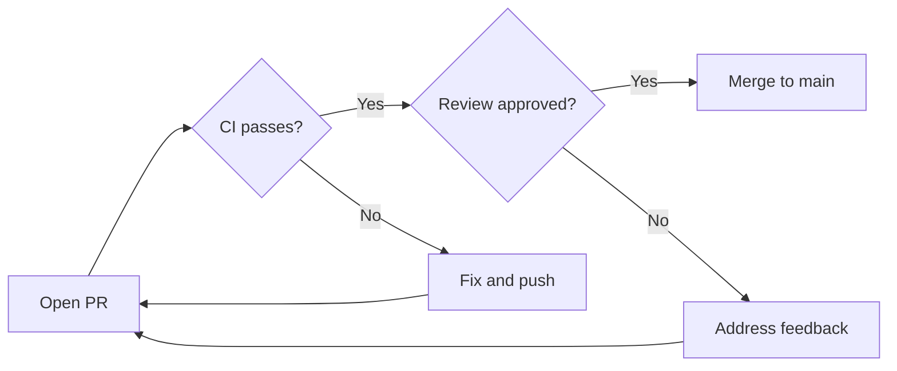
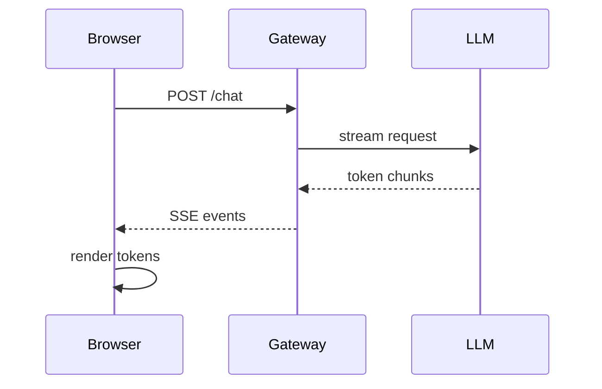
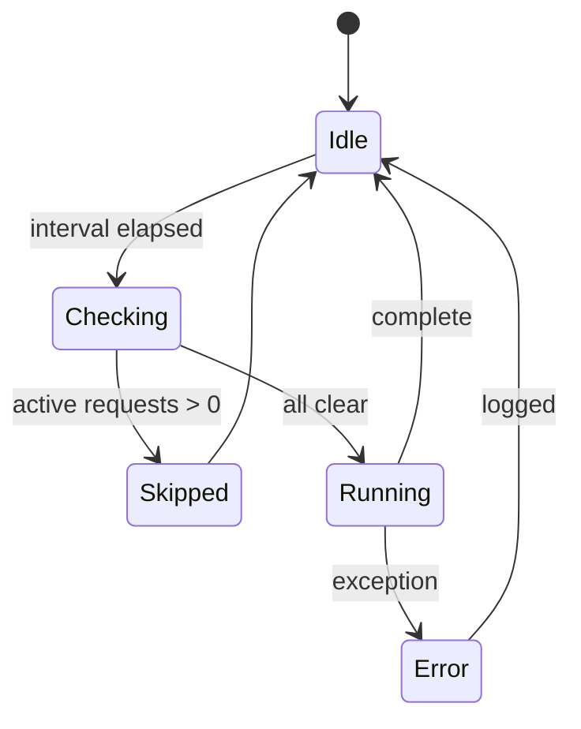
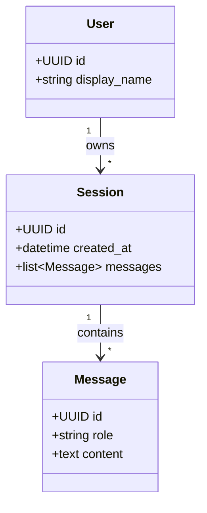
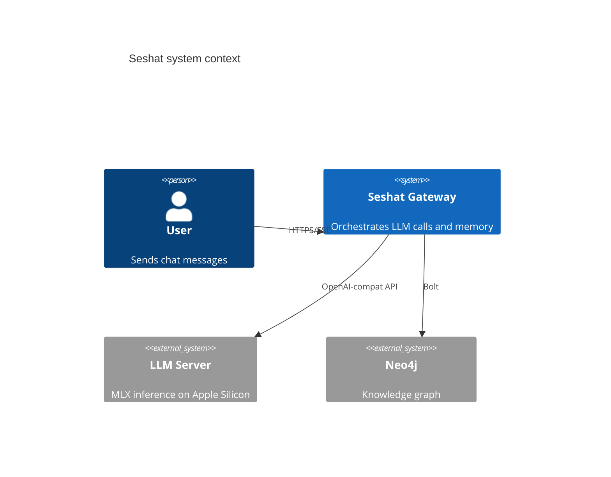
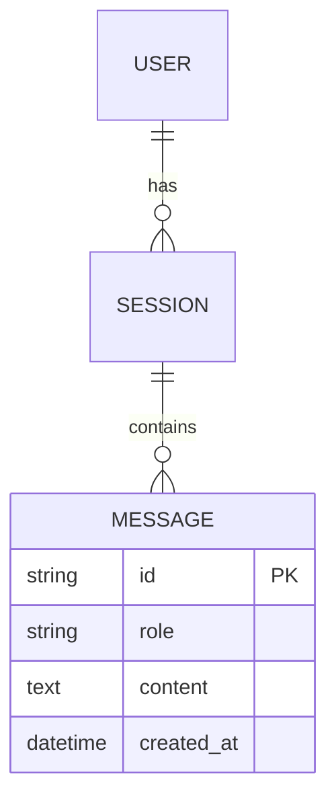

# Prompt Corpus — Seshat Personal Agent

> Source revision: `7a5ff3f9` · Committed: 2026-10-11T07:06:05+02:00  
> ADR: ADR-0078 · Spec: `docs/specs/PROMPT_MANAGEMENT_SPEC.md`  
>
> **Cache tier key**  
> 🟢 STATIC — never varies at runtime  
> 🟡 SEMI_STATIC — varies at session boundary  
> 🔴 DYNAMIC — varies per turn (end of cacheable prefix)


---

## Summary

### Leaf Prompts

| component_id | cache tier | tokens | source |
|---|---|---|---|
| `entity_extraction_system` | 🟢 STATIC | 113 | `src/personal_agent/second_brain/entity_extraction.py:60` |
| `entity_extraction_template` | 🟡 SEMI_STATIC | 4,011 | `src/personal_agent/second_brain/entity_extraction.py:69` |
| `context_compressor_system` | 🟢 STATIC | 1,076 | `src/personal_agent/orchestrator/context_compressor.py:118` |
| `router_system_prompt` | 🟢 STATIC | 124 | `src/personal_agent/orchestrator/prompts.py:24` |
| `tool_rules` | 🟢 STATIC | 476 | `src/personal_agent/orchestrator/prompts.py:137` |
| `tool_use_native_prompt` | 🟢 STATIC | 71 | `src/personal_agent/orchestrator/prompts.py:152` |
| `tool_use_injected_prompt` | 🟢 STATIC | 202 | `src/personal_agent/orchestrator/prompts.py:162` |
| `tool_awareness_prompt` | 🟡 SEMI_STATIC | runtime | `src/personal_agent/orchestrator/prompts.py:200` |
| `operator_stanza` | 🟡 SEMI_STATIC | runtime | `src/personal_agent/orchestrator/prompts.py:367` |
| `reflection_dspy_signature` | 🟢 STATIC | 818 | `src/personal_agent/captains_log/reflection_dspy.py:79` |
| `reflection_manual_fallback` | 🟢 STATIC | 558 | `src/personal_agent/captains_log/reflection.py:172` |
| `html_generation_system` | 🟢 STATIC | 1,468 | `src/personal_agent/tools/artifact_tools.py:1154` |

### Skill Documents

Total skill docs: 11 · Total tokens (all skills): 29,425  
*(No body is injected: the model loads one with `read_skill`; ADR-0156 D2)*

| skill | tokens | source |
|---|---|---|
| SKILL: Artifact Design | 5,558 | `docs/skills/artifact-design/SKILL.md` |
| infrastructure-health — Probe all infrastructure services for reachability | 951 | `docs/skills/infrastructure-health/SKILL.md` |
| SKILL: Mermaid Diagrams | 2,985 | `docs/skills/mermaid-diagrams/SKILL.md` |
| neo4j-direct — Run Cypher queries against the live knowledge graph | 1,133 | `docs/skills/neo4j-direct/SKILL.md` |
| query-elasticsearch — Query ES indices, inspect schema, read self-telemetry | 6,175 | `docs/skills/query-elasticsearch/SKILL.md` |
| query-tempo — Query Tempo traces, read span hierarchies, and investigate latency | 4,167 | `docs/skills/query-tempo/SKILL.md` |
| self-telemetry — Agent self-introspection via ES + Captain's Log | 3,403 | `docs/skills/self-telemetry/SKILL.md` |
| sequential-thinking — Structured Reasoning Discipline | 1,289 | `docs/skills/sequential-thinking/SKILL.md` |
| system-diagnostics — Run system diagnostic commands (ps, ss, vmstat, lsof, …) | 603 | `docs/skills/system-diagnostics/SKILL.md` |
| system-metrics — CPU, memory, and disk utilisation snapshot | 1,180 | `docs/skills/system-metrics/SKILL.md` |
| SKILL: turn-forensics | 1,981 | `docs/skills/turn-forensics/SKILL.md` |

---

## Orchestrator Composition Skeleton

**Callsite:** `orchestrator.primary`  
**Source:** `src/personal_agent/orchestrator/executor.py:1835–2244`  
**Note:** This prompt is assembled imperatively — it is not a string constant. The skeleton below shows the ordered components and their cache tiers. Components must be in STATIC/SEMI_STATIC order before DYNAMIC for KV-cache prefix stability (ADR-0038).  

```
[🟡 SEMI_STATIC ] deployment_context           executor.py:1840–1850
[🟡 SEMI_STATIC ] operator_stanza              executor.py:1852–1858
[🟡 SEMI_STATIC ] skill_index                  executor.py:1860–1993
[🔴 DYNAMIC     ] memory_section               executor.py:2126–2149
[🟡 SEMI_STATIC ] tool_awareness               executor.py:2151–2171  ⚠ OUT OF ORDER
[🟢 STATIC      ] tool_use_rules               executor.py:2171–2194
[🟢 STATIC      ] decomposition_instructions   executor.py:2176–2194
```

### Component descriptions

**`deployment_context`** (🟡 SEMI_STATIC)  
VPS/cloud deployment environment variables injected into the system prompt.

**`operator_stanza`** (🟡 SEMI_STATIC)  
Authenticated user identity + precedence rule (see operator_stanza leaf prompt).

**`skill_index`** (🟡 SEMI_STATIC)  
The skill catalog: one line per skill (name and description) from docs/skills/<name>/SKILL.md. Populated by orchestrator/skills.py (ADR-0156 D2).

**`memory_section`** (🔴 DYNAMIC)  
Recalled memory nodes for this turn. Varies per turn. ⚠ DYNAMIC — marks the end of the cacheable prefix.

**`tool_awareness`** (🟡 SEMI_STATIC)  
Tool list + capabilities (see tool_awareness_prompt leaf prompt). ⚠ PREPENDED late at line 2171 — inserted after memory_section, violating the stable-prefix ordering invariant.

**`tool_use_rules`** (🟢 STATIC)  
_TOOL_RULES + TOOL_USE_PROMPT_INJECTED (see leaf prompts).

**`decomposition_instructions`** (🟢 STATIC)  
Task decomposition guidance for SINGLE/HYBRID/DECOMPOSE/DELEGATE paths.

> ⚠ **Cache-erosion risk**: `tool_awareness` (SEMI_STATIC) is prepended at line 2171, **after** `memory_section` (DYNAMIC). This means the DYNAMIC content precedes a SEMI_STATIC block, breaking the stable-prefix invariant that ADR-0038 assumed. See P2 (FRE-406) for the cache-erosion measurement dashboard.

---

## Leaf Prompts

### `entity_extraction_system`

| | |
|---|---|
| **Cache tier** | 🟢 STATIC — never varies at runtime |
| **Token count** | 113 |
| **Source** | `src/personal_agent/second_brain/entity_extraction.py:60` |

```
You are a knowledge graph extraction expert building a personal memory system.
Reason carefully about (a) which entities and relationships have lasting knowledge value,
(b) the OUTPUT KIND of each entity (knowledge / ephemeral / finding) and, for knowledge
items, the KNOWLEDGE CLASS (World / Personal), and (c) the user's explicit STANCES and
personal situational CLAIMS — which you must emit as structured items, never flatten into
an entity's description.
Your final output must be valid JSON only — no markdown fences, no explanation text.
```

---

### `entity_extraction_template`

| | |
|---|---|
| **Cache tier** | 🟡 SEMI_STATIC — varies at session boundary |
| **Token count** | 4,011 |
| **Source** | `src/personal_agent/second_brain/entity_extraction.py:69` |

```
Analyze this conversation and extract knowledge graph elements.

ENTITY TYPES — use EXACTLY one of these values, no others (ADR-0109 V2, 10-type):
  Person              — a real, named individual human. Not "User"/"Assistant", generic
                        roles, teams, orgs.
  Organization        — a named company, institution, agency, department, team, or
                        standards body. Not software products or locations.
  Location            — a named geographic or physical place. Not organizations named
                        after places, namespaces, repos.
  TechnicalArtifact   — a concrete, named engineered/built thing you install, run, call,
                        deploy, configure, process, or physically use — software or
                        hardware, and the data assets a system runs on (datasets,
                        benchmarks, gold files, prompts). Not a human-authored work you
                        read to understand (-> KnowledgeArtifact); not an abstract
                        method/idea (-> MethodOrConcept).
                        e.g. Python, Neo4j, FastAPI, a GPU, an oscilloscope.
  KnowledgeArtifact   — a concrete, named human-authored work whose purpose is to convey
                        understanding to a reader — a document, ADR, report, paper,
                        article, chapter, specification, or plan. Not a thing you
                        run/deploy/process (-> TechnicalArtifact); not the facts
                        extracted from it into the KG; not a broad field
                        (-> DomainOrTopic). e.g. an ADR, a research paper, a drafted
                        book chapter, an incident post-mortem report.
  MethodOrConcept     — a specific human-invented abstract idea, method, technique,
                        algorithm, data structure, pattern, or principle. Not a built
                        artifact; not a broad field; not a natural phenomenon.
                        e.g. GraphRAG, trie, Nash equilibrium, retrieval-augmented
                        generation.
  DomainOrTopic       — a broad field, domain, discipline, or subject area as a whole.
                        Not a specific technique within it (-> MethodOrConcept).
                        e.g. behavioral economics, cosmology, cybersecurity, game theory.
  Phenomenon          — a naturally-occurring physical/natural phenomenon, process,
                        effect, force, limit, or observable that exists independently of
                        human design. Not a human-invented method (-> MethodOrConcept);
                        not the quantity used to measure it (-> QuantityMeasure).
                        e.g. cosmic microwave background, gravity, photosynthesis, the
                        greenhouse effect, the diffraction limit.
  QuantityMeasure     — a named physical quantity, property, dimension, or unit of
                        measure — an axis along which things are measured. Not the
                        naturally-occurring phenomenon/effect/limit that exhibits it
                        (-> Phenomenon); not a human-invented method to compute it
                        (-> MethodOrConcept); not a specific measured value.
                        e.g. wavelength, mass, temperature, frequency, luminosity.
  Event               — a specific named occurrence, milestone, incident, release, or
                        time-bound activity. e.g. the Big Bang, ICLR 2024, a production
                        outage.

RELATIONSHIP TYPES — use EXACTLY one of these UPPER_SNAKE_CASE values, no others:
  PART_OF       — entity is a component or subset of another
  USES          — entity uses or depends on another
  RELATED_TO    — general semantic relationship
  SIMILAR_TO    — entities are comparable or equivalent
  CREATED_BY    — entity was created or authored by another
  LOCATED_IN    — entity is geographically within another

OUTPUT KIND — every entity MUST carry an "output_kind", EXACTLY one of these three
  (ADR-0115 — the routing axis, orthogonal to "class" below):
  knowledge  — durable user/world knowledge that belongs in the user's memory. This is the
               default for real subject-matter content, whether about the world or the user.
  finding    — the agent's OWN machinery discussed as a subject: infrastructure, tooling,
               telemetry, operations. Examples: a database discussed as infra ("Postgres is
               healthy"), healthchecks, log/telemetry review (sensor_poll,
               cost_gate_reaper_swept, DEBUG counts), harness internals (executor.py,
               ToolLoopGate, the consolidation job), connectivity pings. Judge by the SUBJECT
               of the turn, not the word alone: "our graph store is up" → Postgres is
               finding; "graph databases store nodes and edges" → Postgres is knowledge.
  ephemeral  — a single item that is transient noise with no lasting value even as a system
               observation. (A whole turn with no real content at all is handled by rule 8
               below — return empty entities/relationships arrays for those; use this value
               only for one item that is noise within an otherwise substantive turn.)

KNOWLEDGE CLASS — for "knowledge" items ONLY, every such entity MUST also carry a "class",
  EXACTLY one of these two (omit or ignore for finding/ephemeral items):
  World     — reusable, impersonal know-how: facts, concepts, products, techniques, and
              named people/orgs/places discussed as general knowledge. This is the default
              for real subject-matter content.
  Personal  — a named thing belonging to the USER'S OWN life: their doctor, employer, city of
              residence, their own project. (A first-person SITUATIONAL FACT such as
              "my lease ends in March" is NOT an entity — put it under "claims", below.)
  (There is NO "Stance" or "System" entity class. A stance is a RELATION — emit it under
  "stances", below. System-ness is expressed via output_kind=finding/ephemeral, above, never
  as a class value.)

STANCES — the user's explicit first-person affect toward, or mastery of, a World concept
  ("I love X", "I prefer X over Y", "I'm learning X", "I've basically mastered X").
  A stance is NOT an entity and must NEVER be written into an entity's description.
  Each stance object:
    subject — always the literal string "owner"
    target  — the World concept it is about (this concept should ALSO appear in "entities")
    affect  — a SHORT phrase for the sentiment/preference ("loves it", "prefers over CR-V",
              "wants to learn"); use "" if the stance is purely a mastery/skill level
    mastery — a number 0.0-1.0 if a skill/learning level is stated or clearly implied,
              otherwise null (a pure preference like "I love it" has mastery = null)
    description — one sentence of context

CLAIMS — first-person SITUATIONAL FACTS about the user's own life/relationships/events that
  are assertions, not named entities ("my lease ends in March", "I saw the cardiologist
  today", "I'm actively shopping for a car"). These have no entity slot and are silently
  DROPPED today — you MUST emit them here instead.
  Each claim object:
    subject — always the literal string "owner"
    content — the fact as ONE self-contained declarative sentence
    facet   — a SHORT stable slot key naming WHAT the fact is about, as lower_snake_case
              (e.g. "lease_end_date", "employer", "current_city", "car_shopping_status").
              Two claims about the SAME underlying thing must share the SAME facet so a
              later value replaces the earlier one. Use "" if you cannot name a clear slot.
    update_kind — one of "new" | "correction" | "evolution":
              "correction" when the user is FIXING an earlier mistake ("actually…", "I was
              wrong", "not X, it's Y"); "evolution" when the fact CHANGED ("now…", "as of…",
              "we moved to…", "extended to…"); "new" otherwise (the default).
    description — optional one sentence of context

Do NOT put any provenance, timestamp, id, or record-date on stances or claims — the system
adds those, not you.

EXTRACTION RULES (follow strictly):
1. NEVER extract the protocol role labels "User" / "Assistant" / "System" / "Reasoning" as Person
   entities — these are chat-template role slots, not people.
   This does NOT preclude extracting the human operator (the person who speaks through the User
   slot) when they are named. If a turn contains "my name is Alex" or similar self-reference,
   extract Alex as a normal Person entity.
2. NEVER extract generic message artifacts: "Test message", "Another message", "Original message",
   "Quick test", "Test query", or any placeholder/test text
3. NEVER extract internal tool binding names that start with "mcp_" (e.g. mcp_perplexity_ask,
   mcp_docker, mcp_search, mcp_fetch_content) — extract the underlying service instead
   (e.g. "Perplexity" not "mcp_perplexity_ask", "Docker" not "mcp_docker")
   NEVER extract the native tool name "search_memory" as an entity — it is an internal
   capability, not user-discussed content (ADR-0026).
4. NEVER extract ephemeral data values as entities: temperatures ("7°C", "53°F"), dates used
   only as context ("March 6, 2026"), sky conditions ("Partly sunny"), generic time references
5. ONLY extract entities with knowledge recall value: would knowing this be useful in a future conversation?
6. Normalize entity names to canonical form with consistent diacritics and casing:
   - "Python" not "python", "Neo4j" not "neo4j", "LM Studio" not "lm studio"
   - "Météo France" not "Meteo France" or "Météo-France" (use the official accented form, no hyphen)
   - "Forcalquier" not "Forcqlquier" (correct spelling, not typos)
7. Deduplicate: if two names clearly refer to the same entity, use one canonical name only
8. If the exchange is an empty/placeholder/test artifact with no real content (e.g. "test
   message", a bare ping with no substance), return empty entities and relationships arrays.
   BUT a real operational turn the user actually engaged in — a healthcheck they ran, a
   telemetry/log review, a harness explainer — is NOT empty: emit its subjects as entities
   with output_kind=finding (see rule 11), do not drop them.
9. Write summaries as one concrete sentence about what was accomplished or learned
10. Describe the ENTITY, never the conversation. A description must be a standalone statement
    of what the thing IS — true whether or not this exchange ever happened, and useful to someone
    who never saw it. Write "A French baked dessert of cherries in a custard-like batter", not
    "A French dessert discussed as a cherry dish". Never write that something "was discussed",
    "was mentioned", "was reportedly" anything, and NEVER refer to the retrieval situation you
    are running in (e.g. "in the memory search context") — that is machinery leaking into the
    user's knowledge. If the exchange gave you no durable fact about the entity beyond its name,
    write a short definition from what the name denotes; do not describe the occasion instead.
11. Assign every entity an "output_kind" (knowledge | finding | ephemeral) and, for knowledge
    items, a "class" (World | Personal) per the definitions above. When the turn's SUBJECT is
    the agent's own infra/tooling/telemetry/healthcheck, the entity is output_kind=finding
    even if it names a general technology.
12. NEVER flatten a user stance into an entity description (no "a car the user loves",
    "central to the user's preference"). Emit it as a structured object in "stances".
13. NEVER drop a first-person situational fact. If it is an assertion about the user's life
    rather than a named entity, emit it in "claims".
14. Set each entity's "description_update_kind" from THIS TURN's intent (you are NOT comparing to
    any stored description — you cannot see one; judge only the conversation in front of you):
      "correction" — the turn EXPLICITLY corrects/contradicts an earlier statement about this
                     entity ("actually X is Y, not Z"; "I was wrong, it's …").
      "enrichment" — the turn SUBSTANTIVELY defines or explains the entity (a real definition or
                     characterization), not just a passing mention.
      "new"        — the default: a passing mention with no correction or defining intent.
    Emit "new" whenever unsure. This signal is about the entity's DESCRIPTION only — never a
    stance or a claim.

GOOD EXAMPLES:
  ✓ {{"name": "Paris", "type": "Location", "output_kind": "knowledge", "class": "World", "description": "Capital of France, subject of weather inquiry"}}
  ✓ {{"name": "Qwen3.5", "type": "TechnicalArtifact", "output_kind": "knowledge", "class": "World", "description": "Local reasoning LLM used for entity extraction"}}
  ✓ {{"name": "Postgres", "type": "TechnicalArtifact", "output_kind": "finding", "description": "The agent's own database, referenced in a healthcheck"}}  ← System-natured: finding, not a class value
  ✓ {{"name": "GraphRAG", "type": "MethodOrConcept", "output_kind": "knowledge", "class": "World", "description": "Technique combining knowledge graphs with RAG retrieval"}}
  ✓ {{"name": "Neo4j", "type": "TechnicalArtifact", "output_kind": "knowledge", "class": "World", "description": "A graph database management system storing data as nodes and typed relationships", "description_update_kind": "enrichment"}}  ← the turn substantively defines it
  ✓ stance: {{"subject": "owner", "target": "Toyota RAV4 Hybrid", "affect": "loves the hybrid powertrain", "mastery": null, "description": "User strongly prefers the RAV4 Hybrid's drivetrain"}}
  ✓ claim:  {{"subject": "owner", "content": "The user's current car lease ends in March.", "description": "Situational constraint driving purchase timing"}}

BAD EXAMPLES (never produce these):
  ✗ {{"name": "User", "type": "Person", ...}}
  ✗ {{"name": "Assistant", "type": "Person", ...}}
  ✗ {{"name": "mcp_perplexity_ask", "type": "TechnicalArtifact", ...}}  ← use "Perplexity" instead
  ✗ {{"name": "mcp_docker", "type": "TechnicalArtifact", ...}}           ← use "Docker" instead
  ✗ {{"name": "search_memory", "type": "TechnicalArtifact", ...}}        ← internal tool, not an entity
  ✗ {{"name": "Postgres", "type": "TechnicalArtifact", "class": "System", ...}}  ← System is not a class value; use output_kind=finding instead
  ✗ {{"name": "7°C", "type": "QuantityMeasure", ...}}                   ← ephemeral data value
  ✗ {{"name": "Météo-France", ...}}                               ← use "Météo France" (no hyphen)
  ✗ {{"name": "Test message", "type": "Message", ...}}
  ✗ {{"name": "DomainOrTopic", "type": "DomainOrTopic", ...}}
  ✗ {{"name": "Clafoutis", ..., "description": "A French baked dessert discussed as a cherry-filled dish in the memory search context"}}
        ← describes the occasion and leaks the machinery; write what a clafoutis IS
  ✗ {{"name": "Amlodipine", ..., "description": "A medication discussed as interacting with grapefruit"}}
        ← "discussed as" framing; write "A calcium channel blocker used to treat high blood pressure"
  ✗ {{"name": "Toyota RAV4 Hybrid", ..., "description": "a car the user loves"}}   ← stance flattened; emit a stance
  ✗ (silently omitting "my lease ends in March")                                   ← emit it as a claim
  ✗ {{"name": "my lease ends in March", "type": "Event", ...}}                     ← situational fact is a claim, not an entity
  ✗ {{"subject": "owner", "target": "...", "provenance": {{...}}}}                 ← never emit provenance; the system adds it

{fewshot_exemplars}Conversation:
User: {user_message}
Assistant: {assistant_response}

Return ONLY valid JSON (no markdown fences, no explanation):
{{
  "summary": "One concrete sentence about what was accomplished or discussed",
  "entities": [
    {{
      "name": "Canonical Entity Name",
      "type": "Person|Organization|Location|TechnicalArtifact|KnowledgeArtifact|MethodOrConcept|DomainOrTopic|Phenomenon|QuantityMeasure|Event",
      "output_kind": "knowledge|ephemeral|finding",
      "class": "World|Personal",
      "description": "One sentence with useful context beyond the name",
      "description_update_kind": "new|enrichment|correction",
      "properties": {{}}
    }}
  ],
  "relationships": [
    {{
      "source": "Entity Name 1",
      "target": "Entity Name 2",
      "type": "PART_OF|USES|RELATED_TO|SIMILAR_TO|CREATED_BY|LOCATED_IN",
      "weight": 0.1-1.0,
      "properties": {{}}
    }}
  ],
  "stances": [
    {{
      "subject": "owner",
      "target": "World Concept Name",
      "affect": "short phrase or empty string",
      "mastery": null,
      "description": "One sentence of context"
    }}
  ],
  "claims": [
    {{
      "subject": "owner",
      "content": "One self-contained declarative sentence about the user's situation",
      "facet": "lower_snake_case slot key, or empty string",
      "update_kind": "new|correction|evolution",
      "description": "Optional one sentence of context"
    }}
  ]
}}
```

---

### `context_compressor_system`

| | |
|---|---|
| **Cache tier** | 🟢 STATIC — never varies at runtime |
| **Token count** | 1,076 |
| **Source** | `src/personal_agent/orchestrator/context_compressor.py:118` |

```
You are a context compressor. Given a sequence of conversation messages that are being evicted from the context window, produce a concise structured summary that preserves the most important information for continuing the conversation.

Output format (use exactly these headings):
## Conversation Summary
- **Decisions:** Bullet list of decisions made (empty if none)
- **Entities:** Key names, tools, technologies, people mentioned
- **Facts:** Important facts established during the conversation
- **Open Items:** Unresolved questions or pending actions

Rules:
- Maximum 200 words total
- Only include information actually present in the messages
- Prefer specifics over generalities (names, versions, choices)
- Skip pleasantries and meta-conversation
- Each bullet should stand on its own — a downstream reader will not see the
  original messages
- Preserve identifiers (file paths, ticket IDs, function names, model IDs,
  hostnames, ports) verbatim — they are how the next turn re-grounds itself
- Tool outputs may be truncated upstream; if you encounter an "[Earlier messages truncated]" marker or an existing "## Conversation Summary"
  block, fold that prior summary into the new one rather than re-summarising
  raw text that no longer exists

Worked example 1 — coding session:
  Input (paraphrased):
    [user]: We're deciding between SQLite and Postgres for the metrics store.
    [assistant]: How many writes/sec do you expect, and is concurrent
                 read/write a hard requirement?
    [user]: ~50/sec peak, multiple concurrent readers, single writer.
    [assistant]: Postgres is the right call — SQLite WAL handles concurrent
                 readers fine but multiple-writer concurrency requires
                 server-grade locking, and you'll want pg_stat_statements
                 from day one.
    [tool: ran ALTER TABLE …]: ok
  Output:
    ## Conversation Summary
    - **Decisions:** Use Postgres (not SQLite) for the metrics store; enable
      pg_stat_statements from day one.
    - **Entities:** Postgres, SQLite, WAL, pg_stat_statements, metrics store.
    - **Facts:** Expected load ~50 writes/sec peak, multiple concurrent
      readers, single writer. ALTER TABLE applied successfully.
    - **Open Items:** None.

Worked example 2 — debugging session:
  Input (paraphrased):
    [user]: The /chat endpoint is returning 504 after 30s when the prompt
            exceeds ~10k tokens.
    [assistant]: That looks like the gateway timeout, not the LLM. Check
                 the proxy.
    [tool: curl /chat]: HTTP 504 after 30.1s
    [assistant]: Confirmed — Caddy's default upstream timeout is 30s.
                 Raise it on the /chat path.
  Output:
    ## Conversation Summary
    - **Decisions:** Raise Caddy upstream timeout on the /chat path; root
      cause is gateway, not LLM.
    - **Entities:** /chat endpoint, Caddy reverse proxy, 504 status.
    - **Facts:** 504 reproduces at ~30s when prompt exceeds ~10k tokens;
      Caddy default upstream_timeout=30s.
    - **Open Items:** Apply the timeout bump and re-test.

Worked example 3 — tool-heavy session with prior summary:
  Input (paraphrased):
    [system]: ## Conversation Summary
              - **Decisions:** Use Neo4j 5.26 LTS for the knowledge graph.
              - **Entities:** Neo4j 5.26 LTS, pgvector.
              - **Facts:** pgvector deferred to phase 2.
              - **Open Items:** Choose embedding dimension.
    [user]: Let's go with 768d embeddings — matches Qwen3-Embedding-0.6B.
    [tool: edit docker-compose.yml]: ok
    [assistant]: 768d set. Embedding service rebuilt.
  Output:
    ## Conversation Summary
    - **Decisions:** Use Neo4j 5.26 LTS for the knowledge graph; embedding
      dimension is 768 to match Qwen3-Embedding-0.6B.
    - **Entities:** Neo4j 5.26 LTS, pgvector, Qwen3-Embedding-0.6B,
      docker-compose.yml.
    - **Facts:** pgvector deferred to phase 2; embedding service rebuilt.
    - **Open Items:** None pending from this slice.

Anti-patterns to avoid:
- Do not invent details that are not in the messages — if a decision was
  discussed but not concluded, list it under Open Items, not Decisions.
- Do not summarise meta-conversation ("I will now check…", "let me think
  about this…") — only the substantive turn output matters.
- Do not collapse distinct entities into a generic term ("the database",
  "the model") — name them.
- Do not write narrative prose under the headings — every line is a bullet.
- Do not include this instruction text or any system metadata in the
  output. Output only the four-section summary.
```

---

### `router_system_prompt`

| | |
|---|---|
| **Cache tier** | 🟢 STATIC — never varies at runtime |
| **Token count** | 124 |
| **Source** | `src/personal_agent/orchestrator/prompts.py:24` |

```
You are a routing classifier.
Choose exactly one target model for the user request:
- STANDARD: general chat and tool-oriented requests.
- REASONING: proofs, derivations, rigorous formal analysis, research synthesis.
- CODING: code writing/debugging/refactoring, stack traces, diffs, CI failures.

Return ONLY JSON with this shape:
{"target_model":"STANDARD|REASONING|CODING","confidence":0.0,"reason":"short reason"}

Rules:
- Always delegate. Never answer the user directly.
- No markdown, no code fences, no commentary.
- If uncertain, choose STANDARD.

```

---

### `tool_rules`

| | |
|---|---|
| **Cache tier** | 🟢 STATIC — never varies at runtime |
| **Token count** | 476 |
| **Source** | `src/personal_agent/orchestrator/prompts.py:137` |

```
Rules:
- If no tool is needed to answer accurately, respond directly without calling any tool.
- Do not invent tools or parameters. If no tool fits, say so directly.
- Never describe the outcome of a system action (database write, file edit, API call, graph upsert) unless an actual tool call in this turn performed it and returned a result. If you have no tool for a requested action, say so plainly — do not narrate success, invent counts, or fabricate payloads you did not produce.
- Provide ALL required parameters as specified by each tool's schema.
- PARALLEL CALLS: When a task needs multiple independent tool calls (e.g. checking errors AND checking memory AND checking infra health), issue ALL of them in a SINGLE response as multiple tool_calls entries. Never call them one at a time when they are independent — batching saves iterations.
- Step budget: Complete most requests in ≤ 6 tool calls. Prefer synthesizing with gathered data over additional lookups. If you have enough information to answer, synthesize immediately.
- After tool results are returned, synthesize a final natural-language answer. Do NOT request the same tool again unless the path/args must change.
- Search is not gated on whether the topic "sounds recent". Call web_search for quick lookups (free, private, multi-engine) whenever you need to make a factual claim and memory, tool results, or the user's own words so far don't already give you a source for it — current events and CVEs need this exactly as much as any other unsourced claim does, and no more. Pass categories='it' for technical queries, 'science' for research, 'news' for current events, 'weather' for forecasts.
- web_search results are directly citable. If snippets are insufficient, use fetch_url to read the full page — its fetched page content is an admissible citation source; the URL you pass is not, and a `bash`/curl fetch of the same page is not admissible at all.
- perplexity_query's synthesized output cannot be cited under the grounding contract — reach for it only for background research you will re-verify from a citable source before asserting anything from it, never as the source itself.
- Do NOT answer from your own knowledge when live information is needed; always search first.
```

---

### `tool_use_native_prompt`

| | |
|---|---|
| **Cache tier** | 🟢 STATIC — never varies at runtime |
| **Token count** | 71 |
| **Source** | `src/personal_agent/orchestrator/prompts.py:152` |

```
[f-string template]
You are a tool-using assistant.

When tools are provided, you may call them to gather facts. Use ONLY the provided tool names and EXACT parameter names.

If you need to call a tool, use native function calling (the tool_calls mechanism). Do NOT embed tool calls as text in your response.

{_TOOL_RULES}

```

---

### `tool_use_injected_prompt`

| | |
|---|---|
| **Cache tier** | 🟢 STATIC — never varies at runtime |
| **Token count** | 202 |
| **Source** | `src/personal_agent/orchestrator/prompts.py:162` |

```
[f-string template]
You are a tool-using assistant.

You have access to tools listed below. To call a tool, emit exactly this format (one per tool call):
[TOOL_REQUEST]{{"name":"tool_name","arguments":{{...}}}}[END_TOOL_REQUEST]

If you call a tool, do NOT answer the user yet — wait for the tool result first.

{_TOOL_RULES}

Examples:

User: "What's the latest version of FastAPI?"
[TOOL_REQUEST]{{"name": "web_search", "arguments": {{"query": "FastAPI latest version 2026", "categories": "it"}}}}[END_TOOL_REQUEST]

User: "Give me a comprehensive comparison of React vs Svelte with citations"
[TOOL_REQUEST]{{"name": "perplexity_query", "arguments": {{"query": "comprehensive comparison React vs Svelte 2026 with benchmarks", "mode": "research"}}}}[END_TOOL_REQUEST]

```

---

### `tool_awareness_prompt`

| | |
|---|---|
| **Cache tier** | 🟡 SEMI_STATIC — varies at session boundary |
| **Token count** | runtime (see description) |
| **Source** | `src/personal_agent/orchestrator/prompts.py:200` |

_Dynamically generated listing of available tools grouped by category. Cached for 60 s. Includes tool counts per category and key capability declarations (web search, file access, etc.). Content varies with the active tool registry — changes when tools are added or governance config is reloaded. Cannot be extracted statically; see function source._

---

### `operator_stanza`

| | |
|---|---|
| **Cache tier** | 🟡 SEMI_STATIC — varies at session boundary |
| **Token count** | runtime (see description) |
| **Source** | `src/personal_agent/orchestrator/prompts.py:367` |

_Async function. Renders the operator stanza: the authenticated user's name and the FRE-1150 identity-precedence rule. No Neo4j content — the :Person profile fields (location, pronouns, role, languages) ride the memory_recall tool result instead (FRE-1566, ADR-0140 T2). Content varies per connected user. Cannot be extracted statically._

---

### `reflection_dspy_signature`

| | |
|---|---|
| **Cache tier** | 🟢 STATIC — never varies at runtime |
| **Token count** | 818 (docstring + field descriptors) |
| **Source** | `src/personal_agent/captains_log/reflection_dspy.py:79` |

```
[Class docstring]
Generate structured reflection on task execution to propose improvements.

Analyzes task execution telemetry to identify patterns, issues, and opportunities
for optimization. Proposes concrete, actionable improvements based on evidence.

Focus areas:
- Performance patterns (slow operations, repeated calls)
- Error patterns (failures, retries)
- Tool usage patterns (effectiveness, unnecessary calls)
- Mode/governance interactions
- Optimization opportunities (caching, parallelization)

[user_message] The user's original message

[steps_count] Number of orchestrator steps executed

[final_state] Final task state (e.g., COMPLETED, FAILED)

[reply_length] Length of agent's reply in characters

[telemetry_summary] Summarized telemetry events showing LLM calls, tool executions, errors

[metrics_summary] Pre-formatted system metrics from RequestMonitor (e.g., 'cpu: 9.3%, duration: 5.4s')

[failure_excerpt] JSON-serialized FailureExcerpt with failed tool calls, error summary, and recovery actions. Empty string when had_errors is False.

[had_errors] True when the trace contained at least one tool call failure or error event.

[prompt_manifest] Snapshot of THIS turn's prompt composition: the ordered active component IDs, the cacheable static prefix hash, and a recent quality signal for the callsite (mean 0-3 rating over the trailing 7 days). Use it to notice composition problems and, when warranted, propose a prompt-composition change that names the specific component_id. Patterns to watch for: (1) A component that is always present yet never load-bearing — e.g. skill_index present but no skill content matched — propose trimming it. (2) A static prefix hash that changed recently — indicates cacheable prefix instability that erodes KV-cache reuse — propose stabilising it. (3) A declining or low mean rating for this callsite — suggest revisiting the prompt components driving those turns. When proposing a prompt change, name the component_id in proposed_change_what and set proposed_change_scope to 'llm_client' or 'orchestrator'. Empty string when no manifest is available — skip composition analysis.

[rationale] Analysis of what happened and key observations about the execution

[proposed_change_what] What to change (empty string if no change proposed)

[proposed_change_why] Why this change would help (empty string if no change proposed)

[proposed_change_how] How to implement this change (empty string if no change proposed)

[proposed_change_category] Category of proposed change. One of: performance, reliability, concurrency, knowledge, cost, ux, observability, architecture, safety. Empty string if no change proposed.

[proposed_change_scope] Target subsystem of proposed change. One of: llm_client, orchestrator, second_brain, captains_log, brainstem, tools, telemetry, governance, insights, config, cross_cutting. Empty string if no change proposed.

[impact_assessment] Expected benefits if change is implemented (empty string if none)

[failure_path_fix_what] Surgical fix (≤ 80 chars) that would have prevented this exact failure. Example: 'Add retry-with-scope-reduction note to query_elasticsearch tool description.' Return empty string if had_errors is False or no specific fix is identifiable.

[failure_path_fix_location] File path + symbol of the text to edit, if known. Example: 'src/personal_agent/tools/fetch_url.py::DESCRIPTION' or 'docs/skills/query-tempo/SKILL.md'. Empty string if had_errors is False or unknown.

[missing_skill_names] Skills you needed but didn't have. Format: {domain}-{noun}. Nouns: fetcher, runner, sender, writer, monitor, checker, scanner, analyzer, summarizer, generator, creator, tracker, detector, validator, notifier. Same gap = same name every time. Max 3, comma-separated. Empty string if nothing was missing.
```

---

### `reflection_manual_fallback`

| | |
|---|---|
| **Cache tier** | 🟢 STATIC — never varies at runtime |
| **Token count** | 558 |
| **Source** | `src/personal_agent/captains_log/reflection.py:172` |

```
You are a personal AI agent analyzing your own task execution to generate insights and improvement proposals.

## Task Context
- **User Message**: {user_message}
- **Trace ID**: {trace_id}
- **Steps Completed**: {steps_count}
- **Final State**: {final_state}
- **Reply Length**: {reply_length} characters

## Telemetry Events
{telemetry_summary}

## Prompt Composition (this turn)
{prompt_manifest}

## Your Task
Analyze this task execution and generate a structured reflection entry with:

1. **Rationale**: What happened? Key observations about the execution.
2. **Supporting Metrics**: Specific metrics that stand out (e.g., "llm_call_duration: 2.3s", "tool_executions: 3")
3. **Proposed Change** (if any): Concrete, actionable improvement suggestion based on evidence
   - What to change
   - Why it would help
   - How to implement it
4. **Impact Assessment**: Expected benefits if the change is implemented

Focus on:
- Performance patterns (slow operations, repeated calls)
- Error patterns (failures, retries)
- Tool usage patterns (which tools, success rates, unnecessary calls, permission issues)
- Tool effectiveness (did tool calls provide value or could LLM handle directly?)
- Mode/governance interactions
- Opportunities for optimization (caching, parallelization, reduced tool calls)
- Prompt composition patterns (unused components, unstable static prefix hash, low/declining
  callsite ratings); when proposing a prompt change, name the specific component_id from the
  taxonomy and set scope to llm_client or orchestrator

If this was a simple, successful task with no issues, keep the reflection lightweight.
If there were errors, inefficiencies, or interesting patterns, provide deeper analysis.

Respond with ONLY valid JSON in this exact format:
{{
  "rationale": "string",
  "proposed_change": {{
    "what": "string",
    "why": "string",
    "how": "string",
    "category": "performance|reliability|concurrency|knowledge|cost|ux|observability|architecture|safety",
    "scope": "llm_client|orchestrator|second_brain|captains_log|brainstem|tools|telemetry|governance|insights|config|cross_cutting"
  }} | null,
  "supporting_metrics": ["metric1: value1", "metric2: value2"],
  "impact_assessment": "string" | null,
  "related_adrs": [],
  "related_experiments": []
}}

Do not include markdown formatting, explanations, or any text outside the JSON object.
```

---

### `html_generation_system`

| | |
|---|---|
| **Cache tier** | 🟢 STATIC — never varies at runtime |
| **Token count** | 1,468 |
| **Source** | `src/personal_agent/tools/artifact_tools.py:1154` |

```
You are an HTML document generator. You receive a structured plan and produce a complete, standalone HTML document.

REQUIREMENTS:
- Output ONLY the HTML document. No explanation, no markdown fences, no preamble.
- Start with <!DOCTYPE html> and end with </html>.
- Define a complete design system in a <style> block in <head>:
  * CSS custom properties for colors: --color-primary, --color-secondary, --color-accent, --color-bg, --color-surface, --color-text, --color-muted.
  * Spacing scale: --spacing-1 through --spacing-8 (0.25rem increments).
  * Typography: --font-sans, --font-mono; size classes from text-xs to text-3xl.
  * Utility classes: flex, grid, gap-1 through gap-6, p-1 through p-8, m-1 through m-8, text-center, text-left, text-right, font-bold, font-medium, rounded, rounded-lg, shadow, shadow-lg, hidden, w-full.
- INTERACTIVITY: JavaScript is available. The document runs in a sandboxed, sealed page — inline <script> blocks and event handlers run normally, so use them freely for genuine interactivity: simulations, explorable diagrams, charts, animations, calculators, tabs, filters. Prefer plain CSS (:hover, :target, <details>/<summary>, transitions) when it does the job with less code; reach for JavaScript when the experience genuinely needs it.
- CURATED TOOLKIT: a small, vetted /lib/ shelf is hosted on the artifact origin — it is the ONLY external origin this page may load. Reference each asset by its EXACT absolute, version-pinned URL below (a relative path will not load). Reach for one only when the document genuinely needs it; otherwise inline your own code.
  * Math (KaTeX) — render TeX/LaTeX:
    <link rel="stylesheet" href="https://artifacts.example.com/lib/katex@0.16.47/katex.min.css">
    <script src="https://artifacts.example.com/lib/katex@0.16.47/katex.min.js"></script>
  * Data viz (Chart.js — global `Chart`) — charts/graphs from inline data:
    <script src="https://artifacts.example.com/lib/chartjs@4.4.7/chart.umd.js"></script>
  * 3-D (three.js — global `THREE`, r171) — scenes/geometry; build meshes in code and embed any textures as data: URIs, never fetch them:
    <script src="https://artifacts.example.com/lib/three@0.171.0/three.iife.min.js"></script>
  * Code (highlight.js) — syntax-highlight code blocks:
    <link rel="stylesheet" href="https://artifacts.example.com/lib/highlightjs@11.9.0/github-dark.min.css">
    <script src="https://artifacts.example.com/lib/highlightjs@11.9.0/highlight.min.js"></script>
  * Prose typography (OFL variable fonts) — declare with @font-face, then use the family in your design system:
    @font-face { font-family: "Source Serif 4"; src: url("https://artifacts.example.com/lib/fonts/source-serif-4@4.005/source-serif-4.woff2") format("woff2"); }
    @font-face { font-family: "Playfair Display"; src: url("https://artifacts.example.com/lib/fonts/playfair-display@2.103/playfair-display.woff2") format("woff2"); }
    @font-face { font-family: "JetBrains Mono"; src: url("https://artifacts.example.com/lib/fonts/jetbrains-mono@2.304/jetbrains-mono.woff2") format("woff2"); }
    Use Source Serif 4 for body prose, Playfair Display for display headings, JetBrains Mono for code.
  * Book/print layout: prefer the NATIVE CSS recipes below (@page, column-count, break-*). A paged.js polyfill is also on the shelf but is EXPERIMENTAL and may be restricted under the live page policy — do not rely on it.
- NATIVE TYPOGRAPHY (no library) — reach for these before any font library for refined text:
  * Drop cap: p::first-letter { float: left; font-size: 3.2em; line-height: 0.8; padding-right: 0.08em; }
  * Justified prose: text-align: justify; hyphens: auto; (set lang on <html>).
  * Balanced headings: text-wrap: balance;
  * Ligatures / old-style figures: font-feature-settings: "liga", "onum", "kern";
  * Multi-column flow: column-count, column-gap, column-rule.
  * Print/book pages: @page { margin: ... } with break-inside: avoid; and widows/orphans control.
- SEALED-BOX CONSTRAINTS (hard, enforced by the runtime — design within them):
  * No network: fetch/XHR/WebSocket/beacon are blocked. Embed ALL of your own data inline; inline images and 3-D textures as data: URIs or inline SVG — never fetch them.
  * No storage: localStorage, sessionStorage, IndexedDB, and cookies are unavailable. Keep state in JS variables or the DOM.
  * No arbitrary CDN: only the curated /lib/ shelf above loads. Any other external script/style/font/image (Tailwind CDN, Alpine.js, jQuery, Google Fonts, unpkg, etc.) silently fails — inline it instead. Default to inline CSS and native JS wherever no shelf library is warranted.
  * No popups, no form submission to external endpoints.
- PORTABILITY (choose deliberately): for static diagrams that should travel with the file — flowcharts, architecture, sequence/class diagrams — use <pre class="mermaid">…</pre> markup with Mermaid syntax; the server renders these to static inline SVG, so the document stays self-contained and viewable anywhere. Example: <pre class="mermaid">graph LR; A[Start] --> B[End];</pre>. Use JavaScript instead when the experience is genuinely interactive — such an artifact is viewed on its hosted page.
- Use semantic HTML5 elements: header, main, section, article, footer, nav, aside, figure, figcaption.
- Responsive: use CSS media queries (@media) for mobile/tablet/desktop.
- Accessibility: heading hierarchy (h1 > h2 > h3), alt text on images, ARIA labels where helpful, sufficient color contrast.
- For data tables: <table> with <thead>/<tbody>, striped rows via nth-child, sticky header if many rows.
- For metrics/KPIs: card layout with large number and small label beneath.
- For comparison layouts: CSS grid with equal-width columns.
- Maximum document size: aim for under 200KB of HTML text.
```


---

## Skill Documents (`docs/skills/<name>/SKILL.md`)

The `skill_index` component holds the catalog only. A body reaches the model as the result of a `read_skill` call (ADR-0156 D2).  

### SKILL: Artifact Design

| | |
|---|---|
| **Cache tier** | 🔴 DYNAMIC — a read_skill result, only when the model loads it |
| **Token count** | 5,558 |
| **Source** | `docs/skills/artifact-design/SKILL.md` |

```markdown
# SKILL: Artifact Design

> **Use this skill to** author a complete, standalone HTML artifact that runs inside the
> sealed box: (a) decide when a curated `/lib/` library beats hand-rolling, (b) get each
> library's boot recipe and gotcha right, (c) apply publishing-grade **native** typography,
> (d) stay inside the sealed-box constraints, (e) choose the right **portability** lane, and
> (f) never leak secrets into a file that may leave the sandbox.

> **Tier:** runtime-guidance (not a CLI skill). **ADR:** `docs/architecture_decisions/ADR-0089-artifact-execution-security-model.md` (§D2/D3/D4 + Addendum A).
> **Relationship to the generation prompt:** this doc is the **maintainable source-of-truth**;
> the artifact generation system prompt (`_HTML_GENERATION_SYSTEM_PROMPT`,
> `src/personal_agent/tools/artifact_tools.py`) is **distilled from it**. The generation
> sub-agent is driven by that compressed prompt at runtime today — it does **not** load this
> file. Keep the two paired: when the manifest or a recipe changes, update this doc and
> re-distill the prompt. Versions/URLs are anchored to `config/artifact_lib_manifest.json`.
> **Not** an extension of the `frontend-design` harness skill (that guides the *developer*
> agent; this guides the *runtime artifact-generation* sub-agent — a different consumer).

---

## What This Skill Does

An artifact is a complete `<!DOCTYPE html>…</html>` document that renders in a **sealed box**:
an opaque-origin, CSP-locked, network-denied, storage-denied iframe (ADR-0089 D2/D3). Inside
that box JavaScript runs normally — inline `<script>` and event handlers work — so simulations,
explorable diagrams, charts, animations, calculators, tabs, and filters are all fair game.

The decisive split: **most dynamism needs no library.** Sliders, simulations, explorables,
animation, tabs/filters are all reachable with inline JS + Canvas / WebGL / SVG / CSS, which
ADR-0089 already unlocks. Reach for a curated `/lib/` library **only where the model genuinely
cannot hand-roll the capability well** — real math typesetting, charts, 3-D, syntax
highlighting, publishing-grade fonts, print pagination. Otherwise inline your own code: it is
cheaper, more portable, and fully under your control.

---

## When to Use

- **Reach for `/lib/`** when the capability is hand-roll-impossible at quality: TeX math
  (KaTeX), real charts (Chart.js), 3-D scenes (three.js), syntax highlighting (highlight.js),
  book-grade prose faces (OFL fonts), print pagination (paged.js — experimental).
- **Reach for native CSS/JS** for everything else — design system, layout, interactivity,
  typography refinements. This is the default.
- **Prefer Mermaid server-SVG** for static diagrams that should travel with the file (see
  Portability).

---

## The Curated `/lib/` Shelf

A small, vetted shelf is hosted on the artifact origin (`https://artifacts.example.com`) —
it is the **only** external origin a sealed artifact may load. Reference each asset by its
**exact absolute, version-pinned URL** below; a relative `/lib/…` path is *not* the expected
reach form and is not counted as a satisfied capability by the demand meter. URLs are immutable
pins (ADR-0089 A3) — never edit a version in place. Source of truth:
`config/artifact_lib_manifest.json`.

### KaTeX → math / formula typesetting (MIT)

```html
<link rel="stylesheet" href="https://artifacts.example.com/lib/katex@0.16.47/katex.min.css">
<script src="https://artifacts.example.com/lib/katex@0.16.47/katex.min.js"></script>
```

```html
<span id="eq"></span>
<script>
  katex.render("c = \\pm\\sqrt{a^2 + b^2}", document.getElementById("eq"),
    { throwOnError: false, displayMode: true });
</script>
```

**Gotchas:**
- The **CSS `<link>` is mandatory** — without it KaTeX renders boxes/tofu (the glyph metrics
  and math fonts live in the stylesheet). Loading only the JS is the most common KaTeX failure.
- KaTeX's stylesheet resolves its math fonts from a **co-hosted `fonts/` directory relative to
  the CSS** — do not rewrite or relocate the CSS `url(fonts/…)` references; the shelf hosts them
  at the path the CSS expects.
- Use `throwOnError: false` so a single bad expression degrades to a readable error instead of
  aborting render. `displayMode: true` for block equations, omit for inline.
- KaTeX is **not** auto-render: it does not scan the page for `$…$` delimiters by default.
  Call `katex.render(tex, element, opts)` per equation (the auto-render extension is not on the
  shelf — render explicitly).

### Chart.js → charts / data visualization (MIT, global `Chart`)

```html
<script src="https://artifacts.example.com/lib/chartjs@4.4.7/chart.umd.js"></script>
```

```html
<canvas id="spend" width="640" height="320"></canvas>
<script>
  new Chart(document.getElementById("spend"), {
    type: "bar",
    data: {
      labels: ["Q1", "Q2", "Q3", "Q4"],
      datasets: [{ label: "Spend", data: [12, 19, 8, 15] }]   // inline the data
    },
    options: { responsive: true, maintainAspectRatio: false }
  });
</script>
```

**Gotchas:**
- Give the `<canvas>` **explicit `width` and `height` attributes** (e.g.
  `<canvas width="640" height="320">`). Chart.js reads the element's attributes for initial
  layout; a CSS-sized parent alone is not enough and an unsized canvas collapses to 0×0 or
  renders blurry. If you want it fluid, wrap the canvas in a sized container **and** set
  `maintainAspectRatio: false`.
- **Inline the data** as a JS array/object literal. There is no `fetch` — never point Chart.js
  at a URL or load CSV/JSON over the network.
- The global is `Chart` (UMD build). One `new Chart(...)` per canvas.

### three.js → 3-D / spatial / physics (MIT, global `THREE`, r171)

```html
<script src="https://artifacts.example.com/lib/three@0.171.0/three.iife.min.js"></script>
```

```html
<div id="stage" style="width:100%;height:420px"></div>
<script>
  const el = document.getElementById("stage");
  const scene = new THREE.Scene();
  const camera = new THREE.PerspectiveCamera(60, el.clientWidth / el.clientHeight, 0.1, 100);
  camera.position.z = 4;
  const renderer = new THREE.WebGLRenderer({ antialias: true });
  renderer.setSize(el.clientWidth, el.clientHeight);
  el.appendChild(renderer.domElement);

  const mesh = new THREE.Mesh(
    new THREE.IcosahedronGeometry(1, 0),
    new THREE.MeshStandardMaterial({ color: 0x6366f1, flatShading: true })
  );
  scene.add(mesh);
  scene.add(new THREE.DirectionalLight(0xffffff, 1).translateZ(5));
  scene.add(new THREE.AmbientLight(0x404040));

  (function loop() {
    requestAnimationFrame(loop);
    mesh.rotation.x += 0.005; mesh.rotation.y += 0.008;
    renderer.render(scene, camera);
  })();
</script>
```

**Gotchas:**
- **Textures and models must be `data:` URIs or generated in code — never fetched.**
  `connect-src 'none'` blocks `TextureLoader`/`GLTFLoader` over the network. Build geometry
  procedurally, embed textures as base64 `data:` URIs, or draw to an offscreen `<canvas>` and
  use it as a `CanvasTexture`.
- The shelf hosts a **bundled IIFE/global build** exposing `THREE` on `window` — there is no
  ES-module import (the sealed null-origin can't resolve `import`/CORS). Use the global, not
  `import * as THREE`.
- Size the renderer to a container with an explicit height; on resize, update
  `camera.aspect` + `renderer.setSize`. Dispose geometries/materials/renderer if you tear a
  scene down to avoid GPU leaks in long-lived artifacts.

### highlight.js → code / syntax highlighting (BSD-3, global `hljs`)

```html
<link rel="stylesheet" href="https://artifacts.example.com/lib/highlightjs@11.9.0/github-dark.min.css">
<script src="https://artifacts.example.com/lib/highlightjs@11.9.0/highlight.min.js"></script>
```

```html
<pre><code class="language-python">def greet(name): return f"hi {name}"</code></pre>
<script>
  document.addEventListener("DOMContentLoaded", () => hljs.highlightAll());
</script>
```

**Gotchas:**
- Put code inside `<pre><code class="language-XXX">…</code></pre>` and call
  `hljs.highlightAll()` **after the DOM is ready** (`DOMContentLoaded`) — calling it before the
  `<code>` elements exist highlights nothing.
- The theme **`<link>` carries the colors**; without it highlighted tokens get class names but
  no styling. `github-dark` is the hosted theme.
- HTML-escape `<`, `>`, `&` inside the code text, or the browser parses them as markup.

### OFL fonts → publishing-grade prose (SIL OFL, variable woff2)

Declare each face with `@font-face`, then wire it into the design-system custom properties:

```css
@font-face {
  font-family: "Source Serif 4";
  src: url("https://artifacts.example.com/lib/fonts/source-serif-4@4.005/source-serif-4.woff2") format("woff2");
  font-weight: 200 900; font-display: swap;
}
@font-face {
  font-family: "Playfair Display";
  src: url("https://artifacts.example.com/lib/fonts/playfair-display@2.103/playfair-display.woff2") format("woff2");
  font-weight: 400 900; font-display: swap;
}
@font-face {
  font-family: "JetBrains Mono";
  src: url("https://artifacts.example.com/lib/fonts/jetbrains-mono@2.304/jetbrains-mono.woff2") format("woff2");
  font-weight: 100 800; font-display: swap;
}
:root {
  --font-serif: "Source Serif 4", Georgia, serif;       /* body prose */
  --font-display: "Playfair Display", Georgia, serif;    /* display headings */
  --font-mono: "JetBrains Mono", ui-monospace, monospace;/* code */
}
```

**Gotchas:**
- These are **variable** woff2 fonts — declare a weight range (`font-weight: 200 900`) so the
  whole axis is usable from one file.
- `font-src https://artifacts.example.com data:` already admits them — **no CSP change**.
  Google Fonts / other font CDNs silently fail; use these or inline `data:` woff2.
- Use Source Serif 4 for body prose, Playfair Display for display headings, JetBrains Mono for
  code, falling back to system faces only when no shelf font fits.

### paged.js → book / print layout (MIT) — **experimental, gated**

paged.js is on the shelf **but is `eval_gated`**: it may require `eval` under the live CSP
(which omits `'unsafe-eval'`), pending runtime confirmation (FRE-531). Treat it as an
**advanced, experimental** option that **may silently fail under the live page policy** — do
**not** rely on it as a first-class library. For book/print layout, **lead with the native
`@page` / `column-count` / `break-*` recipes below**; reach for paged.js only for
hand-roll-impossible pagination (running heads, footnote placement, generated page numbers) and
only after confirming it loads in the target environment.

---

## Native Typography (no library)

Reach for these **before** any font library — they cost zero bytes and never fail under the CSP.

```css
/* Drop cap */
p.lead::first-letter { float: left; font-size: 3.2em; line-height: 0.8; padding-right: 0.08em; font-weight: 700; }

/* Justified prose with hyphenation — set lang on <html lang="en"> for the dictionary */
.prose { text-align: justify; hyphens: auto; }

/* Balanced headings (no orphan word on the last line) */
h1, h2 { text-wrap: balance; }

/* Ligatures + old-style figures + kerning */
.prose { font-feature-settings: "liga", "onum", "kern"; }

/* Multi-column flow */
.columns { column-count: 2; column-gap: 2rem; column-rule: 1px solid var(--color-muted); }

/* Print / book pages */
@page { margin: 2cm; }
.chapter { break-inside: avoid; }
p { widows: 3; orphans: 3; }
```

**Notes:**
- `hyphens: auto` needs a `lang` attribute on `<html>` (or the block) to pick the hyphenation
  dictionary.
- `text-wrap: balance` is for short blocks (headings, captions) — don't apply it to long body
  paragraphs.
- `font-feature-settings` requires the font to carry the features (the OFL faces above do).

---

## Design-System Conventions

Define a complete design system in a `<style>` block in `<head>` (kept consistent with the
generation prompt so this doc is its superset):

- **Colors** as CSS custom properties: `--color-primary`, `--color-secondary`, `--color-accent`,
  `--color-bg`, `--color-surface`, `--color-text`, `--color-muted`.
- **Spacing scale**: `--spacing-1` … `--spacing-8` (0.25rem increments).
- **Typography**: `--font-sans`, `--font-mono` (plus the OFL `--font-serif`/`--font-display`
  above when prose-grade); size classes `text-xs` … `text-3xl`.
- **Utility classes**: `flex`, `grid`, `gap-1`…`gap-6`, `p-1`…`p-8`, `m-1`…`m-8`, `text-center`,
  `font-bold`, `rounded`, `rounded-lg`, `shadow`, `shadow-lg`, `w-full`.
- **Semantic HTML5**: `header`/`main`/`section`/`article`/`footer`/`nav`/`aside`/`figure`.
- **Responsive** via `@media`; **accessible** heading hierarchy, `alt` text, ARIA labels,
  sufficient contrast.
- Aim for **under 200KB** of HTML text.

---

## Sealed-Box Constraints (hard, enforced by the runtime — design within them)

- **No network.** `fetch` / `XHR` / `WebSocket` / `sendBeacon` are blocked (`connect-src 'none'`).
  Embed **all** your own data inline; inline images and 3-D textures as `data:` URIs or inline
  SVG — never fetch them.
- **No storage.** `localStorage`, `sessionStorage`, `IndexedDB`, and cookies are unavailable.
  Keep state in JS variables or the DOM.
- **No arbitrary CDN.** Only the curated `/lib/` shelf above loads. Any other external
  script/style/font/image (Tailwind CDN, Alpine.js, jQuery, Google Fonts, unpkg, …) **silently
  fails** at view time — the artifact commits intact but renders broken. Inline it instead.
  Default to inline CSS + native JS wherever no shelf library is warranted.
- **No popups, no form submission to external endpoints.**

---

## Portability — choose the lane deliberately

Three distinct lanes; pick by how the artifact needs to travel.

1. **static-SVG-travels.** For static diagrams — flowcharts, architecture, sequence/class
   diagrams — use `<pre class="mermaid">…</pre>` markup. The server renders these to **inline
   SVG** (FRE-396), so the document stays self-contained and viewable anywhere, including in an
   exported file. Example: `<pre class="mermaid">graph LR; A[Start] --> B[End];</pre>`. This is
   strictly better than a client diagram library for static diagrams.
2. **interactive-viewed-on-origin.** JS-driven and `/lib/`-using artifacts run on their hosted,
   Access-gated page. They reference the sealed shelf and are otherwise **view-on-origin-only** —
   the live interactivity is the point, and it lives where the envelope is applied.
3. **exported-standalone** (server-side export, FRE-530). Two modes, both driven by the per-asset
   export substitution map:
   - **Inline (default, offline-portable):** the referenced pinned `/lib/` assets + fonts are
     inlined (scripts inline, CSS inline, fonts/images as `data:` URIs) into one self-contained
     HTML file that renders **offline, anywhere**.
   - **Substitution-map (opt-in, lean/online):** each `/lib/<name>@<version>` reference is
     rewritten to the **same version on a public CDN** with **Subresource Integrity** (`integrity`
     + `crossorigin`) — tiny, human-editable, byte-verified. **three.js and the fonts inline-only**
     (no faithful public classic twin / UA-varying font CDNs); KaTeX / Chart.js / highlight.js
     map cleanly.
   - **Honest limit:** an exported file **leaves the envelope** — it runs **unsandboxed**
     wherever opened (no CSP, no opaque origin), and substitution-map exports depend on a
     third-party CDN at view time (bounded by SRI). This is why the next rule is absolute.
   - **Realized as** `GET /api/v1/artifacts/{id}/export?mode=inline|substitute` (owner-scoped,
     HTML-only). Inline mode SRI-verifies each fetched `/lib/` asset against the pinned map and
     also inlines a stylesheet's own `url(...)` subresources (e.g. KaTeX glyph fonts) as `data:`
     URIs so math renders offline; substitute mode emits the pinned `integrity` and lets the
     **browser** byte-verify at view time. A reference to an **unmapped** `/lib/` path fails the
     export closed (it would otherwise silently point a "portable" file back at the gated origin).

> *Saving work produced **inside** a running artifact* (e.g. a draft typed into the artifact) is a
> different problem — the sandbox omits downloads/storage/network, so a running artifact cannot
> save out. That needs the future parent-brokered model-bridge (ADR-0089 D4a), not an export
> mode. Out of scope here.

---

## Standing Rule: never bake secrets into an artifact (ADR-0089 D4)

**Never bake secrets into an artifact.** Artifacts are untrusted LLM-authored bytes served from
an opaque origin, and an exported file leaves the sandbox entirely — it can be opened, inspected,
and shared anywhere with no envelope around it. Do **not** embed API keys, tokens, credentials,
session identifiers, internal hostnames/URLs, personal data, or anything that must not travel in
a plain file. Inline only the content the artifact is meant to display.

---

## Distillation Map (doc → generation prompt)

The generation prompt (`_HTML_GENERATION_SYSTEM_PROMPT`) is a compressed distillation of this
doc. Keep the pairs in sync when either changes:

| This doc section | Prompt block it feeds |
|---|---|
| Curated `/lib/` Shelf (the absolute URLs) | `CURATED TOOLKIT` bullet (exact `<script>`/`<link>` snippets) |
| Per-library "when to reach for each" | `CURATED TOOLKIT` per-asset one-liners |
| three.js textures-as-data-URI gotcha | `CURATED TOOLKIT` three.js note + `SEALED-BOX` no-network |
| paged.js experimental/gated | `CURATED TOOLKIT` book/print "experimental" line |
| Native Typography | `NATIVE TYPOGRAPHY` bullet |
| Design-System Conventions | `REQUIREMENTS` design-system bullets |
| Sealed-Box Constraints | `SEALED-BOX CONSTRAINTS` bullet |
| Portability (3 lanes) | `PORTABILITY` bullet |
| Never bake secrets | (carried as the standing D4 rule) |

---

## E2E verification (FRE-531 · ADR-0089 Addendum A7)

The done-bar for the curated toolkit is **"it renders under the live policy, and the
envelope is provably applied"** — not "it renders". Two complementary gates cover it:

**1. Hermetic render harness (in-repo, CI-able) — `make verify-artifact-e2e`.**
Builds a real, SRI-pinned fixture set (the repository's `build_e2e_artifact_fixtures.py`: KaTeX
0.16.11 + Chart.js 4.4.7 + paged.js fetched from the substitution-map CDN twins, each
byte-verified against the pinned `sha384`), then runs `e2e/artifact-lib/` on **Chromium
and WebKit**:

- **A — hosted render** under the *exact* artifact CSP directive set (served by a local
  CSP server whose header is emitted by the Python builder from `EXPECTED_CSP_DIRECTIVES`,
  the single source of truth). Asserts the KaTeX MathML annotation echoes the source TeX,
  the live `Chart.getChart()` instance holds the seeded dataset + the canvas painted, the
  CSP header is present, and **zero CSP violations**.
- **B — offline export** — the real `export_artifact_html(mode="inline")` output opened via
  `file://` with **all network aborted**; same semantic render assertions; proves zero
  network requests (truly self-contained).
- **C — paged.js eval-gate** — loads paged.js under the eval-free CSP and asserts it runs
  with **no `eval`/script CSP violation**.

One-time browser install: `cd e2e/artifact-lib && npx playwright install --with-deps webkit chromium`.

**Fidelity gap:** the harness rebinds the CSP host token to its localhost serving origin, so
it proves render under the directive *shape*, not the exact `artifacts.example.com` tokens.

**2. Live-origin gate (master, post-merge) — `make verify-envelope URL=…` + `make verify-lib`.**
Closes the host-token gap on the real Access-gated origin: the served artifact carries the
exact CSP directive set + MIME + `nosniff`, and every `/lib/` asset serves the correct
executable/typed MIME + `nosniff` reachable under the artifact CSP. Requires a CF Access
service token; runs at the deploy gate. A real-device iOS Safari pass is the owner's check.

**paged.js Scenario C verdict (2026-06-09, record-only):** paged.js 0.4.3 runs **eval-free**
under the eval-free artifact CSP and paginates on **both Chromium and WebKit** in the hermetic
harness — corroborating the static-analysis claim. The `eval_gated` flag is **left set** (the
shelf entry stays *experimental/gated*); un-gating it — which would add paged.js to the default
`verify-lib` assert set — is a separate explicit decision pending the live-origin confirmation.

---

## References

- ADR-0089 — Artifact Execution Security Model (`docs/architecture_decisions/ADR-0089-artifact-execution-security-model.md`), §D2/D3/D4 + **Addendum A** (A2 curated set, A3 hosting/pinning, A4 this doc, A5 export, A7 done-bar).
- `config/artifact_lib_manifest.json` — the single cross-repo source of truth for `/lib/` origin + paths + versions.
- `src/personal_agent/tools/artifact_tools.py` — `_HTML_GENERATION_SYSTEM_PROMPT` (the distilled runtime prompt) + `artifact_draft` tool.
- The `mermaid-diagrams` skill — sibling skill; the static-diagram portability lane.
- Linear: FRE-525 (Addendum A), FRE-527 (manifest + hosting), FRE-528 (prompt reframe), FRE-530 (export-to-standalone), FRE-531 (paged.js CSP confirmation + E2E live verify).
```

---

### infrastructure-health — Probe all infrastructure services for reachability

| | |
|---|---|
| **Cache tier** | 🔴 DYNAMIC — a read_skill result, only when the model loads it |
| **Token count** | 951 |
| **Source** | `docs/skills/infrastructure-health/SKILL.md` |

```markdown
# infrastructure-health — Probe all infrastructure services for reachability

## Rules

Probe the live endpoints with bash curl before concluding a service is healthy or degraded.

**Status:** Primary path (FRE-263, 2026-04-28). Legacy `infra_health` tool is no longer registered in production (`AGENT_LEGACY_TOOLS_ENABLED=false`).

**Category:** `system_read` · **Risk:** none · **Approval:** a plain `bash curl` GET of a listed health endpoint runs without asking (FRE-1583); `psql`, `redis-cli` and `run_python(network=True)` ask the user (ADR-0156 D8)

> **Container vs host:** Hostnames (`postgres`, `neo4j`, `elasticsearch`, `redis`) are Docker DNS names that only resolve from **inside** the `cloud-sim` network. From the VPS host shell, use `localhost:<port>` instead.

## Single-service checks — preferred path (bash)

For "is Postgres reachable?" use a real connection, not a TCP probe to port 5432:

```bash
# Postgres — AGENT_DATABASE_URL uses postgresql+asyncpg:// which psql cannot parse.
# Strip the driver specifier first:
# ask: the shell expands $(…) and $AGENT_DATABASE_URL here, so this is not a plain command and asks for approval.
bash psql "$(echo $AGENT_DATABASE_URL | sed 's|postgresql+asyncpg|postgresql|')" -c 'SELECT 1'
```

> **`pg_isready` is NOT installed** on the agent image. Do not use it.
> Do NOT probe Postgres with `curl http://postgres:5432` — port 5432 is the wire protocol, not HTTP; the response is always garbage and tells you nothing useful.

```bash
# Elasticsearch
bash curl -fsS http://elasticsearch:9200/_cluster/health | grep '"status"'

# Redis
# ask: no allow rule covers redis-cli (FRE-1572), so this asks for approval.
bash redis-cli -h redis ping

# Neo4j HTTP
bash curl -fsS http://neo4j:7474/
```

## Multi-service check — run_python fallback

Use `run_python(network=True)` only when the prompt explicitly asks for all services at once. `run_python` depends on Docker-in-Docker socket availability and may fail when the Docker daemon is not mounted into the gateway container.

```python
import socket, json, urllib.request, urllib.error

def tcp(host, port, timeout=3):
    try:
        with socket.create_connection((host, port), timeout=timeout):
            return {"reachable": True}
    except OSError as e:
        return {"reachable": False, "error": str(e)}

def http(url, timeout=5):
    try:
        with urllib.request.urlopen(url, timeout=timeout) as r:
            return {"reachable": True, "status": r.status}
    except urllib.error.HTTPError as e:
        return {"reachable": True, "status": e.code}
    except Exception as e:
        return {"reachable": False, "error": str(e)}

result = {
    "postgres":      tcp("postgres", 5432),
    "neo4j_http":    http("http://neo4j:7474"),
    "elasticsearch": http("http://elasticsearch:9200/_cluster/health"),
    "redis":         tcp("redis", 6379),
}
result["all_reachable"] = all(v.get("reachable") for v in result.values())
print(json.dumps(result, indent=2))
```

## Stop rules

- Do not infer "service unreachable" from a curl TCP probe to a non-HTTP port.
- If `run_python` fails to start (Docker unavailable), surface that clearly and fall back to single-service bash probes.
- `pg_isready` is not installed — do not attempt it.

## Governance

- `bash curl`: a `GET` of a listed health or telemetry read endpoint runs without asking in NORMAL/ALERT/DEGRADED. Any other host, path or method asks (FRE-1583). For Neo4j only `GET http://neo4j:7474/` runs without asking.
- `bash psql`, `bash redis-cli`: ask the user (FRE-1572), in every mode.
- `run_python(network=True)`: asks the user in every mode (ADR-0156 D8.6).
- LOCKDOWN: bash and run_python both disabled.
```

---

### SKILL: Mermaid Diagrams

| | |
|---|---|
| **Cache tier** | 🔴 DYNAMIC — a read_skill result, only when the model loads it |
| **Token count** | 2,985 |
| **Source** | `docs/skills/mermaid-diagrams/SKILL.md` |

```markdown
# SKILL: Mermaid Diagrams

## Rules

Before emitting any non-trivial mermaid block to the user, validate it with `mmdc` (see Validation section).
The first content line MUST be the diagram-type keyword. Do not invent syntax — every arrow, keyword, and bracket must be from the v11 spec.

> **Use this skill to** (a) decide when a diagram beats prose, (b) pick the right type, (c) get v11 syntax exactly right, (d) **validate the fence with `mmdc` before sending it to the user**.

---

## When to Use a Diagram vs Prose

**Diagram if:**
- Three or more entities with non-linear relationships
- Temporal ordering or message sequence is the point
- A state machine has three or more states
- A decision tree branches into multiple paths
- Architecture explanation benefits from spatial layout

**Prose if:**
- Linear narrative or a single entity
- The diagram adds chrome without adding information
- A bulleted list is shorter and equally clear

---

## Diagram Type Selection

| Intent | Type | First-line header |
|---|---|---|
| Flow / decision / process / pipeline | flowchart | `flowchart TD` or `flowchart LR` |
| Actors exchanging messages over time | sequence | `sequenceDiagram` |
| States and transitions | state | `stateDiagram-v2` |
| Entities + relationships (DB/domain schema) | ER | `erDiagram` |
| OO model / class hierarchy / domain model | class | `classDiagram` |
| Software architecture (system/container/component) | C4 | `C4Context` / `C4Container` / `C4Component` |
| Git branching strategy | git | `gitGraph` |
| Timeline / project plan | gantt | `gantt` |
| Proportions of a whole | pie | `pie` |
| Hierarchical brainstorm | mindmap | `mindmap` |

**Layout hints for `flowchart`:**
- `TD` (top-down): tree structures, ≤6 nodes
- `LR` (left-right): chains, pipelines, request flows
- `BT` / `RL` are valid but uncommon — prefer `TD`/`LR` unless you have a specific reason (e.g. bottom-up dependency tree)

**When to use C4 vs flowchart for architecture:**
- C4 for multi-level architectural views (system → containers → components)
- Flowchart for data/request flow within one level

---

## Core Syntax

All mermaid diagrams follow this pattern: a fenced code block with the language tag `mermaid`, whose first line is the diagram-type keyword, followed by the diagram body. Example structure (literal backticks not shown):

    fenced block with language `mermaid`
        first line: diagram type keyword
        following lines: diagram content

Key principles:
- The **first non-empty line** is the diagram-type keyword — mandatory, no exceptions
- Use `%%` for comments: `%% this is a comment`
- Indentation and line breaks improve readability but aren't required
- Unknown keywords and typos break diagrams silently or with a parse error

---

## Syntax Invariants

These are the rules most commonly broken. Violating any produces a parse error in mermaid v11.

### 1. Diagram-type header is mandatory on line 1

Without it: `No diagram type detected`.

```
flowchart TD
    A --> B    ✅

    A --> B    ❌  (missing header)
```

### 2. Node IDs vs labels in `flowchart`

A node ID is a bare token (no spaces, no punctuation). Put the display label in square brackets:

```
flowchart TD
    A[User clicks Buy] --> B{Authenticated?}
    B -->|Yes| C[Dashboard]
    B -->|No| D[Login page]
```

Never write `User clicks Buy --> B` — that tries to use a label as an ID.

### 3. Arrow syntax is type-specific — never mix

| Type | Valid arrows |
|---|---|
| `flowchart` | `-->` `-.->` `==>` `--text-->` `-->|label|` |
| `sequenceDiagram` | `->>` `-->>` `-x` `--x` `-)` `--)` |
| `stateDiagram-v2` | `-->` only |
| `erDiagram` | cardinality glyphs (see §8 below) |

### 4. Reserved words cannot be bare node IDs

In `flowchart`, these are reserved: `end`, `class`, `subgraph`, `direction`, `default`, `style`, `linkStyle`. Bracket them or rename:

```
A --> B[end state]   ✅
A --> end            ❌  (parse error)
```

### 5. `subgraph` must close with `end`

```
flowchart TD
    subgraph Pipeline
        A --> B
    end
    B --> C
```

Missing `end` leaves the parser in an open block.

### 6. Curly braces have meaning — use them deliberately

In `flowchart`, `{...}` is the **decision/rhombus node shape**: `B{Authenticated?}` is a valid diamond node. `{}` is *not* generally broken — it's reserved syntax.

What can break:
- `{}` inside a `[ ]` rectangle label can confuse the parser depending on contents — e.g. `A[Result {data}]` may parse `{data}` as start of a new node. Either rephrase the label or escape: `A["Result {data}"]` (quoted label).
- `{}` in `%%` comments is usually fine but has been reported to break in some v11 builds — when in doubt, paraphrase the comment.

Quoted labels (`A["any string here"]`) are the safest form when the label contains punctuation, brackets, or special characters.

### 7. `sequenceDiagram` participants with spaces

Declare them explicitly when names contain spaces:

```
sequenceDiagram
    participant GitHub Actions
    participant Deploy Server
    GitHub Actions ->> Deploy Server: push artifacts
```

### 8. `erDiagram` cardinality glyphs

Use exactly these — don't invent variants:

| Relationship | Glyph |
|---|---|
| One to many | `||--o{` |
| One to one | `||--||` |
| Many to many | `}o--o{` |
| Zero or one | `|o--o|` |

### 9. `stateDiagram-v2` specifics

- `[*]` is the start/end state
- Transitions use `-->` with optional label after `:`
- Nested states: `state X { ... }`

---

## Pre-emit Checklist (mental)

Before closing the fence, verify:

1. First line has the diagram-type header
2. Every arrow uses the syntax for *that* diagram type
3. Every label with spaces or punctuation is inside `[ ]` (flowchart) or declared via `participant` (sequence)
4. All `subgraph` blocks have matching `end` lines
5. Decision-shape `{...}` is only used as a `flowchart` node shape, not inside `[...]` rectangles

---

## Validation (automated)

The gateway container has `mmdc` (`@mermaid-js/mermaid-cli`) installed. **Validate any non-trivial diagram before showing it to the user.** A trivial diagram is ≤5 nodes of a type you've successfully produced earlier in this turn.

### Pattern

Write the diagram body to a temp file (no fence), run `mmdc`, check the output file:

```bash
# ask: a here-doc written to a file is not a plain command, so this asks for approval.
cat > /tmp/m.mmd <<'EOF'
flowchart LR
    A[Open PR] --> B{CI passes?}
    B -->|Yes| C[Merge]
    B -->|No| D[Fix]
EOF
mmdc -i /tmp/m.mmd -o /tmp/m.svg 2>&1
test -s /tmp/m.svg && echo "VALID" || echo "INVALID"
```

Interpretation:

- **`VALID`** (the SVG was written and is non-empty) — syntax parses. Emit the fence to the user.
- **`INVALID`** (no SVG, or empty file) — mmdc emits a `Parse error on line X` block to stdout/stderr with the exact location and the expected tokens. Read it, fix, re-validate.

**Note:** `mmdc` exits 0 even on parse failure (the binary's exit semantics are loose), so do not rely on `$?` alone — check the output file.

### Cost-aware policy

Each `mmdc` call takes ~2 seconds (Chromium spin-up). Use the cost budget:

- ✅ **Validate** diagrams ≥6 nodes, any new diagram type in the turn, anything with unfamiliar syntax (cardinality glyphs, C4 directives, subgraphs)
- ❌ **Skip validation** for trivial fences you've already seen succeed earlier in the same turn — repeated calls just burn 2s for no information gain

### Repair loop

If validation fails:

1. Read the error from stderr. Typical forms: `Parse error on line 3: ... Expecting 'X', got 'Y'`.
2. Match the error against the Syntax Invariants section above. The most common failures: missing diagram-type header (§1), label not bracketed (§2), wrong arrow for the type (§3), reserved word as bare ID (§4).
3. Rewrite the diagram and re-validate. Cap at **3 repair attempts** — if you can't get it to parse after three, fall back to the source-only form: emit the raw `mermaid` fence as a `text` code block (so it's at least readable) and explain in prose what the diagram was supposed to show.

---

## Seshat PWA Conventions

The PWA renders mermaid fences with a custom dark theme (slate palette, blue-500 accent). To keep diagrams native to the app:

- **Keep diagrams ≤30 nodes** — larger diagrams overflow the chat column.
- **Do not use `%%{init: ...}%%` directives** — the PWA injects its own theme. An `init` directive overrides it.
- **Do not use frontmatter config blocks** (the `---\nconfig:\n---` syntax) — same reason.
- **Do not embed click handlers** (`click NodeId href "..."`) — strict security mode strips them silently.

---

## Worked Examples

### Flowchart — PR merge flow



### Sequence diagram — SSE streaming



### State diagram — consolidation lifecycle



### Class diagram — domain model



### C4 — system context



### ER diagram — session schema



---

## Failure Recovery

If the user reports a diagram didn't render:

1. Ask them to paste the error shown in the source-view fallback in the PWA (the rose-tinted annotation above the raw code).
2. Compare the error against the Syntax Invariants section above — most failures are one of: missing header, mixed arrow types, bare reserved word, or `{}` in a label.
3. Re-emit the corrected fence in a fresh message — don't try to patch the previous one in place.

---

## Further Reference

External resources (use for syntax lookup, not as import targets):
- [Mermaid Live Editor](https://mermaid.live) — paste a diagram and see if it parses before sending
- Mermaid v11 docs: [mermaid.js.org](https://mermaid.js.org/)
```

---

### neo4j-direct — Run Cypher queries against the live knowledge graph

| | |
|---|---|
| **Cache tier** | 🔴 DYNAMIC — a read_skill result, only when the model loads it |
| **Token count** | 1,133 |
| **Source** | `docs/skills/neo4j-direct/SKILL.md` |

```markdown
# neo4j-direct — Run Cypher queries against the live knowledge graph

**Status:** Primary path (FRE-327). Use when the task requires reading or inspecting
Neo4j graph state directly — entity counts, relationships, schema, recent nodes.

**Category:** `system_read` · **Risk:** none (read-only queries) · **Approval:** auto-approved

> **Do NOT use:** the deprecated `/db/data/transaction/commit` HTTP endpoint — it was removed
> in Neo4j 5.x and always returns 404 or 401.
>
> **Do NOT use:** `run_python` — the sandbox image does not have the `neo4j` driver installed.
> Use `bash python3 -c "..."` instead; the gateway container has `neo4j>=5.15.0`.

---

## Env vars (always use these — never hardcode)

| Variable | Default (dev) | Purpose |
|----------|--------------|---------|
| `AGENT_NEO4J_URI` | `bolt://neo4j:7687` | Bolt connection URI (Docker DNS inside network) |
| `AGENT_NEO4J_USER` | `neo4j` | Username |
| `AGENT_NEO4J_PASSWORD` | *(see .env)* | Password |

---

## Primary path — bash python3 (1 tool call)

```bash
# ask: python3 can run any program, so this asks for approval (ADR-0156 D8.2).
python3 - <<'EOF'
from neo4j import GraphDatabase
import os

uri  = os.environ.get("AGENT_NEO4J_URI", "bolt://neo4j:7687")
user = os.environ.get("AGENT_NEO4J_USER", "neo4j")
pw   = os.environ.get("AGENT_NEO4J_PASSWORD", "")

driver = GraphDatabase.driver(uri, auth=(user, pw))
with driver.session() as s:
    entities      = s.run("MATCH (e:Entity) RETURN count(e) AS n").single()["n"]
    turns         = s.run("MATCH (t:Turn) RETURN count(t) AS n").single()["n"]
    discusses     = s.run("MATCH ()-[r:DISCUSSES]->() RETURN count(r) AS n").single()["n"]
    recent = [
        dict(r)
        for r in s.run(
            "MATCH (e:Entity) "
            "RETURN e.name AS name, e.created_at AS created "
            "ORDER BY e.created_at DESC LIMIT 5"
        )
    ]

driver.close()

print(f"Entity nodes:        {entities}")
print(f"Turn nodes:          {turns}")
print(f"DISCUSSES relations: {discusses}")
print("5 most recent entities:")
for row in recent:
    print(f"  {row['name']}  ({row['created']})")
EOF
```

---

## Common diagnostic queries

Adapt the script above by replacing the query lines:

```python
# All node labels and counts
s.run("CALL db.labels() YIELD label RETURN label").data()
s.run("MATCH (n) RETURN labels(n)[0] AS label, count(n) AS cnt ORDER BY cnt DESC").data()

# All relationship types and counts
s.run("CALL db.relationshipTypes() YIELD relationshipType RETURN relationshipType").data()

# Entities by type
s.run("MATCH (e:Entity) RETURN e.entity_type AS type, count(e) AS n ORDER BY n DESC").data()

# Recent turns (conversation history)
s.run("MATCH (t:Turn) RETURN t.session_id, t.created_at ORDER BY t.created_at DESC LIMIT 10").data()

# Specific entity search
s.run("MATCH (e:Entity) WHERE toLower(e.name) CONTAINS $q RETURN e.name, e.entity_type LIMIT 10",
      q="memory").data()

# Entities with most relationships
s.run(
    "MATCH (e:Entity)-[r]-() "
    "RETURN e.name, count(r) AS degree "
    "ORDER BY degree DESC LIMIT 10"
).data()
```

---

## Alternative — HTTP Cypher API (Neo4j 5.x)

Use only if the Python driver is unavailable. Requires Basic auth:

```bash
# ask: the shell expands ${AGENT_NEO4J_USER} and ${AGENT_NEO4J_PASSWORD} here, so this is not a plain command and asks for approval.
curl -s -X POST \
  -H "Content-Type: application/json" \
  -H "Accept: application/json" \
  -u "${AGENT_NEO4J_USER}:${AGENT_NEO4J_PASSWORD}" \
  "http://neo4j:7474/db/neo4j/tx/commit" \
  -d '{"statements":[{"statement":"MATCH (e:Entity) RETURN count(e) AS n"}]}'
```

---

## Stop rules

- If `AGENT_NEO4J_PASSWORD` is empty, the driver will refuse to connect — check `.env` or `docker-compose.yml` for the actual password set on the neo4j container.
- If `bolt://neo4j:7687` is unreachable, the gateway is not on the Docker network — try `bolt://localhost:7687` only when running outside the container stack.
- Do not write to the graph during diagnostic queries — use `MATCH` / `RETURN` only.
```

---

### query-elasticsearch — Query ES indices, inspect schema, read self-telemetry

| | |
|---|---|
| **Cache tier** | 🔴 DYNAMIC — a read_skill result, only when the model loads it |
| **Token count** | 6,175 |
| **Source** | `docs/skills/query-elasticsearch/SKILL.md` |

```markdown
# query-elasticsearch — Query ES indices, inspect schema, read self-telemetry

## Rules

These results must come from a live ES query — never answer from training-data priors about what the logs might contain.

## Canonical patterns

`agent-logs-*`, `agent-captains-captures-*`, `agent-captains-reflections-*`

**Status:** Primary path (FRE-263, 2026-04-28). Legacy `query_elasticsearch` tool is no longer registered in production (`AGENT_LEGACY_TOOLS_ENABLED=false`).

**Category:** `system_read` · **Risk:** low · **Approval:** a `bash curl` read runs without asking (FRE-1583): `GET` of `_cat`, `_cluster/health`, `_mapping` and `_field_caps`, and `GET` or `POST` with a query body to `_search`, `_count` and `_query`. Every write endpoint and every other method asks; `run_python` runs without asking in NORMAL; with `network: true` it asks

**Latency is not here.** Model-call timing lives on OTel spans in Tempo, not in these logs (ADR-0129, FRE-1219: `duration_ms` and `latency_ms` are retired from `agent-logs-*`). For latency, p50/p90 or "what was slow", use the `query-tempo` skill (Pattern 5) or the `query_telemetry` tool, action `latency`.

## Known mistakes

These calls fail. Until FRE-1574 a global check refused any bash command that held one of these strings; now the server's own error reports the mistake.

- `/logs-*`: Generic '/logs-*' index does not exist in Seshat telemetry. Use '/agent-logs-*' — the correct index family starts with 'agent-'.
- `agent-events-*`: Index 'agent-events-*' does not exist. Use 'agent-logs-*' for events; filter by 'event_type' field.
- `agent-traces-*`: Index 'agent-traces-*' does not exist. Use 'agent-logs-*'; traces are logged events filtered by fields.
- `agent-telemetry-*`: Index 'agent-telemetry-*' does not exist. Use 'agent-logs-*' for all structured telemetry.

## Actual indices (families verified 2026-04-28; date shapes verified 2026-07-31)

The cluster has these index families. **Do not guess index names** — use only these patterns:

| Pattern | Purpose | Example |
|---------|---------|---------|
| `agent-logs-*` | All structured log events (primary telemetry) | `agent-logs-2026.07.31`, `agent-logs-2026-07` |
| `agent-captains-captures-*` | Captain's Log per-request captures | `agent-captains-captures-2026-07-31` |
| `agent-captains-reflections-*` | DSPy self-reflection outputs | `agent-captains-reflections-2026-07-31` |
| `agent-insights-*` | Cross-session insights and anomalies | `agent-insights-2026-07` |

**Wildcard queries:** `agent-logs-*` (all days/months), `agent-captains-captures-*`, `agent-captains-reflections-*`, `agent-insights-*`.

**Non-existent patterns** (404 errors): `agent-events-*`, `agent-traces-*`, `agent-telemetry-*` — these do not exist.

**Do not assume a date shape.** A family holds daily indices (`YYYY.MM.DD`), monthly indices (`YYYY-MM`), or both at once. Use the `<family>-*` wildcard. Never rebuild a date pattern by cutting another one: a cut name such as `agent-logs-2026` looks real and is not.

To classify a family, use the tested classifier, not `sed`:

```bash
# ask: python3 can run any program, so this asks for approval (ADR-0156 D8.2).
curl -s 'http://elasticsearch:9200/_cat/indices?h=index' \
  | grep '^agent-monitors-joinability-' \
  | python3 scripts/es_index_granularity.py agent-monitors-joinability
```

It reports daily and monthly counts, flags `MIXED`, and lists any name it does not recognise.

**The date field differs by family.** The time bound in a query must use the family's own field (from `docker/elasticsearch/*-index-template.json`):

| Family | Date field |
|--------|-----------|
| `agent-logs-*`, `agent-topology-*`, `agent-monitors-cache-reset-cadence-*`, `agent-monitors-projector-health-*` | `@timestamp` |
| `agent-captains-captures-*`, `agent-captains-reflections-*`, `agent-insights-*` | `timestamp` |
| `agent-monitors-slm-health-*` | `probed_at` |
| `agent-monitors-cache-erosion-*`, `agent-monitors-delivery-ratio-*` | `run_at` |
| `agent-monitors-joinability-*` | `started_at` |

## Key fields in `agent-logs-*`

> **Mapping note (2026-05-10 cleanup):** All `keyword` fields below are now **pure `keyword`** (no `.keyword` subfield needed) on every daily index, including older snapshots — they were reindexed against a corrected template. ES|QL term equality (`WHERE level == "ERROR"`) works directly. If you ever see term equality silently returning null, double-check the field's mapping with `_mapping/field/<name>` — a regression in the template would manifest as `text + .keyword` again, and the query would need the `.keyword` suffix to work.

Most important fields for queries:

| Field | Type | Purpose |
|-------|------|---------|
| `@timestamp` | date | Event time |
| `level` | keyword | Log level: `DEBUG`, `INFO`, `WARNING`, `ERROR` |
| `message` | text | Log message (full-text search; not for term equality) |
| `trace_id` | keyword | Request trace ID |
| `session_id` | keyword | Session identifier |
| `event_type` | keyword | What happened (e.g. `tool_call_started`, `model_call_completed`) |
| `action` | keyword | Sub-event action |
| `task_type` | keyword | Gateway intent classification |
| `mode` | keyword | Agent mode: `NORMAL`, `ALERT`, etc. |
| `tool_name` | keyword | Name of tool called |
| `input_tokens` | long | Prompt tokens to LLM (on `model_call_completed`) |
| `output_tokens` | long | Completion tokens from LLM (on `model_call_completed`) |
| `cache_read_tokens` | long | Cache-hit tokens (on `model_call_completed`) |
| `cache_read_input_tokens` | long | Cache-hit tokens (on `api_cost_recorded` — different field name, same meaning) |
| `cache_creation_input_tokens` | long | Cache-miss tokens (new cache entry) |
| `cost_usd` | float | Cost of LLM call |
| `success` | boolean | Whether the operation succeeded |
| `error` | text + `.keyword` | Free-form error message; use `error.keyword` for term equality / aggregations, `error` for full-text search |
| `turn_count` | long | Number of LLM turns in request |
| `model` / `model_id` | keyword | LLM model used |

## When to skip discovery

**For known-pattern questions** (counts, recent errors, cost by task type, trace lookup), use the one-shot canned recipes below directly — no `/_cat/indices` call needed. The index names and field names in this doc are empirically verified (2026-04-28).

**Run discovery only when:** the question involves an index pattern or field name not in this doc, or you're getting empty results/404s that suggest an assumption is wrong.

## Discovery step — for unfamiliar queries only

```bash
# 1. Verify index pattern exists and has data
curl -s 'http://elasticsearch:9200/_cat/indices?v&h=index,docs.count' | grep agent

# 2. Get exact field names
curl -s 'http://elasticsearch:9200/agent-logs-*/_mapping' \
  | jq 'to_entries[0].value.mappings.properties | keys | sort'
```

## Querying Elasticsearch — prefer `_search` (JSON DSL)

> **Use `_search` for everything in this skill.** ES|QL has subtle syntax gotchas (time-unit pluralisation, `KEEP` vs `PROJECT`, `COUNT_IF` vs ternaries) that send the agent into iteration loops trying variants that fail silently. The JSON DSL is verbose but deterministic — every field, query type, and aggregation is named explicitly. Post-2026-05-10 reindex, all named keyword fields are pure keyword so `term` filters work directly with no `.keyword` suffix.

### Canonical recipes for `agent-logs-*`

```bash
# Count events in the last 3 hours by level (errors / warnings / etc.)
curl -s -X POST 'http://elasticsearch:9200/agent-logs-*/_search?format=json' \
  -H 'Content-Type: application/json' \
  -d '{
    "size": 0,
    "query": {"range": {"@timestamp": {"gte": "now-3h"}}},
    "aggs": {"by_level": {"terms": {"field": "level", "size": 10}}}
  }' | jq '.aggregations.by_level.buckets'

# Top N event_types in the last hour
curl -s -X POST 'http://elasticsearch:9200/agent-logs-*/_search?format=json' \
  -H 'Content-Type: application/json' \
  -d '{
    "size": 0,
    "query": {"range": {"@timestamp": {"gte": "now-1h"}}},
    "aggs": {"by_event": {"terms": {"field": "event_type", "size": 20}}}
  }' | jq '.aggregations.by_event.buckets'

# Recent ERROR events with details
curl -s -X POST 'http://elasticsearch:9200/agent-logs-*/_search?format=json' \
  -H 'Content-Type: application/json' \
  -d '{
    "size": 20,
    "query": {"bool": {"must": [
      {"term": {"level": "ERROR"}},
      {"range": {"@timestamp": {"gte": "now-3h"}}}
    ]}},
    "sort": [{"@timestamp": "desc"}],
    "_source": ["@timestamp","level","event_type","message","tool_name","trace_id","error"]
  }' | jq ".hits.hits[]._source"

# All events for one trace (by trace_id)
curl -s -X POST 'http://elasticsearch:9200/agent-logs-*/_search?format=json' \
  -H 'Content-Type: application/json' \
  -d '{
    "size": 200,
    "query": {"term": {"trace_id": "<trace_id>"}},
    "sort": [{"@timestamp": "asc"}],
    "_source": ["@timestamp","event_type","level","tool_name","model_id"]
  }' | jq ".hits.hits[]._source"

# Total tokens / cost in last 24h, grouped by task_type
curl -s -X POST 'http://elasticsearch:9200/agent-logs-*/_search?format=json' \
  -H 'Content-Type: application/json' \
  -d '{
    "size": 0,
    "query": {"range": {"@timestamp": {"gte": "now-24h"}}},
    "aggs": {
      "by_task": {
        "terms": {"field": "task_type", "size": 10},
        "aggs": {
          "input": {"sum": {"field": "input_tokens"}},
          "output": {"sum": {"field": "output_tokens"}},
          "cost": {"sum": {"field": "cost_usd"}}
        }
      }
    }
  }' | jq '.aggregations.by_task.buckets'

# Daily spend trend, last 7 days — TOTAL across all providers (LLM + OVH embedding +
# Voyage rerank). Uses api_cost_recorded, the unified per-call ledger (FRE-979).
# model_call_completed alone would understate this — it excludes embedding/rerank cost.
curl -s -X POST 'http://elasticsearch:9200/agent-logs-*/_search?format=json' \
  -H 'Content-Type: application/json' \
  -d '{
    "size": 0,
    "query": {"bool": {"must": [
      {"term": {"event_type": "api_cost_recorded"}},
      {"range": {"@timestamp": {"gte": "now-7d"}}}
    ]}},
    "aggs": {
      "by_day": {
        "date_histogram": {"field": "@timestamp", "calendar_interval": "day"},
        "aggs": {"cost": {"sum": {"field": "cost_usd"}}}
      }
    }
  }' | jq '.aggregations.by_day.buckets'

# Total spend by provider, last 24h — the total-spend source of truth. api_cost_recorded
# carries every priced call (anthropic, openai, ovh, voyage); model_call_completed alone
# misses embedding_generated (OVH) and reranker_applied (Voyage) cost (FRE-979).
curl -s -X POST 'http://elasticsearch:9200/agent-logs-*/_search?format=json' \
  -H 'Content-Type: application/json' \
  -d '{
    "size": 0,
    "query": {"bool": {"must": [
      {"term": {"event_type": "api_cost_recorded"}},
      {"range": {"@timestamp": {"gte": "now-24h"}}}
    ]}},
    "aggs": {
      "by_provider": {
        "terms": {"field": "provider", "size": 10},
        "aggs": {"cost": {"sum": {"field": "cost_usd"}}}
      }
    }
  }' | jq '.aggregations.by_provider.buckets'

# Managed-inference cost, last 7 days — embedding (OVH) and reranker (Voyage) breakdowns
# that api_cost_recorded's total rolls up but doesn't distinguish by purpose.
curl -s -X POST 'http://elasticsearch:9200/agent-logs-*/_search?format=json' \
  -H 'Content-Type: application/json' \
  -d '{
    "size": 0,
    "query": {"bool": {"must": [
      {"term": {"event_type": "embedding_generated"}},
      {"range": {"@timestamp": {"gte": "now-7d"}}}
    ]}},
    "aggs": {
      "by_day": {
        "date_histogram": {"field": "@timestamp", "calendar_interval": "day"},
        "aggs": {"cost": {"sum": {"field": "cost_usd"}}}
      }
    }
  }' | jq '.aggregations.by_day.buckets'

curl -s -X POST 'http://elasticsearch:9200/agent-logs-*/_search?format=json' \
  -H 'Content-Type: application/json' \
  -d '{
    "size": 0,
    "query": {"bool": {"must": [
      {"term": {"event_type": "reranker_applied"}},
      {"term": {"provider": "voyage"}},
      {"exists": {"field": "cost_usd"}},
      {"range": {"@timestamp": {"gte": "now-7d"}}}
    ]}},
    "aggs": {"total_cost": {"sum": {"field": "cost_usd"}}}
  }' | jq '.aggregations.total_cost'

# Spend by role, last 24h — LLM-only (model_call_completed — role is the factory role,
# e.g. primary / sub_agent / artifact_builder; see Pattern 3b below to group by budget cap).
# Excludes OVH embedding and Voyage rerank cost; use the total-spend-by-provider recipe
# above for a figure that includes them.
curl -s -X POST 'http://elasticsearch:9200/agent-logs-*/_search?format=json' \
  -H 'Content-Type: application/json' \
  -d '{
    "size": 0,
    "query": {"bool": {"must": [
      {"term": {"event_type": "model_call_completed"}},
      {"range": {"@timestamp": {"gte": "now-24h"}}},
      {"exists": {"field": "cost_usd"}}
    ]}},
    "aggs": {
      "by_role": {
        "terms": {"field": "role", "size": 10},
        "aggs": {"cost": {"sum": {"field": "cost_usd"}}}
      }
    }
  }' | jq '.aggregations.by_role.buckets'

# Spend by model, last 24h — LLM-only (model_call_completed); same exclusion as above.
curl -s -X POST 'http://elasticsearch:9200/agent-logs-*/_search?format=json' \
  -H 'Content-Type: application/json' \
  -d '{
    "size": 0,
    "query": {"bool": {"must": [
      {"term": {"event_type": "model_call_completed"}},
      {"range": {"@timestamp": {"gte": "now-24h"}}},
      {"exists": {"field": "cost_usd"}}
    ]}},
    "aggs": {
      "by_model": {
        "terms": {"field": "model", "size": 10},
        "aggs": {"cost": {"sum": {"field": "cost_usd"}}}
      }
    }
  }' | jq '.aggregations.by_model.buckets'

# Spend by budget cap — budget_counter_snapshot already groups roles sharing a
# cap (cost_gate.budget_role_for(), config/governance/budget.yaml) into running_total,
# so no client-side join is needed. Take the latest snapshot per (role, time_window).
curl -s -X POST 'http://elasticsearch:9200/agent-logs-*/_search?format=json' \
  -H 'Content-Type: application/json' \
  -d '{
    "size": 0,
    "query": {"bool": {"must": [
      {"term": {"event_type": "budget_counter_snapshot"}},
      {"range": {"@timestamp": {"gte": "now-5m"}}}
    ]}},
    "aggs": {
      "by_cap": {
        "terms": {"field": "time_window", "size": 5},
        "aggs": {
          "by_role": {
            "terms": {"field": "role", "size": 20},
            "aggs": {
              "running_total": {"max": {"field": "running_total"}},
              "cap_usd": {"max": {"field": "cap_usd"}},
              "utilization_ratio": {"max": {"field": "utilization_ratio"}}
            }
          }
        }
      }
    }
  }' | jq '.aggregations.by_cap.buckets'

# Loop-gate fires (consecutive or identity blocks) in last 7 days
curl -s -X POST 'http://elasticsearch:9200/agent-logs-*/_search?format=json' \
  -H 'Content-Type: application/json' \
  -d '{
    "size": 0,
    "query": {"bool": {"must": [
      {"term": {"event_type": "tool_loop_gate"}},
      {"terms": {"decision": ["warn_consecutive","block_consecutive","block_identity"]}},
      {"range": {"@timestamp": {"gte": "now-7d"}}}
    ]}},
    "aggs": {"by_decision": {"terms": {"field": "decision", "size": 5}}}
  }' | jq '.aggregations.by_decision.buckets'
```

**Time math** uses ES date math: `now-1h`, `now-3h`, `now-24h`, `now-7d`, `now-30d`, etc. No spaces, no plurals.

**Term equality** uses `{"term": {"field": "value"}}` for keyword fields (most named fields). Use `{"match": ...}` for full-text in `message`, `user_message`, or `error` (the `error` field also has an `.keyword` subfield for term equality).

### ES|QL — for ad-hoc analytics only

ES|QL (`/_query`) can be useful for one-off analytics with `STATS … BY …` chains, but it has gotchas the JSON DSL doesn't:

| ES\|QL gotcha | Symptom | Workaround |
|---|---|---|
| Time units must be plural with space: `NOW()-3 hours`, NOT `NOW()-3hour` | Empty result, no error | Use the JSON DSL's `now-3h` instead |
| Column selection uses `KEEP`, not `PROJECT` | Parse error or unexpected columns | Use the JSON DSL's `_source` filter instead |
| Conditional aggregation: `COUNT_IF(condition)` (no ternaries) | Parse error | Use JSON `aggs` with `filter` instead |
| Term equality on `text` fields silently returns null | Empty result, no error | After 2026-05-10 reindex this only affects `error` and `message` — use `_search` |

If you must use ES|QL for an ad-hoc shape:

```bash
curl -s -X POST 'http://elasticsearch:9200/_query?format=json' \
  -H 'Content-Type: application/json' \
  -d '{"query": "FROM agent-logs-* | WHERE @timestamp > NOW()-3 hours | STATS count=COUNT(*) BY level | SORT count DESC"}' \
  | jq '.values'
```

If you get an empty `values` array, switch to `_search` rather than iterating ES|QL syntax.

## Index / schema inspection

```bash
# List all indices with doc count and size
curl -s 'http://elasticsearch:9200/_cat/indices?format=json&h=index,docs.count,store.size' | jq .

# Get field mappings for a specific index
curl -s 'http://elasticsearch:9200/agent-logs-*/_mapping' | jq 'to_entries[0].value.mappings.properties | keys | sort'

# Cluster health
curl -s 'http://elasticsearch:9200/_cluster/health' | jq '{status, active_shards, unassigned_shards}'
```

## Self-telemetry (agent logs + Captain's Log captures)

Use `bash` + `curl` to query ES. **Do NOT use `run_python` for project-module imports** — the
sandbox container does not have project source installed (`from personal_agent import ...` will
`ImportError`). Use the REST API instead.

```bash
# Recent agent log events (last 20, any type)
curl -s -X POST 'http://elasticsearch:9200/agent-logs-*/_search?format=json' \
  -H 'Content-Type: application/json' \
  -d '{
    "size": 20,
    "query": {"match_all": {}},
    "sort": [{"@timestamp": "desc"}],
    "_source": ["@timestamp","level","event_type","message","tool_name","trace_id"]
  }' | jq ".hits.hits[]._source"

# Recent Captain's Log captures (last 10, newest first)
curl -s 'http://elasticsearch:9200/agent-captains-captures-*/_search' \
  -H 'Content-Type: application/json' \
  -d '{
    "size": 10,
    "sort": [{"timestamp": "desc"}],
    "_source": ["trace_id","user_message","outcome","total_tokens","timestamp"]
  }' | jq '.hits.hits[]._source'

# Recent reflections — recurring ones only (seen_count >= 2, most persistent first)
curl -s 'http://elasticsearch:9200/agent-captains-reflections-*/_search' \
  -H 'Content-Type: application/json' \
  -d '{
    "size": 10,
    "query": {"range": {"seen_count": {"gte": 2}}},
    "sort": [{"seen_count": "desc"}, {"created_at": "desc"}],
    "_source": ["rationale","proposed_change_what","seen_count","category","created_at","linear_issue_id"]
  }' | jq '.hits.hits[]._source'

# Full event trace for a specific request (by trace_id)
curl -s 'http://elasticsearch:9200/agent-logs-*/_search' \
  -H 'Content-Type: application/json' \
  -d '{
    "size": 100,
    "query": {"term": {"trace_id.keyword": "<trace_id>"}},
    "sort": [{"@timestamp": "asc"}],
    "_source": ["event_type","@timestamp","model_id","tokens"]
  }' | jq '.hits.hits[]._source'
```

## Common mistakes

| Mistake | Fix |
|---------|-----|
| Using `agent-events-*` or `agent-traces-*` | These don't exist. Use `agent-logs-*` |
| Iterating ES\|QL syntax variants when a query returns null | Switch to `_search` JSON DSL. ES\|QL gotchas (plural time units, `KEEP` vs `PROJECT`, `COUNT_IF`) waste turns. The JSON DSL is verbose but every name is explicit. |
| `term` query on `error` text field | Use `error.keyword`. All other named fields (`level`, `event_type`, `tool_name`, `trace_id`, etc.) are pure keyword post-2026-05-10 reindex — `term` works directly. |
| Wrong time boundary for "today" | "Today" is ambiguous. Use `@timestamp >= now-24h` (rolling window) instead of a midnight boundary — events from earlier in the day may be in yesterday's UTC index. |
| Empty `_source` filter | Omit `_source` to get the full doc (it's small). Or list explicit fields to keep results small. |
| Guessing `event_type` values | Run a `terms` agg on `event_type` to see what's actually emitted. Known values: `tool_call_started`, `tool_call_completed`, `tool_loop_gate`, `session_created`, `gateway_request`, `state_transition`, `model_call_started`, `model_call_completed`, `api_cost_recorded`, `embedding_generated`, `reranker_applied`, `budget_counter_snapshot`, `history_sanitised`. |
| Assuming a separate cloud-only cost event exists | The legacy per-provider event name was removed (FRE-376 Phase 3). Cost/tokens for **both** cloud and local model calls are unified on `model_call_completed` (has `role`). |
| Using `model_call_completed` alone for TOTAL spend | It's LLM-completions only — it excludes `embedding_generated` (OVH) and `reranker_applied` (Voyage) cost, which route through the unified ledger instead. Use `api_cost_recorded` for total spend across every provider (FRE-974/979); keep `model_call_completed` for by-role/by-model LLM-only breakdowns. |

## Governance

- `bash curl` to ES: the reads above run without asking in NORMAL/ALERT/DEGRADED (FRE-1583). `_bulk`, `_doc`, `_update_by_query`, `_delete_by_query`, `_settings`, `PUT`, `DELETE` and every other endpoint ask. No auth required — local cluster only. 30 s timeout.
- LOCKDOWN: `bash` disabled. Use `read` primitive to read raw JSONL directly from log files.
- `run_python` for self-telemetry: available in NORMAL/ALERT/DEGRADED; disabled in LOCKDOWN/RECOVERY.
- Output cap: pipe large responses through `| head -c 50000` or use `LIMIT` in ES|QL.

See also: the `bash` and `run_python` tool descriptions.
```

---

### query-tempo — Query Tempo traces, read span hierarchies, and investigate latency

| | |
|---|---|
| **Cache tier** | 🔴 DYNAMIC — a read_skill result, only when the model loads it |
| **Token count** | 4,167 |
| **Source** | `docs/skills/query-tempo/SKILL.md` |

```markdown
# query-tempo — Query Tempo traces, read span hierarchies, and investigate latency

## Rules

These results must come from a live Tempo query — never answer from training-data priors about what the trace might contain.

## Canonical patterns

`trace_id`

**Status:** Primary path (FRE-1321, 2026-08-29). Tempo v2.10.7 deployed with OTLP ingress (ADR-0129).

**Category:** `system_read` · **Risk:** low · **Approval:** a `bash curl` `GET` of `/api/traces/*`, `/api/v2/traces/*`, `/api/search*`, `/api/v2/search/*`, `/api/metrics/*`, `/api/echo`, `/ready` and `/status` runs without asking in NORMAL/ALERT/DEGRADED (FRE-1583). Any other path or method asks. Reachability is limited to the compose network

## Known mistakes

These calls fail. Until FRE-1574 a global check refused any bash command that held one of these strings; now the server's own error reports the mistake.

- `api/v1/`: Tempo v1 API endpoints do not exist in our deployment. Documented Tempo API (upstream) uses v1, but our deployment (Tempo v2.10.7) has only the unprefixed and v2 APIs. Use '/api/traces/{traceID}' or '/api/v2/traces/{traceID}' for trace retrieval, '/api/search' for search. Never '/api/v1/*'.
- `api/status`: /api/status returns 404. The correct endpoint for Tempo status is /status (not /api/status). Use '/status' or '/api/echo' for status checks.

## Reachability

- **Tempo answers on the compose network as `http://tempo:3200`**
- Query API base: `http://tempo:3200/api/`
- Available only from inside containers (compose network) or SSH tunnels with port forwarding
- Test connectivity: `curl -s 'http://tempo:3200/status'` returns 200

## Endpoints (verified live 2026-08-29)

### Trace retrieval by ID

**Preferred: `/api/v2/traces/{traceID}` (standard OpenTelemetry proto format)**

```bash
# Put your trace id in place of the example id. Do not write {traceID}: curl expands braces.
curl -s 'http://tempo:3200/api/v2/traces/1bc849bf94ebf80162af9c97b9ee91c3' | jq '.trace.resourceSpans[0].scopeSpans[0].spans'
```

Returns standard OTel resourceSpans format:
```json
{
  "trace": {
    "resourceSpans": [
      {
        "resource": {
          "attributes": [
            {
              "key": "service.name",
              "value": {"stringValue": "seshat-vps"}
            }
          ]
        },
        "scopeSpans": [
          {
            "scope": {"name": "personal_agent.telemetry.otel_middleware"},
            "spans": [
              {
                "traceId": "G8hJv5Tr+AFir5yXue6Rww==",
                "spanId": "KPV6tY/gbzU=",
                "name": "GET /health",
                "kind": "SPAN_KIND_INTERNAL",
                "startTimeUnixNano": "1788030491849226974",
                "endTimeUnixNano": "1788030491854866238",
                "attributes": [
                  {
                    "key": "http.method",
                    "value": {"stringValue": "GET"}
                  }
                ],
                "status": {}
              }
            ]
          }
        ]
      }
    ]
  },
  "metrics": {
    "inspectedBytes": "72504"
  }
}
```

**Alternative: `/api/traces/{traceID}` (Tempo-native batches format)**

```bash
curl -s 'http://tempo:3200/api/traces/1bc849bf94ebf80162af9c97b9ee91c3' | jq '.batches[0].scopeSpans[0].spans'
```

Returns Tempo's batches format (similar structure, different root key). Both endpoints work; v2 is the standard.

**Key fields per span:**
- `traceId`, `spanId` — base64-encoded trace and span identifiers
- `parentSpanId` — parent span ID (if set); empty/absent for root spans
- `name` — semantic span name (e.g., `GET /health`, `model_call`)
- `startTimeUnixNano`, `endTimeUnixNano` — Unix nanosecond timestamps
- `kind` — `SPAN_KIND_INTERNAL`, `SPAN_KIND_SERVER`, `SPAN_KIND_CLIENT`, etc.
- `attributes` — key-value metadata (HTTP method, status, service name, etc.)
- `status` — `{}` for success; `{"code": "STATUS_CODE_ERROR"}` for errors

### Search for traces (by service or attributes)

```bash
# Search with limit (required parameter)
curl -s 'http://tempo:3200/api/search?limit=10' | jq '.traces'

# Search for a specific service
curl -s 'http://tempo:3200/api/search?q=service.name%3Dseshat-vps&limit=5' | jq '.traces'

# Search for recent traces with time window
curl -s 'http://tempo:3200/api/search?start=<unix_seconds>&end=<unix_seconds>&q=<query>&limit=10' | jq '.traces'
```

Returns:
```json
{
  "traces": [
    {
      "traceID": "1bc849bf94ebf80162af9c97b9ee91c3",
      "rootServiceName": "seshat-vps",
      "rootTraceName": "GET /health",
      "startTime": "1788030491849226974",
      "duration": "5639264"
    }
  ],
  "metrics": {
    "inspectedBytes": "...",
    "inspectedTraces": "..."
  }
}
```

**Parameters:**
- `limit` — required, max traces to return
- `start`, `end` — Unix seconds (optional; if omitted, searches recent traces only)
- `q` — query string with attribute filters (optional)

### Tag enumeration (search attributes)

```bash
curl -s 'http://tempo:3200/api/search/tags' | jq '.tagNames'
```

Returns available tag/attribute names that can be searched:
```json
{
  "tagNames": ["service.name", "http.method", "http.status_code", ...]
}
```

### Status / version

```bash
curl -s 'http://tempo:3200/status' | jq .
```

Returns:
```json
{
  "version": "2.10.7",
  "buildDate": "...",
  "gitRevision": "..."
}
```

### Echo endpoint (simple connectivity check)

```bash
curl -s 'http://tempo:3200/api/echo' | jq .
```

Returns:
```json
{}
```

---

## Common patterns

### Pattern 1: Read a complete trace end-to-end (with spans and timing)

Replace the trace id in the URL with the one you need. Write it as a literal: a shell variable or `$(…)` makes the command ask for approval.

```bash
curl -s "http://tempo:3200/api/v2/traces/1bc849bf94ebf80162af9c97b9ee91c3" | jq '.trace.resourceSpans[0].scopeSpans[0].spans | 
  map({
    name,
    spanId,
    startTimeUnixNano: (.startTimeUnixNano | tonumber),
    endTimeUnixNano: (.endTimeUnixNano | tonumber),
    durationNano: ((.endTimeUnixNano | tonumber) - (.startTimeUnixNano | tonumber)),
    attributes: ((.attributes // []) | map({(.key): (.value.stringValue // .value.intValue)}) | add)
  }) | 
  sort_by(.startTimeUnixNano)'
```

Output from real trace:
```json
[
  {
    "name": "GET /health",
    "spanId": "KPV6tY/gbzU=",
    "startTimeUnixNano": 1788030491849226974,
    "endTimeUnixNano": 1788030491854866238,
    "durationNano": 5639264,
    "attributes": {
      "http.method": "GET",
      "http.target": "/health",
      "http.status_code": 200
    }
  }
]
```

**Interpretation:** Single span representing an HTTP GET to /health that took ~5.6ms and returned 200.

### Pattern 2: Find recently active services

```bash
curl -s 'http://tempo:3200/api/search?limit=100' | jq '.traces | unique_by(.rootServiceName) | .[] | {service: .rootServiceName, recentTrace: .traceID}'
```

### Pattern 3: Calculate span duration in milliseconds

```bash
curl -s "http://tempo:3200/api/v2/traces/1bc849bf94ebf80162af9c97b9ee91c3" | jq '.trace.resourceSpans[0].scopeSpans[0].spans[] | 
  {
    name,
    durationMs: (((.endTimeUnixNano | tonumber) - (.startTimeUnixNano | tonumber)) / 1000000)
  }'
```

### Pattern 4: Find traces by service name and time window

Read the clock with two plain commands, then write the two numbers into the search. The numbers below are example values.

```bash
date -d '1 hour ago' +%s
date +%s
curl -s 'http://tempo:3200/api/search?start=1788026891&end=1788030491&q=service.name%3Dseshat-vps&limit=20' | jq '.traces[]'
```

### Pattern 5: Model-call latency by role and model (p50, p90, max)

Use this for "how slow are model calls", "p50 and p90 by role" and any latency over a window.
Elasticsearch holds no model-call timing (ADR-0129). Tempo does: one `model_call <model>` span
per model call, with the role in `gen_ai.operation.name` and the model in
`gen_ai.request.model`. The `query_telemetry` tool, action `latency`, returns the same kind of summary
when that tool is available. This is the bash path.

1. Read the clock: `date +%s` is the end, `date -d '24 hours ago' +%s` is the start. Tempo
   refuses a window over 168 hours.
2. Write both numbers as literals in `start` and `end`. A `$(…)` makes the command ask for approval.
3. Keep `limit` (traces) and `--argjson limit` equal. `spss` is the spans returned per trace.

```bash
date +%s
date -d '24 hours ago' +%s
curl -s -G 'http://tempo:3200/api/search' \
  --data-urlencode 'q={ span:name =~ "model_call .*" } | select(span.gen_ai.operation.name, span.gen_ai.request.model)' \
  --data-urlencode 'start=1788000000' \
  --data-urlencode 'end=1788086400' \
  --data-urlencode 'limit=500' \
  --data-urlencode 'spss=100' \
| jq --argjson limit 500 'def pct($p): sort | .[((($p * length) | ceil) - 1)];
def num: if type == "number" then . elif type == "string" then (tonumber? // null) else null end;
def attr($k): ([.attributes[]? | select(.key == $k) | .value.stringValue] | first) // "unknown";
[.traces[]? | (.spanSets // [.spanSet])[]? | select(. != null)] as $sets
| (.metrics.totalJobs | num) as $total
| (if $total != null then ((.metrics.completedJobs | num) // 0) else null end) as $done
| [$sets[] | .spans[]? | select((.durationNanos | num) != null)] as $spans
| (.traces | length) as $returned
| ([.traces[]? | select((.spanSets // .spanSet) == null)] | length) as $noset
| ([$sets[] | select((.matched | num) != null) | ((.matched | num) - ((.spans // []) | length)) | select(. > 0)] | add // 0) as $cut
| ([$sets[] | select((.matched | num) == null)] | length) as $nomatch
| ([$sets[] | .spans[]? | select((.durationNanos | num) == null)] | length) as $nodur
| (if $done != null and $total != null and $done < $total then $total - $done else 0 end) as $unread
| {
    traces_returned: $returned,
    trace_limit: $limit,
    spans_used: ($spans | length),
    spans_cut: $cut,
    blocks_unread: $unread,
    sets_without_match: $nomatch,
    spans_without_duration: $nodur,
    traces_without_span_set: $noset,
    complete: ($returned < $limit and $cut == 0 and $unread == 0 and $nomatch == 0 and $nodur == 0 and $noset == 0),
    groups: ($spans | group_by([attr("gen_ai.operation.name"), attr("gen_ai.request.model")])
      | map({
          role: (.[0] | attr("gen_ai.operation.name")),
          model: (.[0] | attr("gen_ai.request.model")),
          spans: length,
          p50_ms: (map((.durationNanos | num) / 1000000) | pct(0.5)),
          p90_ms: (map((.durationNanos | num) / 1000000) | pct(0.9)),
          max_ms: (map((.durationNanos | num) / 1000000) | max)
        })
      | sort_by(-.spans))
  }'
```

**Read `complete` before you report a number.** It is `false` when any of these holds:

| Field | Meaning when not zero (or `traces_returned` equals `trace_limit`) |
|-------|------------------------------------------------------------------|
| `traces_returned` = `trace_limit` | The `limit` cut the search. More traces can match. Narrow the window or add a filter to the TraceQL. |
| `spans_cut` | Tempo matched more spans in a trace than `spss` returned. |
| `blocks_unread` | Tempo stopped before it read every block. |
| `sets_without_match` | A result had no match count, so its completeness is unknown. |
| `spans_without_duration` | A span had no duration. It is left out of the percentiles. |
| `traces_without_span_set` | A trace came back with no span set. Its spans are not counted. |

When `complete` is `false`, say the percentiles come from a sample and name the field. An empty
`groups` means no model-call span matched in the window. It does not mean zero latency.
Percentiles are nearest-rank over `spans_used`. A role or model with few spans gives a
coarse p90.

---

## Known limitations

**Search requires a limit parameter.** Unlike Elasticsearch, Tempo search always requires `?limit=N`. Without it, requests fail silently or return empty results.

**Time format is Unix seconds only.** Unlike Elasticsearch's date-math (`now-1h`), Tempo requires explicit Unix-second timestamps for `start` and `end` parameters.

**`q` takes TraceQL.** `{ span:name =~ "model_call .*" && span.gen_ai.operation.name = "primary" } | select(span.gen_ai.request.model)` works (verified live, FRE-1567). A search with a pipeline returns only the attributes named in `select(...)`. `spss` caps the spans returned per trace, and `limit` caps the traces. A reply that hits either cap is a sample, not the whole window.

**Base64 encoding on IDs.** Trace and span IDs are base64-encoded in the response. To use them in subsequent queries, use them as-is (no decoding needed for another query).

---

## Data discipline

- **Run `curl` from `bash` as shown.** The bash tool runs inside the gateway container, where `http://tempo:3200` resolves. `docker exec` is not an allowlisted command and asks for approval
- **Search requires a limit.** Always include `?limit=N` in search queries; omitting it causes silent failures
- **Timestamps are nanoseconds.** Divide by 1e9 for seconds; divide by 1e6 for milliseconds
- **v1 API does not exist here.** Documentation says v1, but our Tempo has only the unprefixed and v2 paths
- **Traces are immutable.** Once written to Tempo, a trace cannot be updated

---

## Troubleshooting

| Symptom | Cause | Fix |
|---------|-------|-----|
| `could not resolve host: tempo` | Running from the host instead of inside the gateway container | Run the command through the `bash` tool, which runs in the gateway container |
| Empty `[]` on `/api/search` | Missing or empty `limit` parameter | Add `?limit=10` (or any positive integer) to the query |
| `null` results on search | Trace time window is outside recent history | Use `/api/search?limit=10` with no time filter to get recent traces |
| HTTP 404 on `/api/v1/traces` | Attempting to use the documented Tempo v1 API | Use `/api/v2/traces/{traceID}` or `/api/traces/{traceID}` instead |
| HTTP 404 on `/api/status` | Using the wrong status endpoint | Use `/status` (not `/api/status`) |
| Large trace (>10 MB) takes time to retrieve | Traces with many spans (1000+) are slower to deserialize | Use selective `jq` filtering to extract only needed span fields |

---

## References

- [Tempo upstream API docs](https://grafana.com/docs/tempo/latest/api_docs/) — official reference (our deployment differs; use this skill for our specifics)
- [OpenTelemetry semantic conventions](https://opentelemetry.io/docs/specs/semconv/) — standard span attribute names
- ADR-0129 (`docs/architecture_decisions/ADR-0129-opentelemetry-instrumentation-and-trace-visibility.md`) — Tempo deployment and design rationale
- The `query-elasticsearch` skill — analogue for log queries (Elasticsearch backs logs, Tempo backs traces)
```

---

### self-telemetry — Agent self-introspection via ES + Captain's Log

| | |
|---|---|
| **Cache tier** | 🔴 DYNAMIC — a read_skill result, only when the model loads it |
| **Token count** | 3,403 |
| **Source** | `docs/skills/self-telemetry/SKILL.md` |

```markdown
# self-telemetry — Agent self-introspection via ES + Captain's Log

## Rules

Cite real ES counts/traces in your answer — do not paraphrase what the telemetry 'probably' shows.

## Canonical patterns

`model_call_completed`, `agent-captains-captures-*`, `agent-captains-reflections-*`

**Primary path:** `bash curl` to `http://elasticsearch:9200`. **No `run_python` project imports.**

## Known mistakes

These calls fail. Until FRE-1574 a global check refused any bash command that held one of these strings; now the server's own error reports the mistake.

- `from personal_agent`: run_python sandbox has no project source installed — 'from personal_agent import ...' raises ImportError. Use bash+curl to the ES REST API instead.
- `cache_read_input_tokens`: On 'model_call_completed' the ES field is 'cache_read_tokens', not 'cache_read_input_tokens' (internal usage object name). Use 'cache_read_tokens' when querying 'model_call_completed'.

## Event types and what they cover

| `event_type` | Path | Key fields |
|---|---|---|
| `api_cost_recorded` | **Total-spend source (FRE-979).** Unified per-call cost ledger (Postgres `api_costs` mirror) — every priced call lands here regardless of provider: `anthropic`/`openai` (LLM), `ovh` (managed embedding), `voyage` (reranker). Always carries `cost_usd`, no `role`. | `provider`, `model`, `cost_usd`, `latency_ms`, `record_id`, `trace_id`, `session_id`, `cache_read_input_tokens`, `cache_creation_input_tokens` |
| `model_call_completed` | **LLM-completions only.** Cloud (`LiteLLMClient`) AND local (`LocalLLMClient`) both emit this since FRE-376 Phase 3 (the per-provider event name was retired). Has the `role` dimension, so keep it for by-role/by-model LLM breakdowns — but it **excludes embedding and rerank cost**; do not use it alone for total spend. | `model`, `provider`, `role`, `endpoint`, `latency_ms`, `input_tokens`, `output_tokens`, `total_tokens`, `cache_read_tokens`, `cost_usd` (present on cloud/priced calls) |
| `embedding_generated` | Managed-embedding call (FRE-974) — provider `ovh` only today | `provider` (`ovh`), `model`, `tokens`, `cost_usd`, `latency_ms`, `trace_id`, `session_id` |
| `reranker_applied` | Reranker call, primary + fallback paths (FRE-851/974) — `cost_usd` is `None` for the free local fallback (`slm_local`) or a Voyage response with no reported usage | `provider` (`voyage` or `slm_local`), `model_id`, `cost_usd`, `duration_ms`, `fallback` |
| `budget_counter_snapshot` | Cap-utilization gauge, one doc per configured budget-role cap every 60s (FRE-547) | `role` (the **budget-role** key, e.g. `main_inference`, `entity_extraction`, `artifact_builder` — already groups factory roles like `primary`/`sub_agent`/`compressor` via `cost_gate.budget_role_for()`), `time_window` (`daily`/`weekly`), `window_start`, `running_total`, `cap_usd`, `utilization_ratio` |
| `llm_step_completed` | Orchestrator step wrapper | `model_role`, `duration_ms`, `tokens` (total) |

Captain's Log:
- `agent-captains-captures-*` — per-request outcome: `outcome`, `total_tokens`, `duration_ms`, `task_type`, `user_message`, `timestamp`
- `agent-captains-reflections-*` — recurring pattern reflections: `rationale`, `seen_count`, `category`, `proposed_change_what`

---

## Pattern 1 — Token stats by model, last 2 hours

```bash
curl -s -X POST 'http://elasticsearch:9200/_query?format=json' \
  -H 'Content-Type: application/json' \
  -d '{"query": "FROM agent-logs-* | WHERE event_type == \"model_call_completed\" AND @timestamp > NOW()-2hours | STATS calls=COUNT(*), input=SUM(input_tokens), output=SUM(output_tokens), cost=SUM(cost_usd) BY model, provider | SORT input DESC"}' \
  | jq '.columns[].name, .values'
```

---

## Pattern 2 — Prompt-cache hit rate

Cache read tokens (served from cache) versus input tokens written fresh. A higher ratio = more cache reuse.

```bash
curl -s -X POST 'http://elasticsearch:9200/_query?format=json' \
  -H 'Content-Type: application/json' \
  -d '{"query": "FROM agent-logs-* | WHERE event_type == \"model_call_completed\" AND @timestamp > NOW()-24hours AND input_tokens IS NOT NULL | STATS total_input=SUM(input_tokens), total_cached=SUM(cache_read_tokens), calls=COUNT(*) BY provider"}' \
  | jq '.values'
```

Hit rate ≈ `total_cached / (total_input + total_cached)`. A ratio near zero means caching is not firing; near 1 means heavy reuse.

---

## Pattern 3 — Cost breakdown by role and by model (last 24 h)

**LLM-only** (`model_call_completed`) — excludes OVH embedding and Voyage rerank cost; see
Pattern 3c for total spend across all providers.

`role` is the factory role (`primary`, `sub_agent`, `compressor`, `artifact_builder`, ...) —
not yet grouped into a budget cap. See Pattern 3b to group by budget cap instead.

```bash
# By role
curl -s -X POST 'http://elasticsearch:9200/_query?format=json' \
  -H 'Content-Type: application/json' \
  -d '{"query": "FROM agent-logs-* | WHERE event_type == \"model_call_completed\" AND @timestamp > NOW()-24hours AND cost_usd IS NOT NULL | STATS total_cost=SUM(cost_usd), calls=COUNT(*), avg_latency=AVG(latency_ms) BY role | SORT total_cost DESC"}' \
  | jq '.values'

# By model
curl -s -X POST 'http://elasticsearch:9200/_query?format=json' \
  -H 'Content-Type: application/json' \
  -d '{"query": "FROM agent-logs-* | WHERE event_type == \"model_call_completed\" AND @timestamp > NOW()-24hours AND cost_usd IS NOT NULL | STATS total_cost=SUM(cost_usd), calls=COUNT(*) BY model | SORT total_cost DESC"}' \
  | jq '.values'
```

---

## Pattern 3a — Daily spend trend (last 7 days)

Total spend across **all** providers (LLM + OVH embedding + Voyage rerank) — uses
`api_cost_recorded`, the unified per-call ledger. `model_call_completed` alone would
understate this (misses embedding/rerank cost).

```bash
curl -s -X POST 'http://elasticsearch:9200/_query?format=json' \
  -H 'Content-Type: application/json' \
  -d '{"query": "FROM agent-logs-* | WHERE event_type == \"api_cost_recorded\" AND @timestamp > NOW()-7days | EVAL day = DATE_TRUNC(1 day, @timestamp) | STATS daily_cost=SUM(cost_usd), calls=COUNT(*) BY day | SORT day ASC"}' \
  | jq '.values'
```

---

## Pattern 3b — Spend by budget cap (grouped, not per-role)

Several factory roles share one budget cap (`cost_gate.budget_role_for()` maps them —
`primary`/`sub_agent`/`compressor` all count against the `main_inference` cap;
`artifact_builder` has its own lane). `budget_counter_snapshot` already carries the grouped
`running_total` per cap — no client-side join needed:

```bash
# Current utilization per budget cap (daily + weekly windows)
curl -s -X POST 'http://elasticsearch:9200/_query?format=json' \
  -H 'Content-Type: application/json' \
  -d '{"query": "FROM agent-logs-* | WHERE event_type == \"budget_counter_snapshot\" AND @timestamp > NOW()-5minutes | STATS running_total=MAX(running_total), cap_usd=MAX(cap_usd), utilization_ratio=MAX(utilization_ratio) BY role, time_window | SORT time_window, utilization_ratio DESC"}' \
  | jq '.values'
```

The cap definitions themselves live in `config/governance/budget.yaml`; the `role` value on
this event is the budget-role key from that file, not the factory `role` seen on
`model_call_completed`.

---

## Pattern 3c — Total spend by provider (last 24h)

The **total-spend source of truth**. `api_cost_recorded` carries every priced call
(`anthropic`, `openai`, `ovh`, `voyage`) — `model_call_completed` alone understates spend
because it excludes `embedding_generated` (OVH) and `reranker_applied` (Voyage) cost (FRE-979).

```bash
curl -s -X POST 'http://elasticsearch:9200/_query?format=json' \
  -H 'Content-Type: application/json' \
  -d '{"query": "FROM agent-logs-* | WHERE event_type == \"api_cost_recorded\" AND @timestamp > NOW()-24hours | STATS total_cost=SUM(cost_usd), calls=COUNT(*) BY provider | SORT total_cost DESC"}' \
  | jq '.values'
```

---

## Pattern 3d — Managed-inference cost: embedding + reranker (last 7 days)

Breaks out the two non-LLM cost paths `api_cost_recorded`'s total rolls up but doesn't
distinguish by purpose.

```bash
# OVH embedding cost, daily
curl -s -X POST 'http://elasticsearch:9200/_query?format=json' \
  -H 'Content-Type: application/json' \
  -d '{"query": "FROM agent-logs-* | WHERE event_type == \"embedding_generated\" AND @timestamp > NOW()-7days | EVAL day = DATE_TRUNC(1 day, @timestamp) | STATS daily_cost=SUM(cost_usd), calls=COUNT(*) BY day | SORT day ASC"}' \
  | jq '.values'

# Voyage reranker cost, total (excludes the free slm_local fallback — filter cost_usd IS NOT NULL)
curl -s -X POST 'http://elasticsearch:9200/_query?format=json' \
  -H 'Content-Type: application/json' \
  -d '{"query": "FROM agent-logs-* | WHERE event_type == \"reranker_applied\" AND provider == \"voyage\" AND cost_usd IS NOT NULL AND @timestamp > NOW()-7days | STATS total_cost=SUM(cost_usd), calls=COUNT(*)"}' \
  | jq '.values'
```

---

## Pattern 4 — Recent interaction outcomes

```bash
# Last 10 interactions (newest first)
curl -s 'http://elasticsearch:9200/agent-captains-captures-*/_search' \
  -H 'Content-Type: application/json' \
  -d '{
    "size": 10,
    "sort": [{"timestamp": "desc"}],
    "_source": ["trace_id","task_type","outcome","total_tokens","duration_ms","timestamp","user_message"]
  }' | jq '.hits.hits[]._source'

# Success rate over last 24 h (ES|QL on captures)
# Captures use plain "timestamp", not "@timestamp" (FRE-1035) — filtering on @timestamp
# here returns empty silently since the field doesn't exist on this index.
curl -s -X POST 'http://elasticsearch:9200/_query?format=json' \
  -H 'Content-Type: application/json' \
  -d '{"query": "FROM agent-captains-captures-* | WHERE timestamp > NOW()-24hours | STATS total=COUNT(*), successes=COUNT_IF(outcome == \"success\"), avg_tokens=AVG(total_tokens), avg_duration=AVG(duration_ms)"}' \
  | jq '.values'
```

---

## Pattern 5 — Latency breakdown for a specific trace

Replace `<trace_id>` with the actual ID.

```bash
# Full timeline for a trace
curl -s 'http://elasticsearch:9200/agent-logs-*/_search' \
  -H 'Content-Type: application/json' \
  -d '{
    "size": 100,
    "query": {"term": {"trace_id.keyword": "<trace_id>"}},
    "sort": [{"@timestamp": "asc"}],
    "_source": ["event_type","@timestamp","latency_ms","duration_ms","model","input_tokens","output_tokens","tool_name","role"]
  }' | jq '.hits.hits[]._source'

# LLM-only events for a trace (model call + step wrapper)
curl -s -X POST 'http://elasticsearch:9200/_query?format=json' \
  -H 'Content-Type: application/json' \
  -d '{"query": "FROM agent-logs-* | WHERE trace_id == \"<trace_id>\" AND event_type IN (\"model_call_completed\", \"llm_step_completed\") | FIELDS @timestamp, event_type, latency_ms, duration_ms, model, input_tokens, output_tokens, model_role | SORT @timestamp ASC"}' \
  | jq '.values'
```

---

## Quick health check — am I running well right now?

```bash
# Errors in the last hour
curl -s -X POST 'http://elasticsearch:9200/_query?format=json' \
  -H 'Content-Type: application/json' \
  -d '{"query": "FROM agent-logs-* | WHERE level == \"ERROR\" AND @timestamp > NOW()-1hour | STATS count=COUNT(*) BY message | SORT count DESC | LIMIT 10"}' \
  | jq '.values'

# LLM call count + avg latency last hour (cloud + local combined — one unified event)
curl -s -X POST 'http://elasticsearch:9200/_query?format=json' \
  -H 'Content-Type: application/json' \
  -d '{"query": "FROM agent-logs-* | WHERE event_type == \"model_call_completed\" AND @timestamp > NOW()-1hour | STATS calls=COUNT(*), avg_latency=AVG(latency_ms), p95_approx=PERCENTILE(latency_ms, 95)"}' \
  | jq '.values'
```

---

## Notes

- Always pipe large responses through `| head -c 50000` or use `LIMIT N` in ES|QL.
- `trace_id` requires `.keyword` suffix for exact-match `_search` queries but not for ES|QL `==`.
- Cloud and local paths emit the **same** `event_type` (`model_call_completed`) — filter by `provider` if you need to split them, not by a different event name.
- For **total spend**, use `api_cost_recorded` — `model_call_completed` alone excludes OVH
  embedding (`embedding_generated`) and Voyage rerank (`reranker_applied`) cost (FRE-979).
- Reflections and captures use the Captain's Log indices (`agent-captains-*`), not `agent-logs-*`.

See also: the `query-elasticsearch` skill (`read_skill(name="query-elasticsearch")`).
```

---

### sequential-thinking — Structured Reasoning Discipline

| | |
|---|---|
| **Cache tier** | 🔴 DYNAMIC — a read_skill result, only when the model loads it |
| **Token count** | 1,289 |
| **Source** | `docs/skills/sequential-thinking/SKILL.md` |

```markdown
# sequential-thinking — Structured Reasoning Discipline

## Rules

Keep the discipline below internally on every turn this skill engages.
When the problem has a genuine false start, show the step you tried and
abandoned, alongside the correct path. Never invent a wrong step you did
not actually take. An unremarkable linear chain of reasoning with no false
start must stay invisible to the reader.

> **Tier:** N/A — prompt technique, not a tool.
> **Provenance:** `docs/architecture_decisions/ADR-0028-external-tool-cli-migration.md:83` ruled
> `mcp_sequentialthinking` "Not a real tool — prompt technique", recommendation 5 said to remove
> it, and FRE-1358 executed that removal. This skill replaces the discipline the removed tool's
> instruction text imposed, without re-adding a tool ADR-0028 already ruled against.
>
> **Delivery (FRE-1549):** this skill reached the model only on a keyword match or a `read_skill`
> call, and `route_traces` recorded 0 loads in 1,128 turns. The standing rule now lives in the
> primary system prompt (`REASONING_DISCIPLINE_PROMPT`, `orchestrator/prompts.py`) on every turn.
> This file stays for depth and for the keyword path.

## What this replaces

The removed MCP server did no reasoning. It type-checked its inputs, extended its own step
estimate by one line of logic, appended to two in-memory arrays, and printed a formatted box to
**stderr** that neither the model nor the user ever saw. What it actually bought was:

1. **The instruction text** — a discipline for estimating steps, marking revisions, and naming
   branch points. This skill reproduces that text.
2. **A forcing function** — calling the tool required committing to a step number and a
   continue/stop decision each time. A skill cannot force a call-per-thought loop; it can only
   ask for the discipline. Follow it because it is asked for, not because anything enforces it.

The reasoning itself is not the gap. The primary model already runs with a
32,768-token thinking budget (`config/models.yaml`, `thinking_budget_tokens`) — native thinking
is unstructured and invisible, and does not itself oblige a model to admit it is revising an
earlier conclusion. This skill supplies the discipline, not more thinking.

## The discipline

When this skill engages, hold yourself to the following, internally, for the whole turn:

- **Estimate first.** Before working the problem, form a rough count of the steps it will take.
  Revise that count as you go — do not silently overrun it.
- **State the current step.** Know which step you are on and how many you believe remain.
- **Mark a revision as a revision.** When a later step contradicts an earlier one, that is a
  revision — name what is being reconsidered and why, not just the new conclusion.
- **Name a branch when you take one.** When two genuine alternatives are worth pursuing, name
  the branch point and which line you are following.
- **Gate completion on done-ness.** Only treat the problem as finished when the answer actually
  holds up — not when you have produced a plausible-looking response.

## When to surface structure in the answer

**Owner decision, 2026-09-05 — not always, and not never.** Do not surface anything for an
ordinary linear chain of reasoning that needed no revision or branch — that case must **stay
clean**, exactly as invisible as it was under the removed tool, which never surfaced anything to
the model or the user either way.

**Owner decision, 2026-09-08 — the mechanism changed; the "not always, not never" boundary did
not.** Master's live verification of the 2026-09-05 design ("surface only on a spontaneous
reversal") found it structurally unmeetable: the primary runs with a 32,768-token thinking
budget, so a reversal happens inside the invisible thinking block, and by the time the visible
answer is written the question is already settled. There is no live reversal left to mark.

The owner ruled: "not achievable. We can force the model to think through a problem and include
a step that was wrong." The replacement mechanism is a **false start**, not a spontaneous
reversal — when the problem genuinely has one:

- If the obvious first line of attack on this problem fails, show that **tried and abandoned**
  step in the answer, alongside the correct path, and name what was wrong with it — for example:
  "First attempt: X — that fails because Y, so this answer instead does Z."
- Show it only when a false start actually exists. An unremarkable linear chain of reasoning
  with no false start available must stay clean, per the 2026-09-05 boundary above.
- Do not renumber the whole answer into an essay around it — one short line at the point in the
  answer where the false start belongs.

**Never invent a false start you did not actually take.** A plausible-looking wrong step
manufactured for presentation, rather than reasoning the model genuinely did, is confabulation —
the same failure shape FRE-1327 is open on. If the problem has no real false start, show none;
a fabricated one is worse than showing nothing.

Rationale: a false start the reader cannot see is what native thinking already discards once the
question is settled, so it is the part worth surfacing. It stays rare — most problems this skill
engages on have no wrong turn at all — so ordinary answers do not turn into numbered essays.

## When NOT to engage

- A short factual question with one obvious answer.
- A single-step lookup or command.
- Any turn where no assumption is at risk of being wrong and no real alternative is being
  weighed. Engaging here just manufactures a numbered essay out of a simple answer, which is a
  net loss over saying nothing.
```

---

### system-diagnostics — Run system diagnostic commands (ps, ss, vmstat, lsof, …)

| | |
|---|---|
| **Cache tier** | 🔴 DYNAMIC — a read_skill result, only when the model loads it |
| **Token count** | 603 |
| **Source** | `docs/skills/system-diagnostics/SKILL.md` |

```markdown
# system-diagnostics — Run system diagnostic commands (ps, ss, vmstat, lsof, …)

**Status:** Primary path (FRE-263, 2026-04-28). Legacy `run_sysdiag` tool is no longer registered in production (`AGENT_LEGACY_TOOLS_ENABLED=false`).

**Category:** `system_read` · **Risk:** low · **Approval:** listed commands auto-approved in NORMAL; subset in ALERT/DEGRADED

Pipes and composition work (`bash` now runs via `/bin/bash`). FRE-283.

## Processes — preferred recipes

```bash
# Top memory consumers (preferred — pipe works)
bash ps aux --sort=-%mem | head -15

# No-pipe fallback (always works, shows full list)
bash ps -eo pid,user,pcpu,pmem,rss,comm,args --sort=-rss

# Find a specific process
bash pgrep -fa uvicorn
bash ps -ef | grep uvicorn
```

**Stop rule:** If a piped command fails, do NOT infer the binary is unsupported.
Retry the same command without the pipe, or run `<binary> --version` to verify.

## Network / ports

```bash
bash ss -tunlp          # listening ports (TCP+UDP, with process)
bash ss -tnp state established
bash netstat -tunlp
```

## Load and I/O — ALWAYS use bounded vmstat/iostat

`vmstat` without a count runs until the 30 s timeout returns nothing useful.

```bash
bash vmstat 1 3         # 3 samples, 1 s apart (terminates in 3 s)
bash iostat 1 3
bash uptime             # current load average
```

Rule: `interval × count < 30` seconds.

## Disk usage

```bash
# ask: the shell expands the glob /app/* here, so this is not a plain command and asks for approval.
bash du -sh /app/*
bash du -sh /app/* | sort -rh | head -10
```

## File handles

```bash
bash lsof -i | head -c 30000
bash lsof -p <pid>
```

## Governance

- **NORMAL auto-approve:** `ps`, `pgrep`, `ss`, `netstat`, `lsof`, `vmstat`, `iostat`, `uname`, `uptime`, `du`, `df`, `free`, `top`, `find`.
- **ALERT/DEGRADED auto-approve subset:** `ps`, `top`, `free`, `df`, `ss`, `netstat`, `uname`, `pgrep`.
- LOCKDOWN / RECOVERY: `bash` disabled.
- Output capped at 50 KiB. Use `| head -c 30000` on verbose commands.
```

---

### system-metrics — CPU, memory, and disk utilisation snapshot

| | |
|---|---|
| **Cache tier** | 🔴 DYNAMIC — a read_skill result, only when the model loads it |
| **Token count** | 1,180 |
| **Source** | `docs/skills/system-metrics/SKILL.md` |

```markdown
# system-metrics — CPU, memory, and disk utilisation snapshot

## Rules

Always run the metrics command before answering. Do not estimate or approximate values.

**Status:** Primary path (FRE-263, 2026-04-28). Legacy `system_metrics_snapshot` tool is no longer registered in production (`AGENT_LEGACY_TOOLS_ENABLED=false`).

**Category:** `system_read` · **Risk:** none · **Approval:** auto-approved in all non-LOCKDOWN modes

## Agent-process RSS (NOT `free -m`)

`free -m` reports **host total memory**, not the agent process. For "how much memory is the agent using?":

```bash
# Preferred — pipe works (FRE-283)
bash ps -eo pid,rss,pmem,args --sort=-rss | grep -E 'uvicorn|personal_agent' | head

# No-pipe fallback
bash pgrep -fa uvicorn
bash ps -p <pid> -o pid,rss,pmem,args
```

RSS is in KB. Divide by 1024 for MB.

## Host-level metrics

```bash
bash top -bn1 | head -5   # load average + CPU
bash free -m               # host total memory (not agent)
bash df -h /               # root disk usage
bash df -h                 # all mounts
bash uptime                # load average shortcut
```

## Structured output via run_python

Use `run_python` only when structured keys are needed by downstream code.
Note: `/proc` inside the sandbox reflects cgroup namespace, not raw host. For
host-level metrics the `bash` recipes above are more accurate.

```python
import json, shutil
with open('/proc/loadavg') as f:
    la = f.read().split()
mem = {}
with open('/proc/meminfo') as f:
    for line in f:
        p = line.split()
        if p[0] in ('MemTotal:', 'MemAvailable:'):
            mem[p[0].rstrip(':')] = int(p[1])
print(json.dumps({
    "load_1m": float(la[0]), "load_5m": float(la[1]),
    "mem_total_mb": mem.get('MemTotal', 0) // 1024,
    "mem_available_mb": mem.get('MemAvailable', 0) // 1024,
    "disk_used_pct": round(shutil.disk_usage('/').used / shutil.disk_usage('/').total * 100, 1),
}, indent=2))
```

## Structured output via run_python

Use `run_python` when downstream code needs structured key/value data. The sandbox image now includes `psutil` (installed in `seshat-sandbox-python:0.1`) as well as `/proc` access. No `network=True` needed — reads local files only.

> **Scope note:** Inside the `seshat-sandbox-python:0.1` container, `/proc/meminfo`, `/proc/stat`, and `/proc/loadavg` reflect the **sandbox container's cgroup namespace**, not raw host metrics. Total memory may report the host total, but CPU stats are per-container. For host-level metrics, use the `bash top` / `bash free` / `bash df` recipes — those run in the seshat-gateway container which has direct `/proc` access.

```python
import json, shutil

# CPU load from /proc/loadavg
with open('/proc/loadavg') as f:
    loadavg = f.read().split()
    load_1m, load_5m, load_15m = loadavg[0], loadavg[1], loadavg[2]

# Memory from /proc/meminfo
mem = {}
with open('/proc/meminfo') as f:
    for line in f:
        parts = line.split()
        if parts[0] in ('MemTotal:', 'MemAvailable:', 'MemFree:'):
            mem[parts[0].rstrip(':')] = int(parts[1])

# Disk from Python stdlib
disk = shutil.disk_usage('/')

result = {
    "load_1m": float(load_1m),
    "load_5m": float(load_5m),
    "load_15m": float(load_15m),
    "mem_total_mb": mem.get('MemTotal', 0) // 1024,
    "mem_available_mb": mem.get('MemAvailable', 0) // 1024,
    "disk_used_pct": round(disk.used / disk.total * 100, 1),
}
print(json.dumps(result, indent=2))
```

## Gaps vs legacy `system_metrics_snapshot`

- **Structured keys** (`perf_system_*`): use `run_python` snippet above if needed.
- **GPU metrics**: unavailable. Legacy tool polled Apple Silicon sensors not present in the Linux container. If asked for GPU data, answer "GPU metrics unavailable in this environment".

## Governance

- `top`, `free`, `df` are auto-approved in all non-LOCKDOWN modes — no PWA prompt.
- Available in NORMAL, ALERT, and DEGRADED modes.
- `bash` is disabled in LOCKDOWN and RECOVERY — no workaround for those modes.
- `run_python` for `/proc`-based metrics: available in NORMAL/ALERT/DEGRADED; no `network=True` needed (reads local files only); requires sandbox image (`make sandbox-build`).
- See also: the `bash` tool description (output cap 50 KiB) and the `run_python` tool description (sandbox details).
```

---

### SKILL: turn-forensics

| | |
|---|---|
| **Cache tier** | 🔴 DYNAMIC — a read_skill result, only when the model loads it |
| **Token count** | 1,981 |
| **Source** | `docs/skills/turn-forensics/SKILL.md` |

```markdown
# SKILL: turn-forensics

## Rules

Reconstruct the turn from live logs (gateway + Postgres + R2 + inference-server). Never infer the timeline or token counts from priors — pull them.

> **Tier:** 2 — log/SQL analysis via `bash`
> **Inputs:** a `trace_id` (preferred) or `session_id`. If only "the last/slowest turn" is given, find the trace first (step 0).
> **Related:** ADR-0074 (identity threading — the join key); FRE-401 (context bloat prevention).

---

## What This Skill Does

Takes one turn and reconstructs it end-to-end by joining the substrates on the shared identity tuple (`trace_id` / `session_id`, ADR-0074):

- **Gateway logs** — per-call timeline (`model_call_started/completed`, `input_tokens`, `latency_ms`, `role`), tool calls, state transitions, errors.
- **Postgres `session_events`** — what the PWA received (`RUN_ERROR`, `STATE_DELTA`, replay buffer).
- **R2 artifact store** — bytes actually produced (when the turn wrote an artifact).
- **Inference-server log** — the SLM's view of each request (optional; see §Caveats).

The headline output is a **context-token attribution**: track `input_tokens` per primary call, find the jumps, and blame the preceding tool result (a whole-file `read` is the usual culprit — file bytes ÷ ~4 ≈ tokens).

---

## When to Use

- "Why was that turn slow?" / "Where did the time go?"
- "The context counter jumped to 47K — what caused it?"
- "Replay trace `<id>` step by step."
- **Prefer `query-elasticsearch`** for fleet-wide log questions; this skill is for *one* turn in depth.

---

## Commands

All gateway commands strip ANSI colour first: `sed -r 's/\x1b\[[0-9;]*m//g'`. Container names come from `docker-compose.cloud.yml` (`cloud-sim-seshat-gateway`, `cloud-sim-postgres`).

### 0. Find the trace (if not given)

```bash
# ask: sed can run a program, so this asks for approval (ADR-0156 D8.2).
docker logs cloud-sim-seshat-gateway --since=30m 2>&1 | sed -r 's/\x1b\[[0-9;]*m//g' \
  | grep -E "task_failed|model_call_completed" | grep -oE "trace_id=\S+" | sort | uniq -c | sort -rn | head
```

### 1. Per-call timeline + context attribution (the core)

```bash
# ask: the shell expands $TRACE here, so this is not a plain command and asks for approval.
TRACE=<trace_id>
docker logs cloud-sim-seshat-gateway --since=40m 2>&1 | sed -r 's/\x1b\[[0-9;]*m//g' \
  | grep "$TRACE" | grep -E "model_call_completed|tool_call_started|artifact_draft_sub_agent_complete" \
  | python3 -c "
import sys,re
for l in sys.stdin:
    ts=re.search(r'(\d\d:\d\d:\d\d)\.\d+Z', l); t=ts.group(1) if ts else '?'
    if 'tool_call_started' in l:
        a=re.search(r\"'path': '([^']+)'|'command': '([^']{0,60})\", l); n=re.search(r'tool_name=(\S+)', l)
        print(t,'TOOL', n.group(1) if n else '?', (a.group(1) or a.group(2)) if a else '')
    elif 'sub_agent_complete' in l:
        print(t,'SUBAGENT done')
    else:
        it=re.search(r'input_tokens=(\d+)',l); lat=re.search(r'latency_ms=(\d+)',l); role=re.search(r'role=(\w+)',l)
        print(t,'CALL in=%s lat=%ss %s'%(it.group(1) if it else '?', int(int(lat.group(1))/1000) if lat else '?', role.group(1) if role else ''))
"
```

Read the `in=` column down the primary calls. A big step up = context bloat; the `TOOL read <path>` immediately before it is the cause. Cross-check file size: `wc -c <path>` (÷4 ≈ tokens).

### 2. What the PWA received (Postgres `session_events`)

```bash
# ask: no allow rule covers docker exec, so this asks for approval.
docker exec cloud-sim-postgres psql -U agent -d personal_agent -c \
 "select seq, event_type, payload->'data'->>'category' as cat, created_at \
  from session_events where session_id='<session_id>' order by seq desc limit 20;"
```

### 3. Artifact bytes (if the turn wrote one)

```bash
# ask: no allow rule covers docker exec, so this asks for approval.
docker exec cloud-sim-postgres psql -U agent -d personal_agent -t -c \
 "select r2_key from artifacts where id='<artifact_id>';"
docker exec cloud-sim-seshat-gateway sh -c 'cd /app && /app/.venv/bin/python -c "
import asyncio; from personal_agent.storage.artifact_store import get_artifact_store
print(len(asyncio.run(get_artifact_store().get(\"<r2_key>\"))))"'
```

### 4. Join the SLM request log (ES join on span_id)

slm_server emits a `request_complete` event to `slm-requests-*` for every request,
tagged with the harness's `X-Span-Id` / `X-Trace-Id` headers (FRE-411). Join on
`span_id` for per-call granularity or `trace_id` for the whole turn:

```bash
# ask: the shell expands $TRACE here, so this is not a plain command and asks for approval.
TRACE=<trace_id>
# All SLM request_complete docs for this turn
curl -s -H "CF-Access-Client-Id: $CF_ACCESS_CLIENT_ID" \
        -H "CF-Access-Client-Secret: $CF_ACCESS_CLIENT_SECRET" \
  "https://es.example.com/slm-requests-*/_search?q=trace_id:$TRACE&size=20" \
  | python3 -c "
import sys, json
hits = json.load(sys.stdin)['hits']['hits']
for h in hits:
    s = h['_source']
    print(s.get('ts','?'), 'span', s.get('span_id','?')[:8],
          'in=%s out=%s' % (s.get('prompt_tokens'), s.get('completion_tokens')),
          'prefill=%sms decode=%sms total=%sms' % (s.get('prefill_ms'), s.get('decode_ms'), s.get('total_ms')),
          'cache=%s' % s.get('cache_reuse'))
"
```

Cross-reference with step 1 (`model_call_completed`) using the shared `span_id`. A
`cache_reuse > 0` value means the SLM reused a KV-cache prefix — prompt tokens were
cheaper than they look in terms of compute. No timezone math: all times are UTC ISO-8601.

---

## Interpreting Results

- **Context jump after a `read`** → whole-file slurp. `read` defaults to a 1 MiB cap, so any source file under ~1 MB returns in full (e.g. `executor.py` ≈ 134 KB ≈ 33K tokens). Mitigation lives in the tool (ranged reads / lower token cap) — FRE-401.
- **Slow primary call with no tool before it** → large prefill (the bloated context is re-sent every step) or a degraded SLM origin (multi-minute calls, 524s). Restarting the SLM server fixes the latter.
- **Gap between `sub_agent_complete` and the final reply** → the post-tool *synthesis* primary call running on the now-bloated context (not the sub-agent being slow).
- **Terminal tool failure** → look for `tool_terminal_short_circuit` (FRE-402); the turn should end in ~ms with a `tool_failure` `RUN_ERROR`, no recovery LLM call.

---

## Caveats

- §4 requires `es.example.com` to be reachable and slm_server to be running with
  `SLM_ES_URL=https://es.example.com`. Steps 1–3 are fully self-contained on the gateway VPS.
- `input_tokens` (model tokenizer) and the status bar's `turn_status.context_tokens`
  (`estimate_messages_tokens` heuristic) differ by ~10–20%; same trend, different absolute.
- UTC timestamp join (floor): if `span_id` is absent, match by `ts` within ±5s of the
  gateway's `model_call_started` timestamp.
```

